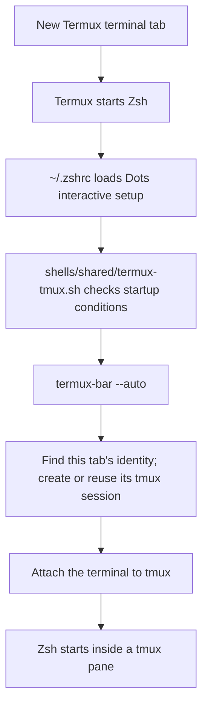

# Codex conversation

## User

how is does the tmux session on termux startup work? where/when/how, is ther a function or something? explain it to me in detail. stuff like how does it name the session?

## Assistant

I’ll trace the Termux shell startup and tmux helpers, then explain when they run, how they choose a session, and where the names come from.

## Activity

    $ rg -n -i 'tmux|termux.*startup|shell.*startup' /data/data/com.termux/files/home/.codex/memories/MEMORY.md
    /data/data/com.termux/files/usr/bin/bash: line 1: /data/data/com.termux/files/home/.local/share/codex-termux/runtimes/v0.164.0-ad59dc4f932695f6/node_modules/@openai/codex-linux-arm64/vendor/aarch64-unknown-linux-musl/codex-path/rg: cannot execute: required file not found
    ✗ (127) • 0ms

## Activity

    $ cat AGENTS.md; rg --files -g '*tmux*' -g '*zshrc*' -g '*bashrc*' -g '*config.fish*' -g 'AGENTS.md' -g '*startup*' -g '*init*' config profiles lib bin agents/guides
    # Dots Agent Guide
    
    This file is the project-wide operating contract for agents and contributors working on `dots`. Keep it concise, authoritative, and current. Put task procedures in `agents/guides/`, architecture reference in `docs/`, and implementation plans in `plans/`.
    
    ## Mission
    
    `dots` is a fast, safe, intuitive, modular, and extensible command center for managing dotfiles, scripts, shells, themes and environment setup across Termux, Linux, WSL, and native Windows.
    
    The intended experience is one command family with discoverable routes such as `dots files`, backed by built-in commands and optional executables named `dots-*`. Managed source files remain in the repository and are linked by default. Copying is an explicit alternative. Existing machine state must be planned, backed up, recorded, and reversible.
    
    ## Current Focus
    
    Maintain the existing dotfiles, scripts, configurations and command framework. The live entry points are `bin/dots` (Bash) and `bin/dots.ps1` (native PowerShell), backed by shared Python controllers. The independent Anodize engine provides palette authoring.
    
    - `dots files` provides catalog inspection and journaled adoption, linking, removal, checkout installation/uninstallation and recovery. See [checkout installation](docs/installation.md).
    - `dots git` provides recursive status/publish/sync under [decision 0010](docs/decisions/0010-git-and-managed-file-operations.md).
    - Themes use bounded publication and fixed app connectors under [decision 0008](docs/decisions/0008-config-catalog-and-theme-apps.md).
    - Platform resources live under `profiles/{termux,linux,wsl,windows}`; Androidots/Windots IDs and root compatibility paths remain during migration. See [profiles](docs/profiles.md).
    - `config/` is canonical; retain temporary `configs -> config` aliases until a separately reviewed cleanup.
    - Termux is the primary local development target. Preserve native Linux, WSL and Windows boundaries and distinguish local fixtures from native evidence.
    
    Focused work and acceptance criteria are indexed in [plans](plans/README.md). Never present a proposed feature as currently usable.
    
    ## Required Reading
    
    Read the guide matching the work before changing files:
    
    - [`agents/guides/worktrees.md`](agents/guides/worktrees.md) — default checkout workflow and optional worktree creation, enrollment, preview, and cleanup.
    - [`agents/guides/commands.md`](agents/guides/commands.md) — dispatcher behavior, command naming, metadata, help, and completions.
    - [`agents/guides/managed-files.md`](agents/guides/managed-files.md) — catalogs, link/copy behavior, adoption, planning, and rollback.
    - [`agents/guides/bootstrap.md`](agents/guides/bootstrap.md) — checkout-local setup, prerequisites, source selection and recovery.
    - [`agents/guides/platforms.md`](agents/guides/platforms.md) — Termux, Linux, WSL, and Windows-specific work.
    - [`agents/guides/testing.md`](agents/guides/testing.md) — test isolation, safety tests, integration tests, and benchmarks.
    - [`agents/guides/documentation.md`](agents/guides/documentation.md) — documentation ownership and synchronization requirements.
    
    Reference documents:
    
    - [`docs/principles.md`](docs/principles.md) — product and engineering priorities.
    - [`docs/architecture.md`](docs/architecture.md) — component boundaries and execution flow.
    - [`docs/commands.md`](docs/commands.md) — implemented CLI vocabulary and extension protocol.
    - [`docs/specification.md`](docs/specification.md) — implemented theme, catalog and installation data contracts.
    - [`docs/safety.md`](docs/safety.md) — mutation, backup, transaction, undo, and secrets rules.
    - [`docs/platforms.md`](docs/platforms.md) — platform model, paths, capabilities and acceptance limits.
    - [`docs/testing.md`](docs/testing.md) — test strategy and performance verification.
    
    ## Sources of Truth
    
    Do not maintain competing exhaustive lists.
    
    - Product priorities: `docs/principles.md`.
    - Architecture and component ownership: `docs/architecture.md`.
    - Command routes and semantics: static command metadata and `docs/commands.md`.
    - Human output style and acceptance: `docs/presentation.md`.
    - Data schemas and precedence: `docs/specification.md`.
    - Destructive-operation rules: `docs/safety.md`.
    - Platform support claims: `docs/platforms.md`.
    - Active scope and sequencing: focused plans indexed in `plans/README.md`.
    - End-user capabilities that actually exist: `README.md`.
    
    When documents disagree, follow the latest explicit user direction, then this file, then the specialized guide, then the reference docs. Resolve the disagreement in the same change instead of choosing silently.
    
    ## Core Principles
    
    Apply these in priority order when tradeoffs conflict:
    
    1. Protect existing user data and preserve a reliable path back.
    2. Keep common commands and shell startup fast.
    3. Make the plan visible before changing the machine.
    4. Prefer simple, predictable behavior over hidden magic.
    5. Keep platform-specific behavior behind explicit adapters.
    6. Keep the core useful without optional interactive tools or private repositories.
    7. Make extensions easy without allowing them to bypass core safety rules silently.
    8. Keep documentation and tests synchronized with behavior.
    
    See `docs/principles.md` for the consequences of each principle.
    
    ## Working Architecture
    
    Shell entry points own native invocation and initialization. Shared Python controllers under `lib/dots/` own file catalogs, configuration, Git operations, themes and checkout setup. `lib/dots/files/transactions.py` owns managed file preflight, journals, backups, rollback and recovery; platform adapters own filesystem primitives. The independent `anodize/` Go module owns palette extraction and color transformations.
    
    External `dots-*` commands may add cohesive features. They must not circumvent the transaction engine for managed filesystem changes. See [architecture](docs/architecture.md) for component ownership.
    
    ## Command Contract
    
    For the live Bash executable, follow [decision 0006](docs/decisions/0006-bash-command-framework.md): repository/local roots plus explicit extras, executable symlinks, optional static comment headers, shared presentation helpers, and on-demand Bash/Zsh/Fish completion. No catalog scans during shell startup or ordinary direct dispatch; no extension execution for help or completion.
    
    - User-facing routes use spaces: `dots files list`.
    - External command filenames use hyphens: `dots-files` or `dots-files-list`.
    - Resolve the longest matching command prefix and forward remaining arguments unchanged.
    - Use a fast direct-resolution path. Do not scan or parse every extension for an ordinary known route.
    - Built-ins cannot be shadowed silently. Duplicate routes are validation failures.
    - Help, completion, JSON discovery, and Markdown command reference must derive from the same metadata.
    - Do not require `gum`, `fzf`, `jq`, `sed`, `awk`, Git, or a package manager merely to start the CLI or display basic help.
    - Keep stdout machine-consumable when a command promises structured output. Send diagnostics to stderr.
    - Every new or changed first-party human view must follow [the presentation contract](docs/presentation.md): cohesive layouts and wording, shared semantic colors, readable plain fallbacks, and preserved data interfaces. Apply its acceptance gate in every focused plan.
    - Prefer optional Gum for suitable new or changed interactive workflows, following [the presentation contract](docs/presentation.md#optional-gum-interactions). Use shared adapters, capability checks and useful fallbacks; preserve scripts, cancellation and explicit approval semantics.
    
    Do not add a new command or rename an existing route without updating `docs/commands.md`, completion behavior, command metadata tests, and user-facing documentation when applicable.
    
    ## Platform Boundaries
    
    A platform is the execution context: `termux`, `linux`, `wsl` or `windows`. Keep native Windows and WSL destinations and state separate. Catalog locations identify source repositories and explicitly mapped resources; their implemented schemas are defined in [data contracts](docs/specification.md).
    
    ## Safety Invariants
    
    The transaction requirements below govern managed installation, replacement, backup, and undo operations. Ordinary edits to repository source files, including live dotfiles, use ordinary repository editing safeguards; preserve unrelated work and use Git history for committed source recovery.
    
    - Read-only inspection and planning must not mutate the target machine, repository, package database, or state store.
    - Every managed filesystem mutation must belong to a transaction with a durable journal.
    - Existing targets are never overwritten or deleted without classification and an applicable backup or explicit refusal policy.
    - Apply must preflight the complete operation set before the first mutation.
    - A failed apply must roll back completed reversible operations in reverse order.
    - Undo must detect post-apply drift and refuse destructive restoration unless explicitly forced.
    - Link-to-copy fallback must never be silent.
    - Package removal is never an automatic consequence of filesystem rollback.
    - Bootstrap must not recursively initialize all submodules or request private credentials by default.
    - Secrets must not appear in plans, logs, diagnostics, diffs, or structured output unless a dedicated explicit reveal operation is designed and approved.
    - Tests must never target the developer's real home, config, state, cache, registry, or package manager.
    
    Read `docs/safety.md` before changing any mutating path.
    
    ## Performance Rules
    
    - Measure before adding caches or complexity, and retain benchmark baselines once established.
    - Keep dispatch independent of repository size for direct routes.
    - Load only the selected route’s inputs.
    - Avoid content hashing when metadata or symlink identity is sufficient; hash when correctness requires it.
    - Generate or cache shell initialization and completion data instead of invoking expensive resolution during every shell startup.
    - Keep large optional assets and vendored dependencies out of the minimum bootstrap path.
    - Any meaningful startup or planning regression requires an explanation and updated measurements.
    
    ## Cross-Platform Rules
    
    - Maintain every first-party route, option, alias, completion, preview, verbose event and data contract for Bash (Termux, native Linux, WSL) and native Windows PowerShell 5.1/7 in the same change. Use shared Python controllers and explicit platform adapters; no Bash dependency on native Windows. Record an explicit platform exception where an operation has no native equivalent.
    - Every focused plan must include both shell surfaces, Windows app destinations, isolated tests and actual native evidence or a named pending acceptance check. Follow [native PowerShell](docs/powershell.md) and the [parity plan](plans/powershell-parity.md). Future work must not silently extend only one shell.
    
    - Do not assume `$HOME`, XDG directories, `sudo`, executable permission bits, GNU utilities, or POSIX symlink behavior in portable core code.
    - Centralize path, privilege, link, shell, and package-manager differences in platform adapters.
    - Treat native Windows and WSL as separate installations with separate state stores.
    - Never silently translate a path between Windows and WSL or create a cross-filesystem link.
    - Shell and PowerShell scripts are platform adapters or extensions, not duplicated implementations of the transaction engine.
    - Optional dependencies must be capability-checked at the boundary that needs them.
    
    ## Repository and Migration Discipline
    
    - Any repository file may be edited when relevant to the requested task, including `bin/dots`, live configurations, scripts, documentation and Anodize sources. File restrictions in earlier implementation slices are historical task boundaries, not a permanent allowlist.
    - Preserve unrelated existing files and user changes; inspect Git status before editing.
    - For task-relevant submodule edits, follow the submodule's local instructions and separate Git history. Editing permission does not authorize unrelated submodule initialization, updates, commits, or pushes.
    - Keep configuration migrations bounded and reversible.
    - Do not initialize private or optional submodules merely to run general tests or documentation checks.
    - Do not add generated caches, bytecode, build outputs, downloaded archives, or machine-local state to Git.
    - Prefer dependency manifests or lazily fetched optional sources over vendoring large third-party trees.
    - Do not rewrite repository history, remove existing submodules, or move large directory trees without explicit approval and a recovery plan.
    
    ## Development Worktree Lifecycle
    
    Work directly in the existing checkout on `main` by default. A separate branch or worktree is optional when the task calls for it; ordinary maintenance requires no worktree creation, enrollment, remote-policy fetch, or cleanup. Read the instructions in the current checkout.
    
    When deliberately using or maintaining linked worktrees, follow [the worktree guide](agents/guides/worktrees.md), including its one-additional-worktree capacity and guarded cleanup. Preserve unrelated work, branch/recovery refs, and review evidence.
    
    Git history provides recovery for committed repository edits. Preserve uncommitted and untracked work separately; reverting a commit does not recover those changes or undo external machine effects. Do not commit, push, reset, or revert without task authorization.
    
    ## Change Workflow
    
    For non-trivial work:
    
    1. Read this file and the relevant task guide.
    2. Inspect the current implementation, tests, plans, and Git state.
    3. Identify whether the work changes a proposed design or implemented behavior.
    4. Write or update the focused plan when scope spans multiple components or contains migration risk.
    5. Implement the smallest coherent change.
    6. Run focused tests, then the broader safe suite when available.
    7. Update every affected source-of-truth document in the same change.
    8. Report behavior, verification, remaining risk, and any deferred documentation explicitly.
    
    Do not mix opportunistic cleanup with a behavioral change unless the cleanup is required for that change.
    
    ## Documentation Contract
    
    A behavior change without matching documentation is incomplete.
    
    - Architecture or directory ownership changed: update `docs/architecture.md`.
    - Product priority or invariant changed: update `docs/principles.md` and record the decision.
    - Command, flag, output, or metadata changed: update `docs/commands.md` and applicable user docs.
    - Data schema, precedence, variable, or collision behavior changed: update `docs/specification.md`.
    - Mutation, backup, rollback, force, package, or secret behavior changed: update `docs/safety.md`.
    - Platform detection, paths, link strategies, or support changed: update `docs/platforms.md`.
    - Test entry points or guarantees changed: update `docs/testing.md` and the relevant agent guide.
    - Milestone or scope changed: update the applicable file under `plans/`.
    - User-visible implemented behavior changed: update `README.md`.
    
    Proposed behavior must be labeled **Proposed** or **Draft**. Implemented behavior must be labeled accurately. Remove stale labels as part of implementation.
    
    ## Testing and Verification
    
    - Use temporary, test-owned home/config/state/cache/repository roots.
    - Test paths containing spaces, Unicode, leading dashes, broken links, and missing parents.
    - Test interrupted apply and reverse-order rollback.
    - Test idempotence: a second apply of an unchanged spec produces no mutations.
    - Test route collisions and longest-prefix dispatch.
    - Test structured output as an API, not incidental text.
    - Run `git diff --check` and verify relative Markdown links for documentation changes.
    
    Until formal runners exist, never invent commands in documentation. Record intended runners as proposed in `docs/testing.md`.
    
    ## Git
    
    - Before pushing, verify the remote push destination and intended branch ref. Use an explicit branch refspec such as `HEAD:refs/heads/<branch>`; do not rely on upstream or default push routing. Direct updates to `main` require explicit task authorization.
    - Keep commits atomic and limited to one coherent purpose.
    - Use succinct commit messages that describe the change.
    - Do not discard, reset, or overwrite unrelated working-tree changes.
    - Do not commit secrets, machine state, generated backups, or credentials.
    
    ## Definition of Done
    
    A change is done only when:
    
    - The implementation matches the documented design or the design was updated deliberately.
    - Existing user data remains protected by the applicable safety rules.
    - Focused tests pass in isolated paths.
    - Cross-platform effects were considered and documented.
    - Performance-sensitive paths were measured when affected.
    - Help, metadata, completions, examples, README, reference docs, and plans are synchronized where applicable.
    
    Repository-local workflow skills are indexed in [.codex/README.md](.codex/README.md);
    they supplement this contract and the task guides.
    
    Wiki documentation is generated from canonical Dots sources. For behavior/documentation changes, update source docs, then rebuild and check the wiki when its checkout is available; otherwise run source-only validation and report synchronization pending. Use the `dots-documentation-maintenance` and `dots-wiki-maintenance` skills and follow [the wiki guide](agents/guides/wiki.md). Documentation work does not authorize commits or pushes.
    /data/data/com.termux/files/usr/bin/bash: line 1: /data/data/com.termux/files/home/.local/share/codex-termux/runtimes/v0.164.0-ad59dc4f932695f6/node_modules/@openai/codex-linux-arm64/vendor/aarch64-unknown-linux-musl/codex-path/rg: cannot execute: required file not found
    ✗ (127) • 0ms

## Activity

    $ pwd; git status --short; git rev-parse --show-toplevel
    /data/data/com.termux/files/home/dots
     M .codex/README.md
     M .codex/skills/dots-cli-presentation/SKILL.md
     M .codex/skills/dots-command-maintenance/SKILL.md
     M .dots/file-locations.json
     M .dots/files.json
     M .github/workflows/installation.yml
     M README.md
     M agents/guides/managed-files.md
     M agents/guides/testing.md
     M bin/dots-keys
     M bin/dots-menu-tmux-keys
     M config/bat/bat.conf
     M config/tmux/termux-status.py
     M config/tmux/tmux.conf
     M config/wttr/config.toml
     M config/yazi/README.md
     M config/yazi/init.lua
     M config/yazi/package.toml
     M config/yazi/plugins/dots.yazi/README.md
     M config/yazi/plugins/dots.yazi/githead.lua
     M config/yazi/plugins/dots.yazi/test-githead.lua
     M config/yazi/plugins/dots.yazi/test-preview.lua
     M config/yazi/yazi.toml
     M default/themed/tmux.conf.tpl
     M docs/architecture.md
     M docs/commands.md
     M docs/files.md
     M docs/git.md
     M docs/keys.md
     M docs/platforms.md
     M docs/powershell.md
     M docs/presentation.md
     M docs/safety.md
     M docs/shell-init.md
     M docs/specification.md
     M docs/testing.md
     M docs/themes.md
     M docs/wiki.md
     M lib/dots/cli.py
     M lib/dots/files/catalog.py
     M lib/dots/files/identities.py
     M lib/dots/interaction.py
     M lib/dots/keys/model.py
     M lib/dots/keys/presentation.py
     M lib/dots/keys/providers.py
     M lib/dots/keys_cli.py
     M lib/dots/native.py
     M lib/dots/shell/environment.json
     M lib/dots/shell/keys.bash
     M lib/dots/shell/keys.ps1
     M lib/dots/themes/core.bash
     M lib/dots/themes/palette_native.py
     M lib/dots/themes/setup.bash
     M lib/dots/themes/setup.py
     M lib/dots/themes/state.bash
     M lib/dots/themes/theme_cli.py
     M lib/dots/wiki.py
     M plans/README.md
     M plans/keys.md
     M plans/powershell-parity.md
     M plans/tmux-status-and-sessions.md
     M plans/yazi-plugin-consolidation.md
     M profiles/termux/shells/zsh/local.zsh
     M shells/zsh/README.md
     M shells/zsh/interactive.zsh
     M shells/zsh/options.zsh
     M tools/test_file_operations.py
     M tools/test_files.py
     M tools/test_installation_adapters.py
     M tools/test_keys.py
     M tools/test_keys_zle.py
     M tools/test_native_cli.py
     M tools/test_resources.py
     M tools/test_theme_workflow.py
     M tools/test_tmux_keys.py
     M tools/test_tmux_status.py
     M tools/test_wiki.py
    ?? .agents/skills/dots-menu-authoring
    ?? .codex/skills/dots-menu-authoring/
    ?? bin/dots-files-repair
    ?? bin/dots-menu
    ?? bin/dots-menu-tmux-sessions
    ?? config/gitmux/
    ?? config/tmux/codex-status.py
    ?? config/tmux/gitmux-status.py
    ?? lib/dots/files/repair.py
    ?? lib/dots/files/repair_picker.py
    ?? lib/dots/keys/browser.py
    ?? lib/dots/keys/codex.py
    ?? lib/dots/keys/data/
    ?? lib/dots/keys/zsh_bridge.py
    ?? lib/dots/menu_cli.py
    ?? lib/dots/menu_host.py
    ?? lib/dots/menu_pager.py
    ?? lib/dots/menu_projects.py
    ?? lib/dots/menu_session_host.py
    ?? lib/dots/menu_session_ui.py
    ?? lib/dots/menu_sessions.py
    ?? lib/dots/menu_tmux.py
    ?? lib/dots/menus.py
    ?? lib/dots/picker_style.py
    ?? lib/dots/shell/keys-ipc.zsh
    ?? lib/dots/themes/bat_cache.py
    ?? plans/bat-syntax-cache.md
    ?? plans/files-repair.md
    ?? plans/popup-menus.md
    ?? plans/zsh-keys.md
    ?? shells/zsh/keys.zsh
    ?? tools/import_codex_keys.py
    ?? tools/test_bat_cache.py
    ?? tools/test_codex_status.py
    ?? tools/test_files_repair.py
    ?? tools/test_gitmux.py
    ?? tools/test_keys_browser.py
    ?? tools/test_keys_defaults.py
    ?? tools/test_keys_ipc.py
    ?? tools/test_menu_launcher.py
    ?? tools/test_menu_pager.py
    ?? tools/test_menu_projects.py
    ?? tools/test_menu_sessions.py
    ?? tools/test_menus.py
    ?? tools/test_zsh_keys.py
    /data/data/com.termux/files/home/dots
    ✓ • 293ms

## Activity

    $ grep -n -iE 'tmux|termux.*startup|shell.*startup' /data/data/com.termux/files/home/.codex/memories/MEMORY.md
    1:# Task Group: Dots keybinding browser category menus and quiet tmux cancellation
    3:scope: Maintain the interactive `dots keys` category/app browser, its FZF/tmux presentation, and the Prefix → ? launcher without changing noninteractive data contracts.
    4:applies_to: cwd=/data/data/com.termux/files/home/dots; reuse_rule=use for Dots keybinding browser and tmux launcher changes; retain machine-readable/direct-provider behavior and inspect both repository config and the running tmux server before live diagnosis.
    10:- rollout_summaries/2026-10-24T16-34-51-Vyo3-dots_keys_category_popup_and_quiet_tmux_cancellation.md (cwd=/data/data/com.termux/files/home/dots, rollout_path=/data/data/com.termux/files/home/.codex/sessions/2026/10/24/rollout-2026-10-24T16-34-51-01a16ec3-d9f0-7280-b23c-94e5fe785f93.jsonl, updated_at=2026-10-25T05:31:41+00:00, thread_id=01a16ec3-d9f0-7280-b23c-94e5fe785f93, category/browser tests, docs, and local wiki checks passed)
    16:## Task 2: Normalize Escape/Ctrl-C only for the tmux shortcut, success
    20:- rollout_summaries/2026-10-24T16-34-51-Vyo3-dots_keys_category_popup_and_quiet_tmux_cancellation.md (cwd=/data/data/com.termux/files/home/dots, rollout_path=/data/data/com.termux/files/home/.codex/sessions/2026/10/24/rollout-2026-10-24T16-34-51-01a16ec3-d9f0-7280-b23c-94e5fe785f93.jsonl, updated_at=2026-10-25T05:31:41+00:00, thread_id=01a16ec3-d9f0-7280-b23c-94e5fe785f93, 7 cancellation/status tests and live binding verification passed)
    24:- `dots keys --browse returned 130`, status 130, Escape, Ctrl-C, tmux `list-keys`, `config/tmux/tmux.conf`, Prefix ?, escaped dollar signs
    28:- For interactive keybinding browsing, the user requested categories “all, apps, bash fzf, kitty, nvim, powershell, television, tmux, azi, zsh” and selected both Prefix → ? and interactive `dots keys` -> provide a compact category-first flow while retaining direct routes. [Task 1]
    31:- When the user reports “dots keys --browse returned 130” after Escape, tmux shortcut cancellation should close quietly while direct CLI cancellation remains observable. [Task 2]
    36:- `lib/dots/interaction.py` accepts scoped FZF `popup`, `height`, `preview_size`, `query`, and header parameters without changing picker defaults. In tmux, category/app menus are content-sized with no preview; binding browsers use `center,99%` and 45% preview. [Task 1]
    37:- Binding rows use published `palette.json` colors with fallbacks: muted metadata, bold bright-magenta keys, normal-foreground descriptions. Providers include Zsh, Bash, PowerShell, tmux, Neovim, Yazi, FZF, Kitty, and Television. [Task 1]
    39:- Only the tmux `run-shell` launcher maps exit status 130 to success; direct `dots keys` and shared selector cancellation still return 130, and all other statuses/stderr pass through unchanged. Verify the live binding with `tmux -N list-keys -T prefix '?'`. [Task 2]
    44:- A stale running tmux binding can differ from `config/tmux/tmux.conf` -> inspect both before diagnosing. `tmux list-keys` escapes `$`; normalize `\\$` before comparing serialized output with the repository launcher. [Task 1][Task 2]
    56:- rollout_summaries/2026-10-24T16-34-51-Vyo3-dots_keys_category_popup_and_quiet_tmux_cancellation.md (cwd=/data/data/com.termux/files/home/dots, rollout_path=/data/data/com.termux/files/home/.codex/sessions/2026/10/24/rollout-2026-10-24T16-34-51-01a16ec3-d9f0-7280-b23c-94e5fe785f93.jsonl, updated_at=2026-10-25T05:31:41+00:00, thread_id=01a16ec3-d9f0-7280-b23c-94e5fe785f93, planning only; no implementation or validation evidence)
    110:- Windows `EBADF` came from flushing a read-only descriptor: copy/write payloads through writable handles, preserve metadata, and treat flush errors as fatal. PowerShell isolation should redirect module-analysis/startup caches to owned paths and allow named cache artifacts only, never blanket-ignore cache mutations. [Task 1]
    270:applies_to: cwd=/data/data/com.termux/files/home/dots; reuse_rule=use for current Dots shell startup/completion changes after inspecting each shell's native initialization and existing user-local/XDG paths; keep Termux-specific Androidots paths as fallbacks.
    299:# Task Group: Dots tmux semantic popup, current-window, and mode-indicator styling
    301:scope: Maintain generated tmux semantic color roles, popup defaults, status indicators, and explicitly authorized live theme activation without replacing canonical layout.
    302:applies_to: cwd=/data/data/com.termux/files/home/dots; reuse_rule=use for Dots tmux theme/template work; inspect current binding/config and tests first, preserve unrelated work, and distinguish Termux live evidence from untested Linux/WSL rendering.
    304:## Task 1: Theme tmux popup content and border, success
    308:- rollout_summaries/2026-10-22T10-46-43-jT9k-dots_tmux_theme_popup_and_status_color_refinement.md (cwd=/data/data/com.termux/files/home/dots, rollout_path=/data/data/com.termux/files/home/.codex/sessions/2026/10/22/rollout-2026-10-22T10-46-44-01a16338-69c9-7692-a307-aea587091616.jsonl, updated_at=2026-10-23T01:06:39+00:00, thread_id=01a16338-69c9-7692-a307-aea587091616, focused tests and live activation passed)
    312:- tmux, popup-style, popup-border-style, lighter_background, background, foreground, default/themed/tmux.conf.tpl, config/tmux/tmux.conf, display-popup, `-S`, tmux-3.8
    318:- rollout_summaries/2026-10-22T10-46-43-jT9k-dots_tmux_theme_popup_and_status_color_refinement.md (cwd=/data/data/com.termux/files/home/dots, rollout_path=/data/data/com.termux/files/home/.codex/sessions/2026/10/22/rollout-2026-10-22T10-46-44-01a16338-69c9-7692-a307-aea587091616.jsonl, updated_at=2026-10-23T01:06:39+00:00, thread_id=01a16338-69c9-7692-a307-aea587091616, status/theme workflow and live verification passed)
    326:- For tmux popups, the user asked that content use the theme background and the border use current-theme `lighter_background` -> use semantic roles rather than hardcoded terminal colors; all-popup scope and live activation were accepted here. [Task 1]
    328:- The user requested current-window `lighter_background` on all tmux platforms and repeatedly requested implementation/live activation after plan review -> publish/reload only when that authorization is explicit. [Task 2]
    332:- `default/themed/tmux.conf.tpl` publishes semantic colors; `config/tmux/tmux.conf` owns layout, conditions, fallbacks, and binding-specific behavior. Popup content is `bg={{ background }},fg={{ foreground }}` and border is `fg={{ lighter_background }},bg={{ background }}`; remove a binding-level `-S` override when it should inherit the shared border. [Task 1]
    334:- Verified Catppuccin Mocha values were popup border `fg=#313244,bg=#1e1e2e`; current window `#313244`; COPY/ZOOM `fg=#101019,bg=#a6e3a1`; PREFIX `fg=#cba6f7,bg=#161622`. Focused checks: `tools/test_tmux_keys.py` 19 passed, `tools/test_tmux_status.py` 16 passed with one optional skip, and theme-workflow/docs/diff checks passed. [Task 1][Task 2]
    340:- Native Linux/WSL rendering was not verified, and Windows has no tmux equivalent; do not inflate Termux live activation into those claims. [Task 2]
    429:# Task Group: Dots weather CLI styling, completion metadata, and tmux network status
    431:scope: Maintain custom Dots weather presentation/completions and the Androidots-backed tmux network indicator while keeping stock and machine interfaces exact.
    432:applies_to: cwd=/data/data/com.termux/files/home/dots and cwd=/data/data/com.termux/files/home/dots/androidots; reuse_rule=use isolated fixtures/private tmux sockets; preserve stock wttr curl output, machine interfaces, unrelated work, and owner-controlled live actions.
    439:- rollout_summaries/2026-10-15T07-10-37-Xi5H-dots_weather_styling_and_tmux_network_status.md (cwd=/data/data/com.termux/files/home/dots, rollout_path=/data/data/com.termux/files/home/.codex/sessions/2026/10/15/rollout-2026-10-15T07-10-37-01a13e66-0ae4-7503-9360-f7ce2a3ca9c1.jsonl, updated_at=2026-10-22T10:22:21+00:00, thread_id=01a13e66-0ae4-7503-9360-f7ce2a3ca9c1, earlier feature set; final refinement superseded)
    445:## Task 2: Tmux network uncertainty indicator, success
    449:- rollout_summaries/2026-10-15T07-10-37-Xi5H-dots_weather_styling_and_tmux_network_status.md (cwd=/data/data/com.termux/files/home/dots, rollout_path=/data/data/com.termux/files/home/.codex/sessions/2026/10/15/rollout-2026-10-15T07-10-37-01a13e66-0ae4-7503-9360-f7ce2a3ca9c1.jsonl, updated_at=2026-10-22T10:22:21+00:00, thread_id=01a13e66-0ae4-7503-9360-f7ce2a3ca9c1, private native rendering and focused regressions passed)
    453:- android-status.py, select_network, uncertain, `?~`, Wi-Fi, cellular, data_enabled, data_state, private tmux socket, 40/80/120 columns, cache gates
    463:- Keep stale positive network connections with `~`; stale negative or indeterminate readings must show uncertainty rather than silently disappear. Do not redesign unrelated tmux layout. [Task 2]
    472:- `config/tmux/android-status.py` is an adapter: Androidots owns caching, polling, permission gates, and refresh workers. It uses concurrent Wi-Fi/cellular reads with one-second deadlines, 2 MiB caps, suppressed stderr, and process-group cleanup. Unknown/failed/expired Wi-Fi gives muted `?`; hide only when fresh Wi-Fi disconnect and confirmed inactive telephony data are present. [Task 2]
    478:- Use private attached tmux clients and avoid live reloads, Android permissions, packages, commits, and pushes unless newly authorized. [Task 2]
    789:- A present failing Vivid is a generation error that preserves the prior generation/receipt; custom-template diagnostics include template path, detected version, and scalar-or-upgrade remediation. Notices pass once through human stderr, stay plain for JSON, and never run at shell startup. [Task 2]
    916:# Task Group: Dots Android/Termux status and tmux upper-row integration
    918:scope: Maintain androidots-backed session/network status and parent-Dots tmux upper-row layout, badges, colors, and safe native verification without live activation.
    921:## Task 1: Repair tmux network uncertainty instead of silently hiding status, success
    925:- rollout_summaries/2026-10-15T07-10-37-Xi5H-dots_weather_styling_and_tmux_network_status.md (cwd=/data/data/com.termux/files/home/dots, rollout_path=/data/data/com.termux/files/home/.codex/sessions/2026/10/15/rollout-2026-10-15T07-10-37-01a13e66-0ae4-7503-9360-f7ce2a3ca9c1.jsonl, updated_at=2026-10-22T10:22:21+00:00, thread_id=01a13e66-0ae4-7503-9360-f7ce2a3ca9c1, private native rendering and focused regressions passed)
    929:- android-status.py, select_network, uncertain, `?~`, Wi-Fi, cellular, data_enabled, data_state, device_stale, `--refresh`, private tmux socket, 40/80/120 columns, cache gates
    931:- Related skill: skills/dots-tmux-private-status-validation/SKILL.md
    933:## Task 2: Compact Termux session/window badges, clock, and semantic tmux styling, success
    937:- rollout_summaries/2026-10-14T15-20-35-Eunp-dots_mdcat_and_termux_tmux_compact_badges.md (cwd=/data/data/com.termux/files/home/dots, rollout_path=/data/data/com.termux/files/home/.codex/sessions/2026/10/14/rollout-2026-10-14T15-20-35-01a13b00-4239-7963-99dd-3df9ba693413.jsonl, updated_at=2026-10-15T08:05:31+00:00, thread_id=01a13b00-4239-7963-99dd-3df9ba693413, compact badges/clock/theme validation passed)
    941:- tmux.conf, termux-status.py, `--split-badge`, `--split-current`, `%-I:%M`, status-format, window-name, exact padding, `1:dots`, darker_background, hint, info, selection, tmux 3.8
    943:- Related skill: skills/dots-tmux-private-status-validation/SKILL.md
    945:## Task 3: Implement `termux-sessions`, cached status modules, completions, and initial tmux handoff, success
    949:- rollout_summaries/2026-10-14T16-59-49-0fhK-termux_session_status_modules_and_tmux_handoff.md (cwd=/data/data/com.termux/files/home/dots/androidots, rollout_path=/data/data/com.termux/files/home/.codex/sessions/2026/10/14/rollout-2026-10-14T16-59-49-01a13b5b-1e76-75b0-81fc-8a95670cc4d8.jsonl, updated_at=2026-10-14T19:50:03+00:00, thread_id=01a13b5b-1e76-75b0-81fc-8a95670cc4d8, focused implementation and native/fixture validation passed)
    953:- androidots, AGENTS.md, termux-sessions, TERMUX_APP__PID, /proc/<pid>/stat, termux-wifi-status, termux-cell-status, termux-notification-status, termux-location-status, termux-status, cache, `--refresh`, tmux `status-format[0]`, Starship, completions
    961:- Keep Android refresh/permission and tmux reload actions owner-controlled; do not turn a requested handoff or safe repair into live configuration activation. [Task 1][Task 3]
    965:- `config/tmux/android-status.py` is an adapter: Androidots owns caching, provider polling, permission gates, detached refresh workers, and failure suspension. Use only bounded normal `--json` reads; recurring tmux jobs must never use `--refresh`. [Task 1]
    967:- Helpers run concurrently with one-second deadlines, 2 MiB output caps, suppressed stderr, and process-group cleanup. Recovery is owner-run in the tmux HOME/XDG environment: `"$HOME/dots/androidots/bin/termux-wifi-status" --refresh --both` and `"$HOME/dots/androidots/bin/termux-cell-status" --refresh --both`; it can prompt and must remain interactive. [Task 1]
    968:- `config/tmux/tmux.conf` owns layout after the optional generated include; `default/themed/tmux.conf.tpl` supplies semantic styling only. The clock is left-first bold `%-I:%M`; current window uses bold `info` on `selection`, active pane border uses `selection`, and generated themes must not replace canonical layout. [Task 2]
    969:- `termux-status.py --split-badge` returns controlled before/current/after fields from one validated discovery query while `--split-current` stays compatible. Join number/session in tmux formatting; compare full window and session names case-sensitively before clipping; render matching as number only, differing as `number:name`, and never leave a dangling colon. Literal Unicode/tmux-format/shell-looking names remain data, never executable. [Task 2]
    970:- `bin/termux-sessions` finds terminal-owning leaders through inherited `TERMUX_APP__PID`, parentage, PID=session-ID equality, nonzero controlling TTY, and `/proc/<pid>/stat`; decode TTY device number because Android may block `/dev/pts`. Its tmux fallback is bounded to 250 ms and needs a unique attached non-control client. [Task 3]
    976:- `no current client` during native tmux tests means attachment raced rendering: wait for `list-clients` to report the private client, then refresh/render; wait for child teardown before fixture cleanup. [Task 1]
    978:- A `display-message` substitution can be empty because asynchronous format jobs need an attached client/status render. Use an attached private tmux PTY and capture timestamps inside workers. Test generated completions in Bash, Zsh, and Fish, not only syntax. [Task 3]
    1034:- rollout_summaries/2026-10-14T15-20-35-Eunp-dots_mdcat_and_termux_tmux_compact_badges.md (cwd=/data/data/com.termux/files/home/dots, rollout_path=/data/data/com.termux/files/home/.codex/sessions/2026/10/14/rollout-2026-10-14T15-20-35-01a13b00-4239-7963-99dd-3df9ba693413.jsonl, updated_at=2026-10-15T08:05:31+00:00, thread_id=01a13b00-4239-7963-99dd-3df9ba693413, isolated auto/dark/light rendering and docs checks passed)
    1349:- Resolve dimensions from the destination stream, then valid `COLUMNS`/`LINES`, then 80x24. Kitty detection is conservative and excludes tmux/screen/Zellij; Chafa is bounded and noninteractive. Machine interfaces—JSON, raw exports, app configuration, completion source/candidates—remain undecorated. [Task 1]
    1404:- Expanded Bash native integrations materially increase Termux startup time. Measure minimal and full-integration modes separately; do not claim cross-platform parity or performance from advisory Termux figures. [Task 2]
    1477:- Reuse Dots palette normalization, immutable generations, stable `${XDG_STATE_HOME:-$HOME/.local/state}/dots/current/theme`, journaled connectors, backups, rollback/recovery, reload handling, command framework, and Anodize publisher bridge. Attach automatic execution to the shared successful publication path, not a separate Anodize-only path. Existing Fish/FZF, tmux, Kitty, Termux, btop, bat, and Yazi integrations are competing-writer boundaries. [Task 1]
    1533:- Prompt-capable/direct-output children retain terminal access through static phase messages: stop animation before Git fetch/init/commit/push, theme downloads, tmux reloads, and wallpaper adapters. Nested work shares the active renderer; private Anodize bridge calls use `DOTS_PROGRESS=never`; renderer failure cannot alter approval, cancellation, exit status, rollback, or retry behavior. [Task 1]
    2071:- planning-review-2026-09-25, plans/README.md, paused-go, main-checkout, anodize, zsh-ll, test_shellmod_uses_running_shell_and_corrected_alias, test_startup_without_optional_tools_or_plugins
    2099:- The broader recorded Zsh suite is 15/17, not all passing: `test_shellmod_uses_running_shell_and_corrected_alias` and `test_startup_without_optional_tools_or_plugins` assume `ll='ls -la'`, while the current configuration uses eza-specific `ll` when available. Reproduce in disposable fixtures before changing them; do not attribute them to Anodize completion. [Task 1]
    2335:applies_to: cwd=/data/data/com.termux/files/home/dots/shells/zsh; reuse_rule=inspect current startup order and preserve intentional deletion of broken static completion artifacts.
    2353:- Optional command-generated completions belong in `_dots_tool_completions()` in `shells/zsh/integrations/tools.zsh`, after `compinit`; guard them with `(( $+commands[tool] ))`. The pip line is `(( $+commands[pip] )) && eval "$(pip completion --zsh)"`; it is applied at startup and again by `rlcs`, so activate with `rl` or a new shell. [Task 1]
    2358:- `test_shellmod_uses_running_shell_and_corrected_alias`, `test_startup_without_optional_tools_or_plugins`, and the docs link failure reproduced without pip completion; retain them as baseline issues. Direct `pip completion --zsh` added about 0.27 seconds in one warm-start comparison, so do not claim caching/performance improvement; evaluate `_dots_source_generated` separately only if startup cost matters. [Task 1]
    2386:- Full `tools/test_zsh.py` failures in `test_shellmod_uses_running_shell_and_corrected_alias` and `test_startup_without_optional_tools_or_plugins` reproduced after removing the new wrapper and were tied to the existing `ll` alias -> report them as pre-existing risk, not mkcd regressions. [Task 1]
    ✓ • 0ms

## Activity

    $ python - <<'PY'
        from pathlib import Path
        import os
        home=Path.home()
        for name in ['.zshenv','.zprofile','.zshrc','.zlogin','.profile','.bash_profile','.bashrc','.config/zsh','.config/tmux/tmux.conf','.tmux.conf','.termux/shell']:
         p=home/name
         print(f'{p} -> {p.resolve()} [exists={p.exists()}, symlink={p.is_symlink()}]')
        for name in ['SHELL','ZDOTDIR','DOTS_ROOT','DOTS_PLATFORM','TERM','TMUX','TERMUX_VERSION']:
         print(f'{name}={os.environ.get(name,"<unset>")}')
        PY
    /data/data/com.termux/files/home/.zshenv -> /data/data/com.termux/files/home/dots/shells/zsh/zshenv [exists=True, symlink=True]
    /data/data/com.termux/files/home/.zprofile -> /data/data/com.termux/files/home/.zprofile [exists=False, symlink=False]
    /data/data/com.termux/files/home/.zshrc -> /data/data/com.termux/files/home/dots/shells/zsh/zshrc [exists=True, symlink=True]
    /data/data/com.termux/files/home/.zlogin -> /data/data/com.termux/files/home/.zlogin [exists=False, symlink=False]
    /data/data/com.termux/files/home/.profile -> /data/data/com.termux/files/home/dots/shells/profile [exists=True, symlink=True]
    /data/data/com.termux/files/home/.bash_profile -> /data/data/com.termux/files/home/dots/shells/bash/.bash_profile [exists=True, symlink=True]
    /data/data/com.termux/files/home/.bashrc -> /data/data/com.termux/files/home/dots/shells/bash/.bashrc [exists=True, symlink=True]
    /data/data/com.termux/files/home/.config/zsh -> /data/data/com.termux/files/home/.config/zsh [exists=False, symlink=False]
    /data/data/com.termux/files/home/.config/tmux/tmux.conf -> /data/data/com.termux/files/home/dots/config/tmux/tmux.conf [exists=True, symlink=False]
    /data/data/com.termux/files/home/.tmux.conf -> /data/data/com.termux/files/home/.tmux.conf [exists=False, symlink=False]
    /data/data/com.termux/files/home/.termux/shell -> /data/data/com.termux/files/usr/bin/zsh [exists=True, symlink=True]
    SHELL=/data/data/com.termux/files/usr/bin/zsh
    ZDOTDIR=<unset>
    DOTS_ROOT=<unset>
    DOTS_PLATFORM=termux
    TERM=xterm-256color
    TMUX=<unset>
    TERMUX_VERSION=0.119.0-beta.3
    ✓ • 126ms

## Activity

    $ nl -ba shells/shared/termux-tmux.sh; nl -ba profiles/termux/bin/termux-bar; nl -ba shells/zsh/zshrc; nl -ba shells/zsh/zshenv
         1    # Shared Bash/Zsh startup hook. Detach keeps the outer shell as an escape hatch.
         2    # shellcheck shell=bash
         3    if [[ $- != *i* || ${DOTS_PLATFORM:-} != termux || -n ${TMUX:-} ||
         4          -z ${TERMUX_APP__PID:-} ||
         5          -n ${SSH_CONNECTION:-}${SSH_CLIENT:-}${SSH_TTY:-} ||
         6          ${DOTS_TERMUX_AUTOSTART:-${dots_options[DOTS_TERMUX_AUTOSTART]:-1}} == 0 || -n ${_DOTS_TERMUX_AUTOSTART_ATTEMPTED:-} ||
         7          ! -t 0 || ! -t 1 ]]; then
         8      return 0
         9    fi
        10    # Shell-local: reloads must not reattach after the user deliberately detaches.
        11    _DOTS_TERMUX_AUTOSTART_ATTEMPTED=1
        12    if [[ ! -r $DOTS/profiles/termux/bin/termux-bar ]]; then
        13      printf 'termux-bar: launcher unavailable; continuing in the plain shell\n' >&2
        14    elif ! command -v python3 >/dev/null 2>&1; then
        15      printf 'termux-bar: python3 not found; continuing in the plain shell\n' >&2
        16    else
        17      if command python3 -B "$DOTS/profiles/termux/bin/termux-bar" --auto; then
        18        :
        19      else
        20        # Only the launcher's confirmed normal session exit closes this outer shell.
        21        case $? in 20) exit 0 ;; esac
        22      fi
        23    fi
        24    true
         1    #!/data/data/com.termux/files/usr/bin/env python3
         2    """Enter a per-Termux-tab tmux session and report its exit to the startup shell."""
         3
         4    import argparse
         5    import os
         6    from pathlib import Path
         7    import shutil
         8    import subprocess
         9    import sys
        10
        11
        12    MARKER = "@dots-termux-default"
        13    # Private handshake with shells/shared/termux-tmux.sh; never returned for skips.
        14    SESSION_EXIT = 20
        15
        16
        17    class BarError(Exception):
        18        """An actionable launcher failure, with no process data in diagnostics."""
        19
        20
        21    def process_identity(pid, proc_root):
        22        record = (proc_root / str(pid) / "stat").read_text()
        23        # comm is parenthesized and can itself contain spaces and parentheses.
        24        fields = record[record.rindex(")") + 2:].split()
        25        return int(fields[1]), int(fields[3]), int(fields[19])
        26
        27
        28    def default_session(auto, env, caller, proc_root):
        29        app = env.get("TERMUX_APP__PID", "")
        30        if not app.isascii() or not app.isdecimal() or int(app) <= 0:
        31            if auto:
        32                return None
        33            raise BarError("run from a Termux app tab with TERMUX_APP__PID available")
        34        if auto:
        35            parent, sid, _ = process_identity(caller, proc_root)
        36            if parent != int(app) or sid != caller:
        37                return None
        38        discovery = Path(__file__).resolve().with_name("termux-sessions")
        39        result = subprocess.run(
        40            [sys.executable, "-B", str(discovery), "--get", "pid", "--pid", str(caller)],
        41            capture_output=True, text=True, timeout=2, check=False,
        42        )
        43        value = result.stdout.strip()
        44        if result.returncode or not value.isascii() or not value.isdecimal() or int(value) <= 0:
        45            raise BarError("cannot identify this Termux tab; check termux-sessions")
        46        root = int(value)
        47        parent, sid, started = process_identity(root, proc_root)
        48        if parent != int(app) or sid != root or (auto and root != caller):
        49            raise BarError("Termux tab identity changed; try again")
        50        return f"termux-{root}-{started}"
        51
        52
        53    def ensure_session(tmux, name):
        54        target = "=" + name
        55        # Option commands resolve window targets too: ':' makes this an exact session.
        56        option_target = target + ":"
        57
        58        def marker():
        59            return subprocess.run(
        60                [tmux, "show-options", "-qv", "-t", option_target, MARKER],
        61                capture_output=True, text=True, timeout=5, check=False,
        62            )
        63
        64        exists = subprocess.run([tmux, "has-session", "-t", target],
        65                                capture_output=True, text=True, timeout=5, check=False)
        66        if exists.returncode:
        67            created = subprocess.run(
        68                [tmux, "new-session", "-d", "-s", name, "-c", os.getcwd(),
        69                 ";", "set-option", "-t", option_target, MARKER, "1"],
        70                capture_output=True, text=True, timeout=5, check=False,
        71            )
        72            # A concurrent launcher can win creation. Never adopt an unmarked session.
        73            existing = marker()
        74            if created.returncode and existing.returncode:
        75                raise BarError("could not create the default tmux session")
        76        else:
        77            existing = marker()
        78        if existing.returncode or existing.stdout.strip() != "1":
        79            raise BarError("default session name is occupied by an unmarked session")
        80        return target
        81
        82
        83    def attach(tmux, target, auto):
        84        # Tmux renders directly to the client's tty. Its stdout contains completion
        85        # messages, separate from pane output; both normal exit and detach return 0.
        86        process = subprocess.Popen([tmux, "attach-session", "-t", target], stdout=subprocess.PIPE)
        87        output = b""
        88        try:
        89            while chunk := process.stdout.read(4096):
        90                output = (output + chunk)[-4096:]
        91            status = process.wait()
        92        finally:
        93            process.stdout.close()
        94            if process.poll() is None:
        95                process.terminate()
        96                try:
        97                    process.wait(timeout=2)
        98                except subprocess.TimeoutExpired:
        99                    process.kill()
       100                    process.wait()
       101        if auto and status == 0 and output == b"[exited]\n":
       102            return SESSION_EXIT
       103        sys.stdout.write(output.decode("utf-8", errors="replace"))
       104        # Do not let an unexpected tmux exit code impersonate the shell handshake.
       105        return 0 if status == 0 else 1
       106
       107
       108    def main(argv=None, *, proc_root=Path("/proc")):
       109        parser = argparse.ArgumentParser(
       110            description="Create or reattach this Termux tab's default tmux session.",
       111            epilog="Detach to return to your shell; exiting the final pane closes an automatic tab. "
       112                   "Set DOTS_TERMUX_AUTOSTART=0 to disable "
       113                   "Bash/Zsh automatic startup. Requires tmux and sibling termux-sessions.",
       114        )
       115        parser.add_argument("--auto", action="store_true",
       116                            help="start only from the original Termux tab shell; otherwise skip")
       117        args = parser.parse_args(argv)
       118        env = os.environ
       119        if env.get("TMUX") or env.get("SSH_CONNECTION") or env.get("SSH_CLIENT") or env.get("SSH_TTY"):
       120            if args.auto:
       121                return 0
       122            print("termux-bar: run outside tmux and SSH in a Termux app tab", file=sys.stderr)
       123            return 1
       124        if args.auto and env.get("DOTS_TERMUX_AUTOSTART") == "0":
       125            return 0
       126        if not os.isatty(0) or not os.isatty(1):
       127            if args.auto:
       128                return 0
       129            print("termux-bar: an interactive terminal is required", file=sys.stderr)
       130            return 1
       131        try:
       132            name = default_session(args.auto, env, os.getppid(), proc_root)
       133            if name is None:
       134                return 0
       135            tmux = shutil.which("tmux")
       136            if not tmux:
       137                raise BarError("tmux not found; continuing in the plain shell")
       138            target = ensure_session(tmux, name)
       139            return attach(tmux, target, args.auto)
       140        except (BarError, OSError, ValueError, IndexError, subprocess.SubprocessError) as error:
       141            message = str(error) if isinstance(error, BarError) else "cannot start tmux; continuing in the plain shell"
       142            print("termux-bar: " + message, file=sys.stderr)
       143            return 1
       144        except KeyboardInterrupt:
       145            return 130
       146
       147
       148    if __name__ == "__main__":
       149        raise SystemExit(main())
         1    # Resolve the source file, including file and parent-directory symlinks.
         2    _dots_zsh_file=${${(%):-%x}:A}
         3    if [[ ! -r $_dots_zsh_file || ! -r ${_dots_zsh_file:h}/../environment.sh || ! -r ${_dots_zsh_file:h}/../../bin/dots ]]; then
         4      unset _dots_zsh_file
         5      print -ru2 -- 'dots: Zsh startup requires a resolvable Dots checkout'
         6      return 1
         7    fi
         8    export DOTS="${_dots_zsh_file:h:h:h}"
         9    unset _dots_zsh_file
        10    _DOTS_STARTUP_MODE=full
        11    source "$DOTS/lib/dots/shell/startup.bash" || { unset _DOTS_STARTUP_MODE; return 1; }
        12    unset _DOTS_STARTUP_MODE
         1    # Also runs for noninteractive Zsh: only paths and native platform detection.
         2    # Resolve the source file, including file and parent-directory symlinks.
         3    _dots_zsh_file=${${(%):-%x}:A}
         4    if [[ ! -r $_dots_zsh_file || ! -r ${_dots_zsh_file:h}/../environment.sh || ! -r ${_dots_zsh_file:h}/../../bin/dots ]]; then
         5      unset _dots_zsh_file
         6      print -ru2 -- 'dots: Zsh startup requires a resolvable Dots checkout'
         7      return 1
         8    fi
         9    export DOTS="${_dots_zsh_file:h:h:h}"
        10    unset _dots_zsh_file
        11    source "$DOTS/shells/environment.sh" || return
        12    prefix="${TERMUX__PREFIX:-${PREFIX:-}}"
        13    [[ -r "$DOTS/shells/zsh/platforms/detect.zsh" ]] && source "$DOTS/shells/zsh/platforms/detect.zsh"
    ✓ • 0ms

## Activity

    $ git grep -n -E 'termux-tmux|(^| )t\(\)|function t|DOTS_TERMUX_AUTOSTART|tmux' -- shells/shared shells/bash/.bashrc shells/bash/.bash_profile shells/bash/interactive.bash shells/zsh/interactive.zsh shells/zsh/functions.zsh profiles/termux/shells/zsh/local.zsh docs/shell-init.md; nl -ba config/tmux/tmux.conf | head -100; nl -ba /data/data/com.termux/files/home/.codex/memories/MEMORY.md | sed -n '945,970p'
    docs/shell-init.md:62:The integration-only key capture adapter also supports [tmux-to-Zsh requests](keys.md#live-zsh-bindings-from-the-tmux-shortcut).
    docs/shell-init.md:63:Inside tmux it registers deduplicated prompt/command/exit hooks for a private
    docs/shell-init.md:131:## Termux tmux startup
    docs/shell-init.md:133:At the end of Dots Bash/Zsh interactive initialization, `shells/shared/termux-tmux.sh` invokes `profiles/termux/bin/termux-bar --auto` once per outer shell. The hook requires the Termux platform, inherited `TERMUX_APP__PID`, terminal stdin/stdout, and no tmux or SSH context. The launcher verifies that its calling shell is the terminal session leader directly beneath the Termux app process; child shells do not attach. Scripts, redirected shells, Fish and other platforms are unaffected. Reloading configuration after detaching does not reattach.
    docs/shell-init.md:137:The launcher uses the existing default tmux server. The session-local `@dots-termux-default=1` option suppresses only the status name badge; the clock/network/battery row and lower-row Termux numbers, windows and mode indicators remain. Other sessions, including projects selected through `t`, keep their names. The internal default name remains visible in tmux's session chooser. Existing session-navigation bindings can return from a project to a default session.
    docs/shell-init.md:139:Detaching resumes the outer shell; its bar disappears until reattachment. Run `~/dots/profiles/termux/bin/termux-bar` (or `termux-bar` when profiles/termux/bin is on PATH) to reattach this tab's default session manually. Manual invocation also works in a child shell outside tmux. During automatic attachment, `exit` (including the `q` alias) closes only the current pane until the final pane/window exits. Closing that session then exits the outer shell, even after switching into a project. Termux enables `detach-on-destroy on`, so the client does not switch to another session. Manual `termux-bar` invocation returns to its caller. The launcher captures tmux completion output separately from terminal rendering: only a successful exact `[exited]` response produces internal exit status 20, consumed by the startup hook. Deliberate detach, unknown responses and server failure retain the shell. Detached sessions and their processes are retained, even after a Termux tab closes.
    docs/shell-init.md:141:Set `DOTS_TERMUX_AUTOSTART=0` before initialization to disable automatic startup; manual `termux-bar` still works. Missing dependencies, identity errors or attachment failures leave a usable shell. Python 3, tmux, the sibling `termux-sessions` script and readable procfs are required; no dependency is installed automatically. New tabs load startup changes; existing tmux servers need their normal configuration reload for the layout and session-destruction behavior.
    shells/bash/interactive.bash:19:source "$DOTS/shells/shared/termux-tmux.sh"
    shells/shared/functions.sh:19:# Inside tmux switch the current client instead of nesting another client.
    shells/shared/functions.sh:20:t() {
    shells/shared/functions.sh:26:  command -v tmux >/dev/null 2>&1 || {
    shells/shared/functions.sh:27:    printf 't: tmux not found\n' >&2
    shells/shared/functions.sh:33:    # Only inferred names are normalized: tmux forbids dots/colons in names.
    shells/shared/functions.sh:38:    command tmux new-session -A -s "$name" -c "$directory"
    shells/shared/functions.sh:41:  # '=' prevents tmux's prefix/glob target matching, including for dash names.
    shells/shared/functions.sh:42:  if ! command tmux has-session -t "=$name" 2>/dev/null; then
    shells/shared/functions.sh:43:    if command tmux new-session -d -s "$name" -c "$directory"; then
    shells/shared/functions.sh:49:      command tmux has-session -t "=$name" 2>/dev/null || return "$result"
    shells/shared/functions.sh:52:  command tmux switch-client -t "=$name"
    shells/shared/termux-tmux.sh:6:      ${DOTS_TERMUX_AUTOSTART:-${dots_options[DOTS_TERMUX_AUTOSTART]:-1}} == 0 || -n ${_DOTS_TERMUX_AUTOSTART_ATTEMPTED:-} ||
    shells/shared/termux-tmux.sh:11:_DOTS_TERMUX_AUTOSTART_ATTEMPTED=1
    shells/zsh/interactive.zsh:32:source "$DOTS/shells/shared/termux-tmux.sh"
         1    # Prefix
         2    set -g prefix C-Space
         3    set -g prefix2 C-b
         4    bind -N "Send prefix" C-Space send-prefix
         5
         6    # Config and help
         7    bind -N "Reload configuration" q source-file ~/.config/tmux/tmux.conf \; display "Configuration reloaded"
         8    bind -N "Browse keybinding categories" ? run-shell -b 'DOTS_KEYS_TARGET_PANE=#{pane_id} dots keys --browse; _dots_keys_status=$?; if [ "$_dots_keys_status" -eq 130 ]; then exit 0; fi; exit "$_dots_keys_status"'
         9    bind -N "Open Dots menu" m run-shell -b -c '#{pane_current_path}' 'TMUX=#{q:socket_path},0,0 TMUX_PANE=#{pane_id} dots menu --browse --client #{q:client_name} 2>&1; _dots_menu_status=$?; if [ "$_dots_menu_status" -eq 130 ]; then exit 0; fi; exit "$_dots_menu_status"'
        10    bind -N "Choose tmux session" s run-shell -b -c '#{pane_current_path}' 'TMUX=#{q:socket_path},0,0 TMUX_PANE=#{pane_id} dots menu tmux sessions --browse --client #{q:client_name} 2>&1; _dots_menu_status=$?; if [ "$_dots_menu_status" -eq 130 ]; then exit 0; fi; exit "$_dots_menu_status"'
        11
        12    # Vi mode for copy
        13    setw -g mode-keys vi
        14    bind -N "Begin selection" -T copy-mode-vi v send -X begin-selection
        15    bind -N "Copy selection" -T copy-mode-vi y send -X copy-selection-and-cancel
        16
        17    # Pane Controls
        18    bind -N "Split pane vertically" -n M-Enter split-window -v -c "#{pane_current_path}"
        19    bind -N "Split pane horizontally" -n M-S-Enter split-window -h -c "#{pane_current_path}"
        20    bind -N "Kill pane" -n M-Escape kill-pane
        21
        22    bind -N "Split pane vertically" h split-window -v -c "#{pane_current_path}"
        23    bind -N "Split pane horizontally" v split-window -h -c "#{pane_current_path}"
        24    bind -N "Kill pane" x kill-pane
        25
        26    bind -N "Focus pane left" -n C-M-Left select-pane -L
        27    bind -N "Focus pane right" -n C-M-Right select-pane -R
        28    bind -N "Focus pane up" -n C-M-Up select-pane -U
        29    bind -N "Focus pane down" -n C-M-Down select-pane -D
        30
        31    bind -N "Resize pane left" -n C-M-S-Left resize-pane -L 5
        32    bind -N "Resize pane down" -n C-M-S-Down resize-pane -D 5
        33    bind -N "Resize pane up" -n C-M-S-Up resize-pane -U 5
        34    bind -N "Resize pane right" -n C-M-S-Right resize-pane -R 5
        35
        36    # Window navigation
        37    bind -N "Rename window" r command-prompt -I "#W" "rename-window -- '%%'"
        38    bind -N "Create window" c new-window -c "#{pane_current_path}"
        39    bind -N "Kill window" k kill-window
        40
        41    bind -N "Switch to window 1" -n M-1 select-window -t 1
        42    bind -N "Switch to window 2" -n M-2 select-window -t 2
        43    bind -N "Switch to window 3" -n M-3 select-window -t 3
        44    bind -N "Switch to window 4" -n M-4 select-window -t 4
        45    bind -N "Switch to window 5" -n M-5 select-window -t 5
        46    bind -N "Switch to window 6" -n M-6 select-window -t 6
        47    bind -N "Switch to window 7" -n M-7 select-window -t 7
        48    bind -N "Switch to window 8" -n M-8 select-window -t 8
        49    bind -N "Switch to window 9" -n M-9 select-window -t 9
        50
        51    bind -N "Previous window" -n M-Left select-window -t -1
        52    bind -N "Next window" -n M-Right select-window -t +1
        53    bind -N "Move window left" -n M-S-Left swap-window -t -1 \; select-window -t -1
        54    bind -N "Move window right" -n M-S-Right swap-window -t +1 \; select-window -t +1
        55
        56    # Session controls
        57    bind -N "Rename session" R command-prompt -I "#S" "rename-session -- '%%'"
        58    bind -N "Create session" C new-session -c "#{pane_current_path}"
        59    bind -N "Kill session" K kill-session
        60    bind -N "Previous session" P switch-client -p
        61    bind -N "Next session" N switch-client -n
        62
        63    bind -N "Previous session" -n M-Up switch-client -p
        64    bind -N "Next session" -n M-Down switch-client -n
        65
        66    # General
        67    set -g default-terminal "tmux-256color"
        68    set -ag terminal-overrides ",*:RGB"
        69    set -g mouse on
        70    set -g base-index 1
        71    setw -g pane-base-index 1
        72    set -g renumber-windows on
        73    set -g history-limit 50000
        74    set -g escape-time 0
        75    set -g focus-events on
        76    set -g set-clipboard on
        77    set -g allow-passthrough on
        78    setw -g aggressive-resize on
        79    set -g detach-on-destroy off
        80    set -g extended-keys on
        81    set -g extended-keys-format csi-u
        82    set -ag terminal-features "xterm-kitty:extkeys"
        83    set -as terminal-features ",*:clipboard"
        84    set -sg escape-time 10
        85
        86    # Status bar
        87    set -g status-position top
        88    set -g status-interval 5
        89    set -g status-left-length 31
        90    set -g status-right-length 50
        91    set -g window-status-separator ""
        92    set -gw automatic-rename on
        93    set -gw automatic-rename-format '#{b:pane_current_path}'
        94    set -g set-titles on
        95    set -g set-titles-string '#h:#W'
        96
        97    # Theme
        98    set -g status-style "bg=#{?#{!=:#{TERMUX_VERSION},},#{@dots-termux-lower-bg},default},fg=default"
        99    set -g @dots-termux-bg default
       100    set -g @dots-termux-fg default
       945    ## Task 3: Implement `termux-sessions`, cached status modules, completions, and initial tmux handoff, success
       946
       947    ### rollout_summary_files
       948
       949    - rollout_summaries/2026-10-14T16-59-49-0fhK-termux_session_status_modules_and_tmux_handoff.md (cwd=/data/data/com.termux/files/home/dots/androidots, rollout_path=/data/data/com.termux/files/home/.codex/sessions/2026/10/14/rollout-2026-10-14T16-59-49-01a13b5b-1e76-75b0-81fc-8a95670cc4d8.jsonl, updated_at=2026-10-14T19:50:03+00:00, thread_id=01a13b5b-1e76-75b0-81fc-8a95670cc4d8, focused implementation and native/fixture validation passed)
       950
       951    ### keywords
       952
       953    - androidots, AGENTS.md, termux-sessions, TERMUX_APP__PID, /proc/<pid>/stat, termux-wifi-status, termux-cell-status, termux-notification-status, termux-location-status, termux-status, cache, `--refresh`, tmux `status-format[0]`, Starship, completions
       954
       955    ## User preferences
       956
       957    - Before editing parent/nested status work, the user required reading `AGENTS.md` and checking Git status in both repositories, preserving unrelated work and three untracked Fish completion files -> repeat this guard and keep the change narrow. [Task 1]
       958    - “Missing, failed, expired, or indeterminate readings: show a compact, visibly uncertain network indicator rather than silently disappearing”; registered-cell signal does not prove active mobile data. Keep stale positive connections with `~`, but stale negative/indeterminate decisions visibly uncertain. [Task 1]
       959    - The user prohibited redesigning clock, lower row, palette, badges, window styles, and battery for the network repair; validate with mocked providers, bounded reads, no stderr leakage, disabled-helper nonexecution, attached private clients at 40/80/120 columns, repeated reloads, and no live server reload. [Task 1]
       960    - For badges, the user specified `1:dots`, matching window names as only the number, differing names as `2:name`, and exactly one leading/trailing space in every segment (`" num:name "`, `" num "`). [Task 2]
       961    - Keep Android refresh/permission and tmux reload actions owner-controlled; do not turn a requested handoff or safe repair into live configuration activation. [Task 1][Task 3]
       962
       963    ## Reusable knowledge
       964
       965    - `config/tmux/android-status.py` is an adapter: Androidots owns caching, provider polling, permission gates, detached refresh workers, and failure suspension. Use only bounded normal `--json` reads; recurring tmux jobs must never use `--refresh`. [Task 1]
       966    - `uncertain(snapshots, colors)` renders muted `? `, or `?~` when stale evidence was retained. Confirmed connected Wi-Fi wins; cellular requires explicitly disconnected Wi-Fi, `data_enabled is True`, and `data_state == "connected"`. Hide only when Wi-Fi disconnected and cellular inactive are freshly confirmed, including fresh telephony-device activity; registered-cell signal alone is insufficient. [Task 1]
       967    - Helpers run concurrently with one-second deadlines, 2 MiB output caps, suppressed stderr, and process-group cleanup. Recovery is owner-run in the tmux HOME/XDG environment: `"$HOME/dots/androidots/bin/termux-wifi-status" --refresh --both` and `"$HOME/dots/androidots/bin/termux-cell-status" --refresh --both`; it can prompt and must remain interactive. [Task 1]
       968    - `config/tmux/tmux.conf` owns layout after the optional generated include; `default/themed/tmux.conf.tpl` supplies semantic styling only. The clock is left-first bold `%-I:%M`; current window uses bold `info` on `selection`, active pane border uses `selection`, and generated themes must not replace canonical layout. [Task 2]
       969    - `termux-status.py --split-badge` returns controlled before/current/after fields from one validated discovery query while `--split-current` stays compatible. Join number/session in tmux formatting; compare full window and session names case-sensitively before clipping; render matching as number only, differing as `number:name`, and never leave a dangling colon. Literal Unicode/tmux-format/shell-looking names remain data, never executable. [Task 2]
       970    - `bin/termux-sessions` finds terminal-owning leaders through inherited `TERMUX_APP__PID`, parentage, PID=session-ID equality, nonzero controlling TTY, and `/proc/<pid>/stat`; decode TTY device number because Android may block `/dev/pts`. Its tmux fallback is bounded to 250 ms and needs a unique attached non-control client. [Task 3]
    ✓ • 0ms

## Activity

    $ cat /data/data/com.termux/files/home/.codex/memories/rollout_summaries/2026-10-14T16-59-49-0fhK-termux_session_status_modules_and_tmux_handoff.md; git -C profiles/termux rev-parse --show-toplevel; ls -ld profiles/termux androidots; find shells/shared shells/bash shells/zsh profiles/termux/bin -maxdepth 1 -name AGENTS.md -print
    thread_id: 01a13b5b-1e76-75b0-81fc-8a95670cc4d8
    updated_at: 2026-10-14T19:50:03+00:00
    rollout_path: /data/data/com.termux/files/home/.codex/sessions/2026/10/14/rollout-2026-10-14T16-59-49-01a13b5b-1e76-75b0-81fc-8a95670cc4d8.jsonl
    cwd: /data/data/com.termux/files/home/dots/androidots
    git_branch: main
    
    # Termux session tooling, Android status modules, and tmux handoff were implemented successfully
    
    Rollout context: Work occurred in `/data/data/com.termux/files/home/dots/androidots`, a Termux dotfiles repository. Existing `AGENTS.md` was detected and left unchanged as explicitly required. The repository had pre-existing/uncommitted changes, which were preserved; no commit, push, package installation, permission changes, or live tmux reload was performed.
    
    ## Task 1: Preserve existing contributor guide
    
    Outcome: success
    
    Key steps:
    
    - Checked the current working directory and found an existing `AGENTS.md` (`3688` bytes, mode `600`).
    - Did not modify or overwrite it.
    
    Reusable knowledge:
    
    - This repository already has contributor instructions in `/data/data/com.termux/files/home/dots/androidots/AGENTS.md`; future work should read it and preserve unrelated working-tree changes.
    
    ## Task 2: Implement `termux-sessions`
    
    Outcome: success
    
    Preference signals:
    
    - The user asked for a script under `androidots/bin` that could be integrated with tmux and Starship, then selected “Count and list” plus “Script and examples,” indicating a preference for a focused helper and documented integration snippets rather than automatic edits to live configuration.
    - The user selected calling-session semantics for `current`, list-order wrapping for `previous`/`next`, template getters, session-number output, and unique-client tmux resolution. Future enhancements should preserve these meanings.
    
    Key steps:
    
    - Added executable `bin/termux-sessions`, using `/proc` and inherited `TERMUX_APP__PID` to identify live terminal-owning Termux session leaders directly beneath the Termux app process.
    - Excludes nested shells, tmux panes, editor terminals, background processes, zombies, and exited drawer tabs.
    - Supports default compact output, `--count`, `--list`, `--json`, getters (`get`, `--get`, `-g`), templates (`format`, `--format`, `-f`), `--fields`, explicit `--pid`/`--tty` selectors, and Bash/Zsh/Fish completion generation and installation.
    - Added static completions with `--install`, `--all`, `--dir`, default shell-specific destinations, atomic replacement, backups, idempotence, and symlink/non-regular-file rejection.
    - Added extensive fixture and native completion tests in `tests/test_termux_sessions.py`.
    - Documented usage, tmux, Starship, getters, field semantics, selector behavior, and completion installation in `README.md`.
    
    Failures and how to do differently:
    
    - Initial native Zsh completion checks exposed template quoting and `--option=value` completion bugs; these were fixed and regression-tested.
    - A temporary Zsh PTY test initially timed out during cleanup; the test was hardened to kill the process if graceful exit exceeds its bound.
    - Completion generation must remain static and must not invoke session discovery or the helper itself.
    
    Reusable knowledge:
    
    - Session discovery relies on `TERMUX_APP__PID`, process parentage, PID=session-ID equality, nonzero controlling TTY, and `/proc/<pid>/stat`; Android blocked `/dev/pts` enumeration, so TTY numbers are decoded from the device field.
    - Current-session resolution uses process ancestry; tmux fallback is bounded to a combined 250 ms and requires a uniquely identifiable non-control client. Ambiguous or detached tmux contexts require `--pid` or `--tty`.
    - Termux’s current environment exposed three sessions (`pts/10`, `pts/1`, `pts/3`); the independent `ps` comparison matched all three.
    - Completion default locations: Bash under `${XDG_DATA_HOME:-$HOME/.local/share}/bash-completion/completions`, Zsh under `${TERMUX__PREFIX:-$PREFIX}/share/zsh/site-functions`, and Fish under `${XDG_CONFIG_HOME:-$HOME/.config}/fish/completions`.
    
    Validation:
    
    - The original session test suite passed 11 tests; after query/completion extensions, 24 tests and native Bash/Zsh/Fish completion checks passed.
    - Live output matched an independent `ps` snapshot.
    - `git diff --check` passed.
    
    ## Task 3: Implement cached Android status modules
    
    Outcome: success
    
    Preference signals:
    
    - The user chose cached refresh-on-demand behavior, bell/count notification output, enabled/off/unknown location semantics, strongest registered cellular signal, and explicit first refresh for permission-sensitive providers. Future status integrations should follow these defaults and avoid unexpectedly opening Android permission screens from prompts.
    
    Key steps:
    
    - Added executable commands: `bin/termux-wifi-status`, `bin/termux-cell-status`, `bin/termux-notification-status`, and `bin/termux-location-status`.
    - Added shared standard-library implementation under `lib/termux_status/` covering providers, normalization, private cache, locking, bounded workers, rendering, CLI parsing, and completions.
    - Added Wi-Fi signal thresholds, cellular registered-cell selection and `--cell`, notification package filters/privacy reduction, location toggle handling, JSON/getter/template output, stale markers, and explicit/cached refresh modes.
    - Added Bash/Zsh/Fish completion generation and installation for each module.
    - Added `docs/termux-status.md` and a README overview with setup, permissions, fields, cache behavior, tmux, Starship, and completion instructions.
    
    Failures and how to do differently:
    
    - Android’s settings query for `location_mode` was denied on this device; the location module correctly reports unknown rather than inferring state or requesting coordinates.
    - Cellular and notification behavior was tested with mocked providers to avoid triggering permission dialogs. They require a successful explicit `--refresh` before automatic polling is enabled.
    - A tmux `display-message` command-substitution check returned an empty result because asynchronous format jobs need an attached client/status rendering context; validation was pivoted to an attached private tmux PTY, where rendering passed.
    - A cache refresh implementation was corrected so provider timestamps are captured inside worker execution rather than before collection.
    - Wi-Fi’s Termux:API `API_ERROR: No current connection` response was normalized as disconnected instead of treated as malformed.
    
    Reusable knowledge:
    
    - Cache path is `${XDG_CACHE_HOME:-$HOME/.cache}/termux-status`, mode `0700`; cache files are mode `0600`, atomically replaced, boot-ID validated, and protected by per-module locks.
    - Freshness windows are Wi-Fi 10 seconds, cellular/notifications 15 seconds, location 30 seconds; successful samples remain usable up to five minutes with `~`/`stale=true`, then become unknown.
    - Provider calls have four-second bounds, bounded output, process-group cleanup, and fixed diagnostics that do not echo raw API content. Cell providers run concurrently.
    - Notifications are reduced to package counts before persistence; titles, bodies, and lines are never stored or displayed. Termux and Termux:API packages are excluded by default.
    - Location reads the Android toggle only and never requests coordinates or claims to detect “location in use.”
    - Live validation: Wi-Fi refresh succeeded at full strength; location refresh failed as expected due to Android access restrictions. Warm status reads were approximately 180 ms median; live Wi-Fi refresh was approximately 1.17 seconds.
    
    Validation:
    
    - Status suite passed 25 tests in the final run, including cache lifecycle, permissions, privacy, timeout cleanup, concurrency, output contracts, shell syntax/completions, and installation failure handling.
    - Existing `tests/test_termux_sessions.py` passed 21 tests and `tests/test_termux_bar.py` passed 6 tests.
    - Python syntax checks passed for 12 new/changed Python files; whitespace and `git diff --check` passed.
    - Native Bash, Zsh, and Fish completion checks passed.
    - Isolated Starship rendering produced `wifi:3/4`; attached private tmux rendering also produced the expected Wi-Fi status.
    
    ## Task 4: Produce tmux integration handoff prompt
    
    Outcome: success
    
    Preference signals:
    
    - The user requested a handoff prompt for another session rather than direct live configuration changes, indicating they want explicit control over tmux integration and a reusable implementation brief.
    
    Key steps:
    
    - Inspected the parent Dots repository and found that the existing tmux layout uses `status-format[0]` for the upper Android/Termux row and `status-format[1]` for the normal tmux row.
    - Confirmed `status-right` belongs to the lower tmux row and should not be changed for the upper Android status cluster.
    - Produced a paste-ready prompt directing the next agent to inspect both repositories, preserve uncommitted work, integrate the four commands into the upper row, retain clock/session/battery/window/mode behavior, use private tmux sockets and mocked providers, avoid live reloads, and validate narrow widths.
    
    Reusable knowledge:
    
    - Relevant parent files include `config/tmux/tmux.conf`, `config/tmux/termux-status.py`, `config/tmux/battery-status.sh`, `default/themed/tmux.conf.tpl`, `plans/tmux-status-and-sessions.md`, and `tools/test_tmux_status.py`.
    - The current upper-row command is in `config/tmux/tmux.conf` around `status-format[0]`; it invokes the Termux session adapter and battery adapter. The lower row owns the normal `status-right` indicators.
    - Activation should be performed later with the documented tmux reload/keybinding, not by the handoff task itself.
    
    References:
    
    - `/data/data/com.termux/files/home/dots/androidots/bin/termux-sessions`
    - `/data/data/com.termux/files/home/dots/androidots/bin/termux-wifi-status`
    - `/data/data/com.termux/files/home/dots/androidots/bin/termux-cell-status`
    - `/data/data/com.termux/files/home/dots/androidots/bin/termux-notification-status`
    - `/data/data/com.termux/files/home/dots/androidots/bin/termux-location-status`
    - `/data/data/com.termux/files/home/dots/androidots/lib/termux_status/`
    - `/data/data/com.termux/files/home/dots/androidots/docs/termux-status.md`
    - `/data/data/com.termux/files/home/dots/config/tmux/tmux.conf`
    - `/data/data/com.termux/files/home/dots/plans/tmux-status-and-sessions.md`
    /data/data/com.termux/files/home/dots
    ls: cannot access 'androidots': No such file or directory
    drwx------. 12 u0_a1043 u0_a1043 3452 Oct 24 13:38 profiles/termux
    ✓ • 0ms

## Activity

    $ git grep -n -i -E 'auto.?attach|auto.?start|new-session|attach-session|tmux.*session|session.*tmux' -- shells profiles/termux lib/dots/shell config/tmux docs/shell-init.md plans/tmux-status-and-sessions.md; find shells profiles/termux config/tmux -name AGENTS.md -print
    config/tmux/termux-status.py:2:"""Render one Termux session snapshot as trusted tmux styles and numeric labels."""
    config/tmux/tmux.conf:10:bind -N "Choose tmux session" s run-shell -b -c '#{pane_current_path}' 'TMUX=#{q:socket_path},0,0 TMUX_PANE=#{pane_id} dots menu tmux sessions --browse --client #{q:client_name} 2>&1; _dots_menu_status=$?; if [ "$_dots_menu_status" -eq 130 ]; then exit 0; fi; exit "$_dots_menu_status"'
    config/tmux/tmux.conf:58:bind -N "Create session" C new-session -c "#{pane_current_path}"
    config/tmux/tmux.conf:214:set -g @dots-gitmux-preceded '#{||:#{E:@dots-session-visible},#{E:@dots-windows-visible}}'
    docs/shell-init.md:133:At the end of Dots Bash/Zsh interactive initialization, `shells/shared/termux-tmux.sh` invokes `profiles/termux/bin/termux-bar --auto` once per outer shell. The hook requires the Termux platform, inherited `TERMUX_APP__PID`, terminal stdin/stdout, and no tmux or SSH context. The launcher verifies that its calling shell is the terminal session leader directly beneath the Termux app process; child shells do not attach. Scripts, redirected shells, Fish and other platforms are unaffected. Reloading configuration after detaching does not reattach.
    docs/shell-init.md:137:The launcher uses the existing default tmux server. The session-local `@dots-termux-default=1` option suppresses only the status name badge; the clock/network/battery row and lower-row Termux numbers, windows and mode indicators remain. Other sessions, including projects selected through `t`, keep their names. The internal default name remains visible in tmux's session chooser. Existing session-navigation bindings can return from a project to a default session.
    docs/shell-init.md:139:Detaching resumes the outer shell; its bar disappears until reattachment. Run `~/dots/profiles/termux/bin/termux-bar` (or `termux-bar` when profiles/termux/bin is on PATH) to reattach this tab's default session manually. Manual invocation also works in a child shell outside tmux. During automatic attachment, `exit` (including the `q` alias) closes only the current pane until the final pane/window exits. Closing that session then exits the outer shell, even after switching into a project. Termux enables `detach-on-destroy on`, so the client does not switch to another session. Manual `termux-bar` invocation returns to its caller. The launcher captures tmux completion output separately from terminal rendering: only a successful exact `[exited]` response produces internal exit status 20, consumed by the startup hook. Deliberate detach, unknown responses and server failure retain the shell. Detached sessions and their processes are retained, even after a Termux tab closes.
    docs/shell-init.md:141:Set `DOTS_TERMUX_AUTOSTART=0` before initialization to disable automatic startup; manual `termux-bar` still works. Missing dependencies, identity errors or attachment failures leave a usable shell. Python 3, tmux, the sibling `termux-sessions` script and readable procfs are required; no dependency is installed automatically. New tabs load startup changes; existing tmux servers need their normal configuration reload for the layout and session-destruction behavior.
    lib/dots/shell/settings.tsv:9:DOTS_TERMUX_AUTOSTART    bool    1    Enable the personal Termux tmux startup hook
    plans/tmux-status-and-sessions.md:1:# Tmux battery status and named sessions
    plans/tmux-status-and-sessions.md:7:Show only the current session badge, retaining its number when the existing Termux discovery count exceeds one. Hide all before/after session indicators and their overflow marks/dividers. Keep per-client selection and unmatched/failure behavior: unavailable current numbers are omitted while useful current names remain. Reuse the existing single discovery snapshot and retain helper compatibility; change the shipped layout rather than the legacy renderer contract. Keep window scrolling, mouse targets, Gitmux and mode indicators.
    plans/tmux-status-and-sessions.md:27:Extend the existing bounded helper with a waiting state. Match exact `[ ! ] Action Required` and `[ . ] Action Required` title fields, with confirmed foreground Codex presence. Explicit waiting overrides a lingering Working field within one pane; across panes the chosen priority is Working, waiting, idle. Keep raw titles inside tmux, reducing them to flags before transport; retain existing limits, failures and process lifecycle handling. No Codex settings, public commands, credentials/session-log access or persistent tracker are added. Planning verified the installed 0.164.0 title literals and observed `[ ! ] Action Required` during an actual input question; automated tests use harmless named sleepers.
    plans/tmux-status-and-sessions.md:89:The current session shows the active pane repository's remote host icon from optional `git-it info --json`, matching dots.yazi host selection and aliases. Named labels read `󰊤 dots` or `1:󰊤 dots`; hidden default names retain an icon alone or `1:󰊤`. No remote means no icon. One bounded asynchronous snapshot combines independently failing Gitmux and metadata providers; legacy adapter calls remain supported. Clip names by displayed width before inserting styles, retaining numeric/icon prefixes when they fit.
    plans/tmux-status-and-sessions.md:103:Update theme mappings, existing status/connector expectations and canonical documentation. Verify distinct `selection_background`, `selection` and `lighter_background` fixture values, multiple adjacent inactive sessions, all dividers at 40/80/120 columns, compatibility and invalid color clearing. Run status and focused connector suites, documentation links, wiki and whitespace checks. Refresh the existing selection through its journaled publisher and reload only the updated session-helper job, retaining recovery state and bindings. Native Termux evidence is separate from pending native Linux/WSL rendering; Windows has no tmux consumer.
    plans/tmux-status-and-sessions.md:124:Place gitmux immediately after the final session/window label, on the second row on Termux and the single row elsewhere. Preserve native window scrolling/mouse ranges and right-aligned mode indicators. Use the existing divider only between visible groups, explicit style resets, a 24-character branch limit and a segment bound of half the client width capped at 48 cells. The asynchronous job uses the safely quoted active pane directory, explicit config, a one-second timeout and empty failure output; retain the five-second refresh interval.
    plans/tmux-status-and-sessions.md:144:Verification: the status suite passes 18 tests with one optional upstream battery-source skip; all eight keybinding tests and the focused dark/light connector test pass. Both renderers produce byte-identical tmux includes for all 34 selectable palettes, and a private native tmux server accepts each include and verifies its semantic roles. Native status captures cover exact colors, text-only underlining, padding/dividers, literal names, independent counts, empty lists, actual bell/activity/silence alerts, injected selected-singleton alert precedence, mouse targets, overflow and theme/config reloads. An empty native window list requires omitting its list directives so later session labels and indicators remain visible. The pre-existing simultaneous-mode fixture now enters/leaves the client's actual prefix table directly, avoiding outer-PTY Escape timing while preserving the style assertions; the combined case passes.
    plans/tmux-status-and-sessions.md:158:- The main tmux config owns `status-left` and `status-right` after the theme include. Generated themes supply the badge’s `@dots-session-style` instead of replacing layouts, with blue/black fallback in the main config. The template also publishes `@dots-termux-*` colors: `background`/`foreground` for both row bases, `dark_background` for window labels, `lighter_background`/`hint` for inactive entries, and `hint`/`darker_background` for the current entry. Use `info` without underlining for the current tmux window and `selection` for the active pane border. Do not edit existing generated artifacts.
    plans/tmux-status-and-sessions.md:159:- Shared Bash/Zsh `t [session-name]` infers the Git worktree root's basename when called without arguments, even from nested directories. New inferred sessions start at the root; explicit names bypass detection and use the caller's directory. Missing Git/non-repository directories fall back to Work. Normalize dots/colons/control characters only in inferred names to hyphens. Same resulting names reuse one session; explicit names disambiguate. Attach/create outside tmux; switch/create inside, without nesting or renaming. Exact targeting, quoted arguments, explicit invalid-name refusal, error propagation and legacy-alias reload safety are required.
    plans/tmux-status-and-sessions.md:167:- [x] Disposable native tmux verifies config loading, legacy-theme override, asynchronous output and named-session behavior.
    plans/tmux-status-and-sessions.md:175:Implemented on 2026-10-14. A bounded Python adapter invokes `termux-sessions --json` once per job and matches the viewing client's TTY; it preserves creation order without depending on server ancestry or altering the script's CLI. Missing/invalid data and one-second timeouts clear session labels. Numbers may change as sessions close, and no click-to-switch behavior is added. The main config saves tmux's standard window row after resetting defaults, so repeated reloads and theme-only refreshes preserve row ownership and mouse ranges. Native clipping keeps the current Termux entry visible on narrow terminals.
    plans/tmux-status-and-sessions.md:205:Implemented on 2026-10-14, following the approved plan. New Dots Bash/Zsh Termux tabs enter independent default tmux sessions. The default badge is hidden while both rows and windows remain; project sessions keep their badges. Detaching returns to the outer shell without looping. `androidots/bin/termux-bar` provides manual reattachment and guarded `--auto` startup, with `DOTS_TERMUX_AUTOSTART=0` opt-out. Identity uses the Termux root PID and start ticks, never its displayed session number. Existing default sessions are retained without cleanup; unmarked name collisions are refused.
    plans/tmux-status-and-sessions.md:212:- The six Androidots launcher tests pass. Five native autostart cases pass (four together plus the added cold-server case): Bash/Zsh attachment, separate tabs, same-client project switching, detach/reload/manual reattach, final-session exit, guarded startup/failure fallback, and creating the first private server. App process identity is simulated; real Android new-tab startup remains manual.
    plans/tmux-status-and-sessions.md:215:- Seven alternating warm samples in disposable minimal-tool Bash/Zsh initialization fixtures measured median startup milliseconds before/after this hook: Bash 80.284/90.757; Zsh 97.740/103.184. The hook adds a source/guard check to interactive initialization. Separately, seven fresh default-session attachments per shell on a private existing server with simulated procfs/discovery took median 310.278 ms (Bash) and 282.011 ms (Zsh), including fixture polling. These advisory measurements include scheduling/process overhead; they are not real Android app startup or full live-plugin timing. Existing tmux panes skip the Python launcher.
    plans/tmux-status-and-sessions.md:224:Change the upper-row background to `dark_background` and inactive-session colors to `background`/`hint`; retain current-session `hint`/`darker_background`. Validate 40/80/120-column rendering, reloads, theme updates, quoting, safe output, failures and bounded reads with private tmux servers, copied scripts/libraries and mocked providers. Apply the existing presentation gate. Update both repositories' documentation and report focused plus relevant regression results separately from device/font checks. No live provider initialization, permissions, package installation, server reload, commits or pushes.
    plans/tmux-status-and-sessions.md:229:- Parent checks pass: Android adapter 6/6; tmux status 8 passed plus one optional battery-source skip; named sessions 3/3; automatic startup 5/5; themes 29/29; theme workflow 26 passed plus one optional Pi skip. The added cell-color assertions also pass in the rendered status case. The historical Neovim timeout did not recur in this theme run.
    plans/tmux-status-and-sessions.md:231:- Attached private tmux clients verify all four indicators before the battery at 40/80/120 columns, including `99+~`, current session 31 in an overflowing list, valid unknown states, missing/invalid helpers, missing Python, repeated config reloads, theme refresh, hidden default badges, normal project badges, and unchanged non-Termux layout. Captured cells prove the Android cluster uses the upper-row foreground/background and the green battery retains that background.
    plans/tmux-status-and-sessions.md:232:- Nine alternating warm samples in disposable fixtures measured median 186.283 ms for the existing session adapter and 424.541 ms for the added Android cluster using the real copied scripts with warm caches. No provider calls occurred during warm samples. These are advisory process/scheduling timings, not live Android API or font evidence; tmux jobs remain asynchronous and helper reads have concurrent one-second deadlines.
    plans/tmux-status-and-sessions.md:236:Changed for this integration: `config/tmux/android-status.py`, `config/tmux/tmux.conf`, `default/themed/tmux.conf.tpl`; `tools/test_android_status.py`, `tools/test_tmux_status.py`, `tools/test_theme_workflow.py`; parent README, testing guide, architecture/platform/testing/theme references and this plan; Androidots README and `docs/termux-status.md`. Session discovery, launcher, battery adapter and Androidots provider/cache implementations are unchanged by this integration.
    plans/tmux-status-and-sessions.md:247:For automatic Bash/Zsh attachment, distinguish tmux completion stdout from pane rendering. Only successful exact `[exited]` yields internal status 20; the startup hook consumes it to exit the outer shell. Termux `detach-on-destroy on` prevents unrelated session switching. Deliberate detach, manual attachment and server failures retain the shell. Preserve unrelated sessions and normal pane/window lifetime.
    plans/tmux-status-and-sessions.md:251:Changed in this follow-up: parent `config/tmux/tmux.conf`, `config/tmux/android-status.py`, `config/tmux/battery-status.sh`, `default/themed/tmux.conf.tpl`, `shells/shared/termux-tmux.sh`; `tools/test_tmux_status.py`, `tools/test_android_status.py`, `tools/test_termux_autostart.py`, `tools/test_theme_workflow.py`; README, testing guide, architecture/command/platform/shell-init/testing/theme references and this plan. Androidots changes: `bin/termux-volume-status`, `bin/termux-bar`, shared status provider/cache/display/CLI/completion modules, status/launcher tests, README and status documentation. Existing unrelated dirty and untracked work is preserved.
    plans/tmux-status-and-sessions.md:257:- Pre-change baselines: autostart 5/5, Android adapter 6/6, Androidots status 25/25.
    plans/tmux-status-and-sessions.md:258:- Updated focused checks: tmux status 8 passed and one optional skip; the optional battery-source test was then run separately with copied source and mocked APIs and passed. Android adapter 6/6, named sessions 3/3, autostart 7/7; Androidots status 27/27, launcher 7/7 and session discovery 28/28. Shared-shell regressions pass 19/19 and Zsh passes 22/22. Theme workflow passes 26 tests with one optional Pi skip.
    plans/tmux-status-and-sessions.md:288:Implemented: move Termux numbers before the optional session badge and windows on row two; leave the clock alone at upper left. Termux-only colors: row two `background`, inactive numbers `lighter_background`/`hint`, windows `dark_background` with existing foregrounds. Retain current-number and session-badge colors and default-session badge hiding. Bound numbers to one quarter of client width capped at 20 columns, keeping nearby entries and overflow arrows; bound the badge to one quarter capped at 30. The session adapter clips complete numeric labels without window-list directives so native tmux window scrolling and mouse ranges remain independent. Preserve non-Termux appearance, network/battery behavior and existing uncommitted work. Validate attached private clients at 40/80/120 columns, theme publication/reloads, long names, overflow, colors, mouse ranges, mode indicators and failure clearing. No live activation or provider/permission changes.
    plans/tmux-status-and-sessions.md:297:Python syntax and both repositories' whitespace checks pass. Changed-document checking resolves 183 relative targets; the pre-existing missing `config/yazi/plugins/dots-symlink.yazi/README.md` target remains. Changed sources are the canonical tmux config, session adapter and theme template; status and theme-workflow tests; parent README, testing guide, architecture/platform/shell-init/testing/theme references and this plan; Androidots README and status integration documentation.
    plans/tmux-status-and-sessions.md:312:- Changed sources: the canonical tmux config, Termux session adapter and Android indicator adapter; focused status/Android tests; parent README, testing guide, architecture/platform/testing/theme references and this plan; Androidots README and status integration documentation. Existing unrelated work is preserved.
    plans/tmux-status-and-sessions.md:344:Implemented (supersedes the earlier lower-row styling): join the current Termux number and optional project name as ` 1:dots `; default sessions keep ` 1 `. In Termux only, windows whose full name exactly matches the full tmux session name show only their number; other windows show ` number:name `. Each segment owns one leading/trailing space, with no extra separators. Current badges use `hint`/bold `darker_background`; inactive numbers use row `background`/bold `hint`; selected windows use `selection`/bold `info`; inactive windows use `dark_background`/`light_foreground`. The clock uses `dark_background`/bold `info`, preserving 12-hour formatting without a leading zero or icon.
    profiles/termux/README.md:32:## Default tmux session and bar
    profiles/termux/README.md:34:`bin/termux-bar` creates or reattaches a default tmux session specific to the current Termux tab. The Dots Bash/Zsh startup hook calls `termux-bar --auto` for original interactive app shells; child shells, tmux panes, SSH and scripts skip automatic attachment. Fish is unchanged. Set `DOTS_TERMUX_AUTOSTART=0` before shell initialization to opt out. `--help` works without tmux or session discovery.
    profiles/termux/README.md:36:With the Dots tmux configuration, the default session shows the daylight-clock/battery row and the Termux-number/window row, but hides its session-name badge. Project sessions selected with `t` keep their names. The current Termux number expands with its optional tmux name and windows, followed by later Termux numbers; colored blocks and spaces separate the groups. During automatic attachment, `exit`/`q` on the final pane also exits the outer shell without switching sessions. Other panes and unrelated sessions retain their normal lifetime. Detach to return to the outer shell, then run `~/dots/androidots/bin/termux-bar` to reattach. Startup does not loop after detaching or reloading shell configuration.
    profiles/termux/README.md:38:Requires Python 3, tmux, sibling `bin/termux-sessions`, readable procfs and inherited `TERMUX_APP__PID`. The launcher identifies the tab by its root process PID and start time, not its changing display number. It reuses only marked default sessions, preserves their windows and directory, refuses unmarked name collisions, and retains detached sessions without cleanup. Failure leaves a usable shell; no packages, service, shell links or tmux configuration are installed. The bar itself remains tmux's status display, so it disappears when detached.
    profiles/termux/README.md:40:Run `python3 -B tests/test_termux_bar.py` for isolated mocked identity/failure tests. The parent Dots `tools/test_termux_autostart.py` covers native Bash/Zsh/tmux with simulated Termux identity and private servers. Actual Android new-tab startup remains a manual check.
    profiles/termux/README.md:114:a detached session, stale pane context, or failed tmux queries require an explicit
    profiles/termux/README.md:120:The helper does not query tmux for formats or getters that need no current session.
    profiles/termux/README.md:178:The update rule also copies it into the tmux session environment on attachment,
    profiles/termux/bin/termux-bar:2:"""Enter a per-Termux-tab tmux session and report its exit to the startup shell."""
    profiles/termux/bin/termux-bar:53:def ensure_session(tmux, name):
    profiles/termux/bin/termux-bar:64:    exists = subprocess.run([tmux, "has-session", "-t", target],
    profiles/termux/bin/termux-bar:68:            [tmux, "new-session", "-d", "-s", name, "-c", os.getcwd(),
    profiles/termux/bin/termux-bar:75:            raise BarError("could not create the default tmux session")
    profiles/termux/bin/termux-bar:86:    process = subprocess.Popen([tmux, "attach-session", "-t", target], stdout=subprocess.PIPE)
    profiles/termux/bin/termux-bar:110:        description="Create or reattach this Termux tab's default tmux session.",
    profiles/termux/bin/termux-bar:112:               "Set DOTS_TERMUX_AUTOSTART=0 to disable "
    profiles/termux/bin/termux-bar:113:               "Bash/Zsh automatic startup. Requires tmux and sibling termux-sessions.",
    profiles/termux/bin/termux-bar:124:    if args.auto and env.get("DOTS_TERMUX_AUTOSTART") == "0":
    profiles/termux/bin/termux-bar:138:        target = ensure_session(tmux, name)
    profiles/termux/bin/tm:4:    [[ -n "$TMUX" ]] && change="switch-client" || change="attach-session"
    profiles/termux/bin/tm:6:        tmux $change -t "$1" 2>/dev/null || (tmux new-session -d -s $1 && tmux $change -t "$1")
    profiles/termux/bin/tm:9:    session=$(tmux list-sessions -F "#{session_name}" 2>/dev/null | fzf --exit-0) && tmux $change -t "$session" || echo "No sessions found."
    profiles/termux/docs/termux-status.md:139:the second row; the current number expands with its optional tmux session badge
    profiles/termux/tests/test_termux_bar.py:67:                G['ensure_session']('tmux', 'termux-42-1234')
    profiles/termux/tests/test_termux_bar.py:70:            self.assertEqual(G['ensure_session']('tmux', 'termux-42-1234'), '=termux-42-1234')
    profiles/termux/tests/test_termux_bar.py:73:                G['ensure_session']('tmux', 'termux-42-1234')
    profiles/termux/tests/test_termux_bar.py:77:                    {'SSH_TTY': '/dev/pts/0'}, {'DOTS_TERMUX_AUTOSTART': '0'}, {}]:
    profiles/termux/tests/test_termux_geo.py:79:                        MOCK_ROOT=str(self.root), TERM='dumb', DOTS_TERMUX_AUTOSTART='0')
    shells/fish/integrations/done.fish:126:        # (e.g. '/usr/bin/tmux' from command '/usr/bin/tmux new-session -c /some/start/dir')
    shells/fish/integrations/done.fish:131:    # tmux session attached and window is active -> no notification
    shells/fish/integrations/done.fish:133:    tmux list-panes -a -F "#{session_attached} #{window_active} #{pane_pid}" | string match -q "1 1 $tmux_fish_pid"
    shells/fish/integrations/done.fish:166:    # If inside a tmux session, check if the tmux window is focused
    shells/powershell/Scripts/open-auto-start-folder.ps1:3:    Opens the autostart folder
    shells/powershell/Scripts/open-auto-start-folder.ps1:5:    This PowerShell script launches the File Explorer with the user's autostart folder.
    shells/powershell/Scripts/open-auto-start-folder.ps1:7:    PS> ./open-auto-start-folder
    shells/powershell/Scripts/open-auto-start-folder.ps1:17:        throw "Autostart folder at  $TargetDir doesn't exist (yet)"
    shells/shared/functions.sh:38:    command tmux new-session -A -s "$name" -c "$directory"
    shells/shared/functions.sh:42:  if ! command tmux has-session -t "=$name" 2>/dev/null; then
    shells/shared/functions.sh:43:    if command tmux new-session -d -s "$name" -c "$directory"; then
    shells/shared/functions.sh:49:      command tmux has-session -t "=$name" 2>/dev/null || return "$result"
    shells/shared/termux-tmux.sh:6:      ${DOTS_TERMUX_AUTOSTART:-${dots_options[DOTS_TERMUX_AUTOSTART]:-1}} == 0 || -n ${_DOTS_TERMUX_AUTOSTART_ATTEMPTED:-} ||
    shells/shared/termux-tmux.sh:11:_DOTS_TERMUX_AUTOSTART_ATTEMPTED=1
    shells/zsh/README.md:31:The file loads before plugins and applies bindings after widget registration. Deduplicated vi-mode callbacks reapply them after initialization, first normal-mode lazy installation, and mode changes. It does not repeatedly reset the vi maps or wrap plugin widgets. Open a fresh Zsh session after the initial migration; subsequent `rl` reloads reapply edits without duplicating hooks. `dots keys zsh` from the integrated shell captures these effective bindings, including Zsh's abbreviated `bindkey -a` normal-mode declarations. The tmux shortcut can request the source pane's live maps while Zsh is at its prompt; unavailable capture is labeled configuration only. See [live Zsh capture](../../docs/keys.md#live-zsh-bindings-from-the-tmux-shortcut) for targeted activation in an existing session.
    shells/zsh/completions/_atuin:1382:':feature -- The feature to enable:((daemon\:"Run the daemon, autostart it, and use it for search"
    profiles/termux/AGENTS.md
    ✓ • 28.43s

## Assistant

I found the startup hook and the Python launcher it calls. Each Termux tab gets a default tmux session named from its shell process ID and start time. The shorter names you see in the bar can come from separate project-session and window-naming rules; I’m checking those distinctions and your active configuration.

## Activity

    $ grep -nE '^def |sort|starttime|start_time|number|session_id|ppid|tty_nr|TERMUX_APP__PID' profiles/termux/bin/termux-sessions | head -110; grep -nE 'detach-on-destroy|default-shell|default-command|@dots-termux-default|@dots-session-visible|session_name|termux-status|status-format|update-environment' config/tmux/tmux.conf; grep -nE 'termux|DOTS_PLATFORM' shells/zsh/platforms/detect.zsh shells/environment.sh; grep -R -n --exclude-dir=__pycache__ 'DOTS_TERMUX_AUTOSTART' lib/dots/shell shells/settings* shells/zsh/options.zsh config/dots 2>/dev/null
    19:    "current": "current session number (alias of number)",
    20:    "number": "current session number in creation order",
    21:    "previous": "previous session number, wrapping",
    22:    "next": "next session number, wrapping",
    23:    "total": "number of running sessions",
    27:    "first": "first session number",
    28:    "last": "last session number",
    55:def parse_stat(text):
    65:        "ppid": int(fields[1]),
    72:def tty_name(device):
    79:def discover(app_pid, proc_root):
    102:            info["ppid"] == app_pid
    109:    sessions.sort(key=lambda item: (item["started"], item["pid"]))
    116:def plain_text(value):
    120:def ancestry(pid, proc_root):
    133:        pid = record["ppid"]
    137:def from_chain(chain, sessions):
    142:def resolve_current(sessions, proc_root, env, *, pid=None, tty=None):
    146:    chain = ancestry(pid if pid is not None else os.getppid(), proc_root)
    187:def template_fields(template):
    211:def query_values(requested, sessions, proc_root, env, args):
    221:            values.update(current=index + 1, number=index + 1,
    225:        raise DiscoveryError("session context unavailable for " + ", ".join(sorted(missing))
    230:def completion_source(shell):
    431:def completion_targets(shells, directory, env):
    446:def install_completions(targets):
    484:def normalize_args(argv):
    498:def main(argv=None, *, proc_root=Path("/proc"), environ=None):
    504:            "Session queries require readable procfs and inherited TERMUX_APP__PID.\n"
    506:            "creation order, not drawer numbering or the selected tab. Each call\n"
    576:    value = env.get("TERMUX_APP__PID", "")
    578:        print("termux-sessions: TERMUX_APP__PID must be a positive process ID", file=sys.stderr)
    79:set -g detach-on-destroy off
    172:set -g @dots-session-name '#{?@dots-termux-default,,#{?#{e|>:#{E:@dots-session-name-width},0},#{=/#{E:@dots-session-name-width}/;q/h:session_name},}}'
    177:set -g @dots-session-visible '#{!=:#{E:@dots-session-label},}'
    188:set -g @dots-window-name '#{?#{==:#{window_name},#{session_name}},,#{q/h:window_name}}'
    200:set -g window-status-format '#{E:@dots-window-format}'
    206:set -g status-left '#{?#{E:@dots-session-visible},#{E:@dots-session-style} #{E:@dots-session-text} #[default]#{?#{E:@dots-windows-visible},#{E:@dots-status-separator},},}'
    214:set -g @dots-gitmux-preceded '#{||:#{E:@dots-session-visible},#{E:@dots-windows-visible}}'
    220:set -gu status-format
    221:set -gF @dots-tmux-row "#{status-format[0]}"
    227:set -g status-format[0] '#{?#{E:@dots-windows-visible},#{E:@dots-tmux-window-row},#{E:@dots-tmux-left-row}}#{E:@dots-gitmux-segment}#{E:@dots-tmux-right-row}'
    229:  set -g detach-on-destroy on
    236:  set -g @dots-termux-numbers '#(python3 -B "${XDG_CONFIG_HOME:-$HOME/.config}/tmux/termux-status.py" --tty=#{q:client_tty} #{q:@dots-termux-inactive-bg} #{q:@dots-termux-inactive-fg} #{q:@dots-termux-current-bg} #{q:@dots-termux-current-fg} --compact-badge --separator-fg=#{q:@dots-separator-fg} --separator-bg=#{q:@dots-separator-bg} --width=#{?#{e|<:#{?client_width,#{client_width},80},80},#{e|/|:#{?client_width,#{client_width},80},4},20} 2>/dev/null || printf "\n")'
    240:  set -g status-format[1] '#[fill=#{@dots-termux-lower-bg},bg=#{@dots-termux-lower-bg}]#[push-default]#{?#{E:@dots-windows-visible},#{E:@dots-tmux-window-row},#{E:@dots-tmux-left-row}}#{E:@dots-gitmux-segment}#{E:@dots-tmux-right-row}#[pop-default]'
    244:  set -g status-format[0] '#[fill=#{@dots-termux-bg},bg=#{@dots-termux-bg},fg=#{@dots-termux-fg}]#[push-default]#[align=left,bold,bg=#{@dots-termux-clock-bg},fg=#{E:@dots-termux-daylight-fg}] %-I:%M #[default nobold align=right]#(bash "${XDG_CONFIG_HOME:-$HOME/.config}/tmux/battery-status.sh" --slot #{q:@dots-termux-red} #{q:@dots-termux-yellow} #{q:@dots-termux-green} #{q:@dots-termux-muted} 2>/dev/null || printf "      ") #[pop-default]'
    lib/dots/shell/settings.tsv:9:DOTS_TERMUX_AUTOSTART    bool    1    Enable the personal Termux tmux startup hook
    ✗ (2) • 21ms

## Activity

    $ nl -ba lib/dots/shell/startup.bash | head -240; nl -ba shells/zsh/interactive.zsh; nl -ba shells/bash/interactive.bash; nl -ba shells/shared/functions.sh | head -100; nl -ba profiles/termux/shells/zsh/local.zsh; nl -ba docs/shell-init.md | sed -n '125,145p'
         1    source "$DOTS/lib/dots/shell/debug.bash"
         2    _dots_debug_event begin startup phase
         3    # Shared native loader. Cache checks never invoke Python on a warm startup.
         4    _DOTS_INHERITED_PROFILE_PATHS=${DOTS_PROFILE_PATHS:-}
         5    _DOTS_PREVIOUS_CHECKOUT=${DOTS_PROFILE_CHECKOUT:-}
         6    source "$DOTS/lib/dots/shell/platform.bash"
         7    _dots_startup_shell=bash
         8    [[ -z ${ZSH_VERSION:-} ]] || _dots_startup_shell=zsh
         9    _dots_startup_cache=${XDG_CACHE_HOME:-$HOME/.cache}/dots/startup/$_dots_startup_shell-$DOTS_PLATFORM-$DOTS_DISTRO
        10    _dots_startup_generation=''
        11    if [[ -f $_dots_startup_cache/current && ! -L $_dots_startup_cache/current ]]; then
        12      IFS= read -r _dots_startup_generation < "$_dots_startup_cache/current"
        13    fi
        14    _dots_startup_valid=0
        15    _dots_startup_prepared=0
        16    if [[ $_dots_startup_generation =~ ^[a-f0-9]+$ && -r $_dots_startup_cache/$_dots_startup_generation/guard ]]; then
        17      if source "$_dots_startup_cache/$_dots_startup_generation/guard"; then _dots_startup_valid=1; fi
        18    fi
        19    if (( ! _dots_startup_valid )); then
        20      _dots_debug_event cache miss cache
        21      _dots_debug_event begin preparation phase
        22      if command -v python3 >/dev/null 2>&1 &&
        23          DOTS_BUILD_SHELL_VERSION=${ZSH_VERSION:-${BASH_VERSION:-}} command python3 -B "$DOTS/lib/dots/startup.py" --shell "$_dots_startup_shell" --cache "$_dots_startup_cache"; then
        24        _dots_startup_prepared=1
        25        IFS= read -r _dots_startup_generation < "$_dots_startup_cache/current"
        26        if [[ $_dots_startup_generation =~ ^[a-f0-9]+$ ]] && source "$_dots_startup_cache/$_dots_startup_generation/guard"; then _dots_startup_valid=1; fi
        27      fi
        28      _dots_debug_event end preparation phase "$((1 - _dots_startup_valid))"
        29    fi
        30    if (( _dots_startup_valid )); then
        31      if (( _dots_startup_prepared )); then _dots_debug_event cache prepared cache
        32      else _dots_debug_event cache hit cache; fi
        33      source "$_dots_startup_cache/$_dots_startup_generation/bundle" || return
        34    else
        35      _dots_debug_event cache fallback cache
        36      printf 'dots: startup preparation unavailable; loading minimal integration\n' >&2
        37      source "$DOTS/lib/dots/shell/environment_runtime.bash"
        38      source "$DOTS/lib/dots/shell/integration.bash" || return
        39    fi
        40    _dots_debug_event end startup phase 0
        41    unset _dots_startup_prepared _dots_startup_shell _dots_startup_cache _dots_startup_generation _dots_startup_valid _dots_bundle_inputs
        42    true
         1    # Interactive entry point: explicit order, immediate readiness, one compinit.
         2    [[ -n ${ZSH_DEBUGRC+1} ]] && zmodload zsh/zprof
         3    export ZSH="$DOTS/shells/zsh"
         4    [[ -n ${DOTS_PLATFORM:-} ]] || source "$ZSH/platforms/detect.zsh"
         5    source "$ZSH/core/environment.zsh"
         6    source "$ZSH/core/cache.zsh"
         7    autoload -Uz colors
         8    colors
         9    export CLICOLOR=1
        10
        11    # Compatibility modules remain sourceable at their original locations.
        12    source "$DOTS/shells/shared/functions.sh"
        13    source "$ZSH/options.zsh"
        14    source "$ZSH/keys.zsh"
        15    source "$DOTS/shells/shared/fzf.sh"
        16    source "$DOTS/lib/dots/shell/init.zsh"
        17    source "$ZSH/completions.zsh"
        18    source "$ZSH/integrations/plugins.zsh"
        19    _dots_completion_plugins
        20    source "$ZSH/core/completion.zsh"
        21    _dots_shell_prompt
        22    _dots_hook_snapshot
        23    source "$ZSH/integrations/tools.zsh"
        24    _dots_hook_record tools
        25    source "$DOTS/shells/shared/aliases.sh"
        26    [[ -r "${zsh[local]}" ]] && _dots_hook_source "${zsh[local]}" private-local 1
        27    source "$ZSH/integrations/fzf.zsh"
        28    _dots_widget_plugins
        29    _dots_zsh_keys_finish
        30
        31    [[ -n ${ZSH_DEBUGRC+1} ]] && zprof
        32    source "$DOTS/shells/shared/termux-tmux.sh"
        33    # Do not propagate an optional tool's absence as the startup status.
        34    true
         1    # shellcheck disable=SC1090,SC1091,SC2153
         2    # Interactive entry point: portable settings, native hooks, optional tools.
         3    [[ $- == *i* ]] || return 0
         4    source "$DOTS/shells/shared/session.sh"
         5    source "$DOTS/shells/shared/functions.sh"
         6    source "$DOTS/shells/bash/core/options.bash"
         7    source "$DOTS/shells/shared/fzf.sh"
         8    source "$DOTS/lib/dots/shell/init.bash"
         9    # Register before tool hooks so they can compose with the existing prompt.
        10    declare -gA _DOTS_BASH_TOOL_READY
        11    source "$DOTS/shells/bash/core/prompt.bash"
        12    _dots_hook_snapshot
        13    source "$DOTS/shells/bash/integrations/tools.bash"
        14    _dots_hook_record tools
        15    source "$DOTS/shells/bash/core/completion.bash"
        16    source "$DOTS/shells/shared/aliases.sh"
        17    [[ ! -r $HOME/.bash_aliases || $HOME/.bash_aliases -ef $DOTS/shells/bash/aliases.bash ]] || _dots_hook_source "$HOME/.bash_aliases" private-aliases 1
        18    source "$DOTS/shells/bash/integrations/fzf.bash"
        19    source "$DOTS/shells/shared/termux-tmux.sh"
        20    true
         1    # Shared interactive Bash/Zsh commands. Script utilities live in bin/lib/common.sh.
         2    # Native bootstrap, completion engines and editor hooks stay in shell adapters.
         3    # Sources are runtime checkout paths; FZF expands its preview in a child shell.
         4    # shellcheck disable=SC1091,SC2016,SC2119,SC2120
         5    # Suspend alias expansion while parsing definitions, then restore the caller's
         6    # setting below. This permits name() syntax even when a name is already aliased.
         7    _dots_shared_alias_mode=''
         8    if [[ -n ${ZSH_VERSION:-} ]]; then
         9      if [[ -o aliases ]]; then
        10        _dots_shared_alias_mode=zsh
        11        builtin unsetopt aliases
        12      fi
        13    elif builtin shopt -q expand_aliases; then
        14      _dots_shared_alias_mode=bash
        15      builtin shopt -u expand_aliases
        16    fi
        17
        18    # Default to the Git worktree's name/root; explicit names retain the caller's cwd.
        19    # Inside tmux switch the current client instead of nesting another client.
        20    t() {
        21      local name=${1-Work} directory=$PWD project result
        22      if (( $# > 1 )) || [[ -z $name || $name == *[[:cntrl:].:]* ]]; then
        23        printf 'Usage: t [session-name] (nonempty; no control characters, colon or dot)\n' >&2
        24        return 2
        25      fi
        26      command -v tmux >/dev/null 2>&1 || {
        27        printf 't: tmux not found\n' >&2
        28        return 127
        29      }
        30      if (( $# == 0 )) && project=$(command git rev-parse --show-toplevel 2>/dev/null) && [[ -d $project ]]; then
        31        directory=$project
        32        name=${project##*/}
        33        # Only inferred names are normalized: tmux forbids dots/colons in names.
        34        name=${name//[[:cntrl:].:]/-}
        35        name=${name:-Work}
        36      fi
        37      if [[ -z ${TMUX:-} ]]; then
        38        command tmux new-session -A -s "$name" -c "$directory"
        39        return $?
        40      fi
        41      # '=' prevents tmux's prefix/glob target matching, including for dash names.
        42      if ! command tmux has-session -t "=$name" 2>/dev/null; then
        43        if command tmux new-session -d -s "$name" -c "$directory"; then
        44          :
        45        else
        46          result=$?
        47          # Another client may have created it since our first check. Keep the
        48          # creation diagnostic, and its failure status unless that exact name exists.
        49          command tmux has-session -t "=$name" 2>/dev/null || return "$result"
        50        fi
        51      fi
        52      command tmux switch-client -t "=$name"
        53    }
        54
        55    # Create a new worktree and branch from within current git directory.
        56    ga() {
        57      if [[ -z "$1" ]]; then
        58        echo "Usage: ga [branch name]"
        59        return 1
        60      fi
        61
        62      local branch="$1"
        63      local base
        64      base="$(basename "$PWD")"
        65      local wt_path="../${base}--${branch}"
        66
        67      git worktree add -b "$branch" "$wt_path" || return
        68      if has mise; then mise trust "$wt_path" || return; fi
        69      builtin cd -- "$wt_path" || return
        70    }
        71
        72    # Remove worktree and branch from within active worktree directory.
        73    gd() {
        74      if gum confirm "Remove worktree and branch?"; then
        75        local cwd base branch root worktree
        76
        77        cwd="$(pwd)"
        78        worktree="$(basename "$cwd")"
        79
        80        # split on first `--`
        81        root="${worktree%%--*}"
        82        branch="${worktree#*--}"
        83
        84        # Protect against accidentally nuking a non-worktree directory
        85        if [[ "$root" != "$worktree" ]]; then
        86          builtin cd -- "../$root" || return
        87          git worktree remove "$cwd" --force || return 1
        88          git branch -D "$branch"
        89        fi
        90      fi
        91    }
        92
        93    compress() { tar -czf "${1%/}.tar.gz" "${1%/}"; }
        94
        95    ls_repos() {
        96      command find . -mindepth 2 -type d -name .git -prune -print | while IFS= read -r directory; do
        97        printf '%s\n' "${directory%/.git}"
        98      done
        99    }
       100
         1    [ -z $USER ] && export USER="$(whoami)"
         2
         3    export ZSH_SYSTEM_CLIPBOARD_METHOD="termux"
         4
         5    zvm_config() {
         6      ZVM_SYSTEM_CLIPBOARD_ENABLED=true
         7      ZVM_CLIPBOARD_COPY_CMD='termux-clipboard-set'
         8      ZVM_CLIPBOARD_PASTE_CMD='termux-clipboard-get'
         9
        10      ZVM_OPEN_CMD='termux-open'
        11      ZVM_OPEN_URL_CMD='termux-open-url'
        12      ZVM_OPEN_FILE_CMD='nvim'
        13      ZVM_VI_HIGHLIGHT_FOREGROUND="${selection_foreground[hex]}"
        14      ZVM_VI_HIGHLIGHT_BACKGROUND="${selection_background[hex]}"
        15      ZVM_VI_HIGHLIGHT_EXTRASTYLE=bold
        16
        17    }
        18
        19    # Bindings and vi-mode lifecycle callbacks are owned by shells/zsh/keys.zsh.
        20    zinit ice depth=1
        21    zinit light jeffreytse/zsh-vi-mode
        22
        23    zinit light kutsan/zsh-system-clipboard
        24
        25    export LYNX_CFG="${dot[configs]}/lynx/lynx.cfg"
        26    export LYNX_LSS="${dot[configs]}/lynx/lynx.lss"
        27
        28    export TERMUX_APP_PACKAGE_MANAGER='apt'
        29
        30    export RISH_APPLICATION_ID="com.termux"
        31
        32    open() (
        33      termux-open "$@" >/dev/null 2>&1 &
        34    )
        35
        36    alias rlt='termux-reload-settings'
        37
        38    alias upd="pkg update && pkg upgrade -y"
        39
        40    alias path='echo -e ${PATH//:/\\n}'
        41
        42    alias "p:"='echo $PATH | tr ":" "\n"'
        43
        44    spath() {
        45      local args="$@"
        46
        47      echo "${args[@]}" | sed "s|${HOME}|~|" | sed "s|${PREFIX}|/usr|"
        48    }
        49
        50    updpkg() {
        51      local pipkgs="$DROIDOTS/pip"
        52      local pkgs="$DROIDOTS/pkgs"
        53      local pkgs_all="$DROIDOTS/pkgs_all"
        54      echo "$(pkg list-installed 2>/dev/null)" | sed '1d' | tr "/" " " | awk '{print $1}' >|"$pkgs_all"
        55      echo "$(pkg list-installed 2>/dev/null)" | sed '1d' | grep -v automatic | cut -d '/' -f 1 >|"$pkgs"
        56      echo "$(pip list --format=freeze)" >|"$pipkgs"
        57    }
        58
        59    extpath "${HOME}/perl5/bin"
        60
        61    if has perl; then
        62      PERL5LIB="${HOME}/perl5/lib/perl5${PERL5LIB:+:${PERL5LIB}}"
        63      export PERL5LIB
        64      PERL_LOCAL_LIB_ROOT="${HOME}/perl5${PERL_LOCAL_LIB_ROOT:+:${PERL_LOCAL_LIB_ROOT}}"
        65      export PERL_LOCAL_LIB_ROOT
        66      PERL_MB_OPT="--install_base \"${HOME}/perl5\""
        67      export PERL_MB_OPT
        68      PERL_MM_OPT="INSTALL_BASE=${HOME}/perl5"
        69      export PERL_MM_OPT
        70    fi
        71
        72    # vim: set noet ft=zsh tw=4 sw=4 ff=unix
       125    ## Verification
       126
       127    Run `python3 -B tools/test_shell_init.py` for isolated native contracts. It owns home, config, data, state, cache, repository, and terminal fixtures; private modules are synthetic. Unavailable shells are reported as skips. The Xonsh interactive test uses readline with a test-owned PTY rather than depending on optional prompt-toolkit. Run `python3 -B tools/test_powershell_init.py` on a machine with `pwsh` for portable native PowerShell parsing, generation, environment and error checks. This separate runner does not require Bash, POSIX PTYs, symlink privileges or a live profile. It is not native Windows evidence when run on another platform.
       128
       129    Run the Bash dispatcher and Zsh suites for shared behavior. Startup measurements and remaining platform/regression limits are recorded in the [initialization plan](../plans/shell-init.md).
       130
       131    ## Termux tmux startup
       132
       133    At the end of Dots Bash/Zsh interactive initialization, `shells/shared/termux-tmux.sh` invokes `profiles/termux/bin/termux-bar --auto` once per outer shell. The hook requires the Termux platform, inherited `TERMUX_APP__PID`, terminal stdin/stdout, and no tmux or SSH context. The launcher verifies that its calling shell is the terminal session leader directly beneath the Termux app process; child shells do not attach. Scripts, redirected shells, Fish and other platforms are unaffected. Reloading configuration after detaching does not reattach.
       134
       135    Each tab gets a session named internally as `termux-<root-pid>-<start-ticks>`, starting in the caller's directory. A fresh `termux-sessions --get pid --pid ...` query identifies the tab; procfs start time prevents PID reuse from attaching a later tab to an older session. Existing marked sessions are reused without changing their directory or windows. An unmarked name collision is refused. No registry, cache or automatic session cleanup is added.
       136
       137    The launcher uses the existing default tmux server. The session-local `@dots-termux-default=1` option suppresses only the status name badge; the clock/network/battery row and lower-row Termux numbers, windows and mode indicators remain. Other sessions, including projects selected through `t`, keep their names. The internal default name remains visible in tmux's session chooser. Existing session-navigation bindings can return from a project to a default session.
       138
       139    Detaching resumes the outer shell; its bar disappears until reattachment. Run `~/dots/profiles/termux/bin/termux-bar` (or `termux-bar` when profiles/termux/bin is on PATH) to reattach this tab's default session manually. Manual invocation also works in a child shell outside tmux. During automatic attachment, `exit` (including the `q` alias) closes only the current pane until the final pane/window exits. Closing that session then exits the outer shell, even after switching into a project. Termux enables `detach-on-destroy on`, so the client does not switch to another session. Manual `termux-bar` invocation returns to its caller. The launcher captures tmux completion output separately from terminal rendering: only a successful exact `[exited]` response produces internal exit status 20, consumed by the startup hook. Deliberate detach, unknown responses and server failure retain the shell. Detached sessions and their processes are retained, even after a Termux tab closes.
       140
       141    Set `DOTS_TERMUX_AUTOSTART=0` before initialization to disable automatic startup; manual `termux-bar` still works. Missing dependencies, identity errors or attachment failures leave a usable shell. Python 3, tmux, the sibling `termux-sessions` script and readable procfs are required; no dependency is installed automatically. New tabs load startup changes; existing tmux servers need their normal configuration reload for the layout and session-destruction behavior.
       142
       143    ## User-local completion directories
       144
       145    Interactive personal startup gives user-local completion directories priority over repository providers. Paths follow XDG overrides, with `$HOME/.local/share` and `$HOME/.config` as the data and config fallbacks. Registration does not create directories or install completion files.
    ✓ • 68ms

## Activity

    $ python - <<'PY'
        import os, subprocess
        from pathlib import Path
        for args in [['tmux','-V'], ['tmux','list-sessions','-F','#{session_name}\tdefault=#{@dots-termux-default}\twindows=#{session_windows}\tattached=#{session_attached}'], ['tmux','show-options','-gv','detach-on-destroy'], ['tmux','show-options','-gv','default-shell'], ['tmux','show-options','-gwv','automatic-rename-format'], ['tmux','list-clients','-F','#{client_tty}\t#{session_name}']]:
         print('$ ' + ' '.join(args))
         try:
          r=subprocess.run(args,capture_output=True,text=True,timeout=3)
          print(r.stdout or r.stderr, end='')
         except (OSError,subprocess.TimeoutExpired) as e:
          print(type(e).__name__)
        print('TERMUX_APP__PID present:', bool(os.environ.get('TERMUX_APP__PID')))
        for p in [Path.home()/'.config/tmux',Path.home()/'.local/state/dots/settings.json',Path.home()/'.config/dots/settings.json']:
         print(f'{p}: exists={p.exists()}, resolves={p.resolve()}')
        PY
    $ tmux -V
    tmux 3.8
    $ tmux list-sessions -F #{session_name}    default=#{@dots-termux-default}    windows=#{session_windows}    attached=#{session_attached}
    battery    default=    windows=1    attached=0
    blastoff    default=    windows=1    attached=0
    dots    default=    windows=3    attached=1
    termux-17920-208367041    default=1    windows=1    attached=0
    termux-22129-208387696    default=1    windows=1    attached=0
    termux-23650-210903334    default=1    windows=1    attached=0
    $ tmux show-options -gv detach-on-destroy
    on
    $ tmux show-options -gv default-shell
    /data/data/com.termux/files/usr/bin/zsh
    $ tmux show-options -gwv automatic-rename-format
    #{b:pane_current_path}
    $ tmux list-clients -F #{client_tty}    #{session_name}
    /dev/pts/1    dots
    TERMUX_APP__PID present: True
    /data/data/com.termux/files/home/.config/tmux: exists=True, resolves=/data/data/com.termux/files/home/dots/config/tmux
    /data/data/com.termux/files/home/.local/state/dots/settings.json: exists=False, resolves=/data/data/com.termux/files/home/.local/state/dots/settings.json
    /data/data/com.termux/files/home/.config/dots/settings.json: exists=False, resolves=/data/data/com.termux/files/home/.config/dots/settings.json
    ✓ • 339ms

## Activity

    $ nl -ba profiles/termux/bin/termux-sessions | sed -n '50,180p'; nl -ba lib/dots/shell/integration.bash | head -180; git grep -n -E 'interactive\.(zsh|bash)|_DOTS_STARTUP_MODE|DOTS_TERMUX_AUTOSTART|dots shell.*(set|options)' -- lib/dots/startup.py lib/dots/shell docs/shell-init.md docs/commands.md README.md | head -100; nl -ba config/tmux/tmux.conf | sed -n '161,201p'; nl -ba config/tmux/tmux.conf | sed -n '225,244p'
        50
        51    class DiscoveryError(Exception):
        52        """A complete process snapshot could not be obtained."""
        53
        54
        55    def parse_stat(text):
        56        # comm may contain spaces, parentheses, and newlines.
        57        opening = text.index("(")
        58        closing = text.rindex(")")
        59        pid = int(text[:opening].strip())
        60        fields = text[closing + 1 :].split()
        61        return {
        62            "pid": pid,
        63            "command": text[opening + 1 : closing],
        64            "state": fields[0],
        65            "ppid": int(fields[1]),
        66            "sid": int(fields[3]),
        67            "tty_device": int(fields[4]) & 0xFFFFFFFF,
        68            "started": int(fields[19]),
        69        }
        70
        71
        72    def tty_name(device):
        73        major, minor = os.major(device), os.minor(device)
        74        if 136 <= major <= 143:
        75            return f"pts/{(major - 136) * 256 + minor}"
        76        return f"{major}:{minor}"
        77
        78
        79    def discover(app_pid, proc_root):
        80        try:
        81            # Establish that procfs is usable even when no sessions match.
        82            parse_stat((proc_root / "self" / "stat").read_text())
        83            processes = list(proc_root.iterdir())
        84        except (OSError, ValueError, IndexError) as error:
        85            raise DiscoveryError("cannot read the process table") from error
        86
        87        sessions = []
        88        for process in processes:
        89            if not process.name.isascii() or not process.name.isdecimal():
        90                continue
        91            try:
        92                if process.stat().st_uid != os.getuid():
        93                    continue
        94                info = parse_stat((process / "stat").read_text(errors="replace"))
        95            except (FileNotFoundError, ProcessLookupError):
        96                continue  # The process exited during the scan.
        97            except (OSError, ValueError, IndexError) as error:
        98                # An unreadable same-user record might be a session. Do not
        99                # quietly turn an incomplete snapshot into a successful count.
       100                raise DiscoveryError(f"cannot inspect process {process.name}") from error
       101            if (
       102                info["ppid"] == app_pid
       103                and info["pid"] == info["sid"]
       104                and info["tty_device"] != 0
       105                and info["state"] not in ("Z", "X", "x")
       106            ):
       107                sessions.append(info)
       108
       109        sessions.sort(key=lambda item: (item["started"], item["pid"]))
       110        return [
       111            {"pid": item["pid"], "tty": tty_name(item["tty_device"]), "command": item["command"]}
       112            for item in sessions
       113        ]
       114
       115
       116    def plain_text(value):
       117        return "".join("?" if unicodedata.category(char).startswith("C") else char for char in value)
       118
       119
       120    def ancestry(pid, proc_root):
       121        """Return a bounded ancestor chain; unreadable or cyclic chains stop here."""
       122        chain = []
       123        for _ in range(256):
       124            if pid <= 1 or pid in chain:
       125                break
       126            try:
       127                record = parse_stat((proc_root / str(pid) / "stat").read_text(errors="replace"))
       128                if record["pid"] != pid:
       129                    break
       130            except (OSError, ValueError, IndexError):
       131                break
       132            chain.append(pid)
       133            pid = record["ppid"]
       134        return chain
       135
       136
       137    def from_chain(chain, sessions):
       138        by_pid = {session["pid"]: index for index, session in enumerate(sessions)}
       139        return next((by_pid[pid] for pid in chain if pid in by_pid), None)
       140
       141
       142    def resolve_current(sessions, proc_root, env, *, pid=None, tty=None):
       143        if tty is not None:
       144            tty = tty.removeprefix("/dev/")
       145            return next((i for i, session in enumerate(sessions) if session["tty"] == tty), None)
       146        chain = ancestry(pid if pid is not None else os.getppid(), proc_root)
       147        if pid is not None:
       148            return from_chain(chain, sessions)
       149        if not env.get("TMUX"):
       150            return from_chain(chain, sessions)
       151
       152        # A server's launching ancestry is not the viewing client's ancestry.
       153        # Only a pane whose root belongs to our own chain is a valid context.
       154        deadline = time.monotonic() + 0.250
       155
       156        def query(*args):
       157            remaining = deadline - time.monotonic()
       158            if remaining <= 0:
       159                raise TimeoutError
       160            return subprocess.run(
       161                ["tmux", *args], capture_output=True, text=True, check=True,
       162                timeout=remaining, env=env,
       163            ).stdout
       164
       165        try:
       166            panes = query("list-panes", "-a", "-F", "#{pane_id} #{pane_pid}")
       167            candidates = []
       168            for line in panes.splitlines():
       169                pane, root = line.split()
       170                if int(root) in chain:
       171                    candidates.append((chain.index(int(root)), pane))
       172            if not candidates:
       173                return None
       174            pane = min(candidates)[1]
       175            if env.get("TMUX_PANE") and env["TMUX_PANE"] != pane:
       176                return None
       177            clients = query("list-clients", "-t", pane, "-F", "#{client_pid} #{client_control_mode}")
       178            clients = [line.split() for line in clients.splitlines()]
       179            clients = [int(client) for client, control in clients if control == "0"]
       180            if len(clients) == 1:
         1    # Public colors and options are shared with the sourced adapters.
         2    # shellcheck disable=SC2034,SC2154
         3    # Dots integration only. No personal aliases, plugins, prompt or tool activation.
         4    source "$DOTS/lib/dots/shell/config.bash"
         5    _dots_config_load || return
         6    source "$DOTS/lib/dots/shell/environment.bash"
         7    source "$DOTS/lib/dots/shell/platform.bash"
         8    [[ $- == *i* ]] || return 0
         9    source "$DOTS/lib/dots/shell/keys.bash"
        10    [[ ${rst-} == $'\e[0m' ]] || typeset -g rst=$'\e[0m'
        11    [[ ${RST-} == $'\e[0m' ]] || typeset -g RST=$'\e[0m'
        12    if [[ ${dots_options[DOTS_INIT_COLORS]} == 0 ]]; then
        13      for _dots_name in "${_DOTS_THEME_COLOR_NAMES[@]-}"; do [[ ! $_dots_name ]] || unset "$_dots_name"; done
        14      _DOTS_THEME_COLOR_NAMES=()
        15      unset _dots_name
        16    fi
        17    if [[ ${dots_options[DOTS_INIT_THEME]} == 1 ]]; then
        18      _dots_hook_snapshot
        19      source "$DOTS/lib/dots/themes/shell.bash"
        20      set_theme 2>/dev/null || printf 'dots: could not initialize theme; previous colors retained\n' >&2
        21      _dots_hook_record theme
        22    fi
        23    _dots_shell_completion_off() {
        24      local name specification
        25      local -a names=(dots theme)
        26      if [[ -r ${THEMESBIN%/bin}/names ]]; then
        27        while IFS= read -r name; do names+=("$name"); done < "${THEMESBIN%/bin}/names"
        28      fi
        29      for name in "${names[@]}"; do
        30        if [[ -n ${ZSH_VERSION:-} ]]; then
        31          if (( ${+functions[compdef]} )) && [[ ${_comps[$name]:-} == _dots ]]; then compdef -d "$name"; fi
        32        else
        33          specification=$(complete -p "$name" 2>/dev/null) || continue
        34          [[ $specification != *' -F _dots_complete_bash '* ]] || complete -r "$name"
        35        fi
        36      done
        37      _DOTS_COMPLETION_READY='' _DOTS_THEME_COMMANDS_TOKEN=''
        38    }
        39    [[ ${dots_options[DOTS_INIT_COMPLETION]} == 1 ]] || _dots_shell_completion_off
        40    _dots_shell_prompt() {
        41      local previous_status=$?
        42      if [[ ${dots_options[DOTS_INIT_COMPLETION]} == 1 ]]; then
        43        if [[ -n ${ZSH_VERSION:-} ]]; then
        44          if (( ${+functions[compdef]} )) && [[ -z ${_DOTS_COMPLETION_READY:-} ]]; then
        45            source "$DOTS/lib/dots/completion/zsh" && _DOTS_COMPLETION_READY=1
        46          fi
        47        fi
        48        if typeset -f _dots_theme_commands >/dev/null; then _dots_theme_commands; fi
        49      fi
        50      if [[ ${dots_options[DOTS_INIT_THEME]} == 1 && ${dots_options[DOTS_THEME_AUTO_UPDATE]} == 1 ]]; then
        51        _dots_theme_precmd
        52      fi
        53      return "$previous_status"
        54    }
        55    if [[ -n ${ZSH_VERSION:-} ]]; then
        56      autoload -Uz add-zsh-hook
        57      add-zsh-hook -d precmd _dots_theme_precmd 2>/dev/null
        58      add-zsh-hook precmd _dots_shell_prompt
        59    else
        60      if [[ ${dots_options[DOTS_INIT_COMPLETION]} == 1 ]]; then source "$DOTS/lib/dots/completion/bash"; fi
        61      if [[ -z ${_DOTS_SHELL_PROMPT_READY:-} ]]; then
        62        # Native scalar and array prompt forms are intentionally separate.
        63        # shellcheck disable=SC2178,SC2128
        64        if [[ $(declare -p PROMPT_COMMAND 2>/dev/null) == 'declare -a '* ]]; then
        65          PROMPT_COMMAND=(_dots_shell_prompt "${PROMPT_COMMAND[@]}")
        66        else PROMPT_COMMAND="_dots_shell_prompt${PROMPT_COMMAND:+; $PROMPT_COMMAND}"; fi
        67        _DOTS_SHELL_PROMPT_READY=1
        68      fi
        69    fi
        70    true
    README.md:111:New Termux tabs using the Dots Bash/Zsh configuration automatically enter their own default tmux session. Both status rows remain visible, but the default session's name badge is hidden; project sessions selected with `t` keep their badges. Exiting the final pane with `exit` or `q` closes the automatically started outer shell without switching to another tmux session. Detaching returns to a plain shell. Run `~/dots/profiles/termux/bin/termux-bar` to reattach that tab's default session. Set `DOTS_TERMUX_AUTOSTART=0` before shell initialization to opt out. Fish, SSH, child shells and noninteractive commands do not autostart tmux. See [startup details](docs/shell-init.md#termux-tmux-startup).
    docs/shell-init.md:141:Set `DOTS_TERMUX_AUTOSTART=0` before initialization to disable automatic startup; manual `termux-bar` still works. Missing dependencies, identity errors or attachment failures leave a usable shell. Python 3, tmux, the sibling `termux-sessions` script and readable procfs are required; no dependency is installed automatically. New tabs load startup changes; existing tmux servers need their normal configuration reload for the layout and session-destruction behavior.
    lib/dots/shell/init.bash:2:_DOTS_STARTUP_MODE=integration
    lib/dots/shell/init.bash:3:source "$DOTS/lib/dots/shell/startup.bash" || { unset _DOTS_STARTUP_MODE; return 1; }
    lib/dots/shell/init.bash:4:unset _DOTS_STARTUP_MODE
    lib/dots/shell/settings.tsv:9:DOTS_TERMUX_AUTOSTART    bool    1    Enable the personal Termux tmux startup hook
    lib/dots/startup.py:102:        if relative == 'shells/zsh/interactive.zsh':
    lib/dots/startup.py:145:        body += 'if [[ ${_DOTS_STARTUP_MODE:-integration} == full ]]; then\n:\n'
       161    # Layout belongs here, after the include (including older generated themes).
       162    # These literal formats are shared by every platform and generated palette.
       163    set -g @dots-status-separator '#[fg=#{@dots-separator-fg},bg=#{@dots-separator-bg},nobold,nounderscore,noreverse,nodim]│#[default]'
       164    set -g @dots-label-separator '#[fg=#{@dots-label-separator-fg},nobold,nounderscore,noreverse,nodim] '
       165    set -g @dots-session-style '#[bg=#{@dots-termux-current-bg},fg=#{@dots-termux-current-fg},bold,noreverse,nounderscore,nodim]'
       166    # Keep plain labels separate from styled separators and budget by display cells.
       167    set -g @dots-session-number ''
       168    set -g @dots-session-width 31
       169    set -g @dots-session-prefix-width '#{?#{!=:#{E:@dots-session-number},},#{e|+|:#{w:#{E:@dots-session-number}},1},0}'
       170    set -g @dots-session-icon '#{?#{e|>=:#{E:@dots-session-width},#{e|+|:2,#{e|+|:#{E:@dots-session-prefix-width},#{w:#{E:@dots-remote-icon}}}}},#{E:@dots-remote-icon},}'
       171    set -g @dots-session-name-width '#{e|-|:#{E:@dots-session-width},#{e|+|:2,#{e|+|:#{E:@dots-session-prefix-width},#{?#{!=:#{E:@dots-session-icon},},#{e|+|:#{w:#{E:@dots-session-icon}},1},0}}}}'
       172    set -g @dots-session-name '#{?@dots-termux-default,,#{?#{e|>:#{E:@dots-session-name-width},0},#{=/#{E:@dots-session-name-width}/;q/h:session_name},}}'
       173    set -g @dots-session-tail '#{E:@dots-session-icon}#{?#{&&:#{!=:#{E:@dots-session-icon},},#{!=:#{E:@dots-session-name},}}, ,}#{E:@dots-session-name}'
       174    set -g @dots-session-has-separator '#{&&:#{!=:#{E:@dots-session-number},},#{!=:#{E:@dots-session-tail},}}'
       175    set -g @dots-session-label '#{E:@dots-session-number}#{?#{E:@dots-session-has-separator}, ,}#{E:@dots-session-tail}'
       176    set -g @dots-session-text '#{E:@dots-session-number}#{?#{E:@dots-session-has-separator},#{E:@dots-label-separator}#{E:@dots-session-style},}#{E:@dots-session-icon}#{?#{&&:#{!=:#{E:@dots-session-icon},},#{!=:#{E:@dots-session-name},}}, ,}#{?#{!=:#{E:@dots-session-name},},#[underscore]#{E:@dots-session-name}#[nounderscore],}'
       177    set -g @dots-session-visible '#{!=:#{E:@dots-session-label},}'
       178    # Every window reuses this bounded inventory job; titles become boolean flags.
       179    set -g @dots-codex-snapshot '#(python3 -B "${XDG_CONFIG_HOME:-$HOME/.config}/tmux/codex-status.py" #{q:socket_path} 2>/dev/null || printf "\n")'
       180    set -g @dots-window-codex '#{m:*|#{window_id}:*|*,#{E:@dots-codex-snapshot}}'
       181    set -g @dots-window-codex-working '#{m:*|#{window_id}:working|*,#{E:@dots-codex-snapshot}}'
       182    set -g @dots-window-codex-waiting '#{m:*|#{window_id}:waiting|*,#{E:@dots-codex-snapshot}}'
       183    set -g @dots-window-marker '#{?#{E:@dots-window-codex-working},•,#{?#{E:@dots-window-codex-waiting},·,}}'
       184    set -g @dots-window-alert '#{||:#{window_bell_flag},#{||:#{window_activity_flag},#{window_silence_flag}}}'
       185    set -g @dots-window-number '#{?#{e|>:#{session_windows},1},#I,}'
       186    set -g @dots-window-prefix '#{E:@dots-window-number}#{E:@dots-window-marker}'
       187    set -g @dots-window-styled-prefix '#{?#{!=:#{E:@dots-window-number},},#{E:@dots-window-number-style}#{E:@dots-window-number}#{E:@dots-window-style},}#{E:@dots-window-marker}'
       188    set -g @dots-window-name '#{?#{==:#{window_name},#{session_name}},,#{q/h:window_name}}'
       189    set -g @dots-window-label '#{E:@dots-window-prefix}#{?#{&&:#{!=:#{E:@dots-window-prefix},},#{!=:#{E:@dots-window-name},}}, ,}#{E:@dots-window-name}'
       190    set -g @dots-window-styled-label '#{E:@dots-window-styled-prefix}#{?#{!=:#{E:@dots-window-name},},#{?#{!=:#{E:@dots-window-prefix},},#{E:@dots-label-separator},}#{E:@dots-window-name-style}#{E:@dots-window-name}#{E:@dots-window-style},}'
       191    set -g @dots-window-text '#{?#{E:@dots-window-alert},[#{?#{!=:#{E:@dots-window-label},},#{E:@dots-window-styled-label},#{q/h:window_name}}],#{E:@dots-window-styled-label}}'
       192    set -g @dots-windows-visible '#{||:#{e|>:#{session_windows},1},#{!=:#{E:@dots-window-text},}}'
       193    set -g @dots-window-idle-style '#[fg=#{?#{E:@dots-window-codex-working},#{@dots-window-codex-working-fg},#{?#{E:@dots-window-codex},#{@dots-window-codex-fg},#{?#{!=:#{TERMUX_VERSION},},#{@dots-termux-window-fg},#{@dots-termux-muted}}}},bg=#{?#{!=:#{TERMUX_VERSION},},#{@dots-termux-window-bg},default},#{?#{E:@dots-window-codex-working},bold,nobold},nounderscore,noreverse,nodim]'
       194    set -g @dots-window-selected-style '#[fg=#{@dots-window-selected-fg},bg=#{@dots-termux-selected-bg},bold,nounderscore,noreverse,nodim]'
       195    set -g @dots-window-alert-style '#[fg=#{@dots-window-alert-fg},bg=#{@dots-window-alert-bg},bold,nounderscore,noreverse,nodim]'
       196    set -g @dots-window-style '#{?#{E:@dots-window-alert},#{E:@dots-window-alert-style},#{?window_active,#{E:@dots-window-selected-style},#{E:@dots-window-idle-style}}}'
       197    set -g @dots-window-number-style '#{E:@dots-window-style}#{?#{||:#{E:@dots-window-alert},#{window_active}},,#[fg=#{@dots-window-number-inactive-fg}]#[bold]}'
       198    set -g @dots-window-name-style '#{E:@dots-window-style}#{?#{E:@dots-window-alert},,#[fg=#{?window_active,#{@dots-window-name-current-fg},#{@dots-window-name-inactive-fg}}]#{?window_active,#[bg=#{@dots-window-name-current-bg}]#[nobold],}}'
       199    set -g @dots-window-format '#{?#{!=:#{E:@dots-window-text},},#{E:@dots-window-style}#{?#{E:@dots-window-alert},, }#{E:@dots-window-text}#{?#{E:@dots-window-alert},, }#[default],}'
       200    set -g window-status-format '#{E:@dots-window-format}'
       201    set -g window-status-current-format '#{E:@dots-window-format}'
       225    # An empty native list suppresses following text in tmux; omit its directives
       226    # when the singleton window label is hidden, retaining the ordinary left/right.
       227    set -g status-format[0] '#{?#{E:@dots-windows-visible},#{E:@dots-tmux-window-row},#{E:@dots-tmux-left-row}}#{E:@dots-gitmux-segment}#{E:@dots-tmux-right-row}'
       228    if-shell -F '#{!=:#{TERMUX_VERSION},}' {
       229      set -g detach-on-destroy on
       230      set -g status 2
       231      # The current badge alone represents the per-client session discovery.
       232      set -g @dots-termux-badge-width '#{?#{e|<:#{?client_width,#{client_width},80},120},#{e|/|:#{?client_width,#{client_width},80},4},30}'
       233      set -g @dots-session-width '#{E:@dots-termux-badge-width}'
       234      set -g @dots-session-number '#{E:@dots-termux-current}'
       235      # Reuse the existing snapshot protocol; only its current number is displayed.
       236      set -g @dots-termux-numbers '#(python3 -B "${XDG_CONFIG_HOME:-$HOME/.config}/tmux/termux-status.py" --tty=#{q:client_tty} #{q:@dots-termux-inactive-bg} #{q:@dots-termux-inactive-fg} #{q:@dots-termux-current-bg} #{q:@dots-termux-current-fg} --compact-badge --separator-fg=#{q:@dots-separator-fg} --separator-bg=#{q:@dots-separator-bg} --width=#{?#{e|<:#{?client_width,#{client_width},80},80},#{e|/|:#{?client_width,#{client_width},80},4},20} 2>/dev/null || printf "\n")'
       237      set -g @dots-termux-before ''
       238      set -g @dots-termux-current '#{s/^[^|]*[|]//:#{s/[|][^|]*$//:#{E:@dots-termux-numbers}}}'
       239      set -g @dots-termux-after ''
       240      set -g status-format[1] '#[fill=#{@dots-termux-lower-bg},bg=#{@dots-termux-lower-bg}]#[push-default]#{?#{E:@dots-windows-visible},#{E:@dots-tmux-window-row},#{E:@dots-tmux-left-row}}#{E:@dots-gitmux-segment}#{E:@dots-tmux-right-row}#[pop-default]'
       241      # A bounded weather cache read may schedule HTTP work, never Android location.
       242      set -g @dots-termux-daylight '#(python3 -B "${XDG_CONFIG_HOME:-$HOME/.config}/tmux/weather-status.py" 2>/dev/null || printf "unknown\n")'
       243      set -g @dots-termux-daylight-fg '#{?#{==:#{E:@dots-termux-daylight},day},#{@dots-termux-yellow},#{?#{==:#{E:@dots-termux-daylight},night},#{@dots-termux-blue},#{@dots-termux-fg}}}'
       244      set -g status-format[0] '#[fill=#{@dots-termux-bg},bg=#{@dots-termux-bg},fg=#{@dots-termux-fg}]#[push-default]#[align=left,bold,bg=#{@dots-termux-clock-bg},fg=#{E:@dots-termux-daylight-fg}] %-I:%M #[default nobold align=right]#(bash "${XDG_CONFIG_HOME:-$HOME/.config}/tmux/battery-status.sh" --slot #{q:@dots-termux-red} #{q:@dots-termux-yellow} #{q:@dots-termux-green} #{q:@dots-termux-muted} 2>/dev/null || printf "      ") #[pop-default]'
    ✓ • 45ms

## Activity

    $ python -B profiles/termux/bin/termux-sessions --list; tmux list-keys -T prefix d; nl -ba /data/data/com.termux/files/home/.codex/memories/rollout_summaries/2026-10-14T16-59-49-0fhK-termux_session_status_modules_and_tmux_handoff.md | sed -n '20,48p'; nl -ba profiles/termux/AGENTS.md | head -120
    PID    TTY    COMMAND
    23650    pts/1    zsh
    bind-key  -T prefix d detach-client
        20    Reusable knowledge:
        21
        22    - This repository already has contributor instructions in `/data/data/com.termux/files/home/dots/androidots/AGENTS.md`; future work should read it and preserve unrelated working-tree changes.
        23
        24    ## Task 2: Implement `termux-sessions`
        25
        26    Outcome: success
        27
        28    Preference signals:
        29
        30    - The user asked for a script under `androidots/bin` that could be integrated with tmux and Starship, then selected “Count and list” plus “Script and examples,” indicating a preference for a focused helper and documented integration snippets rather than automatic edits to live configuration.
        31    - The user selected calling-session semantics for `current`, list-order wrapping for `previous`/`next`, template getters, session-number output, and unique-client tmux resolution. Future enhancements should preserve these meanings.
        32
        33    Key steps:
        34
        35    - Added executable `bin/termux-sessions`, using `/proc` and inherited `TERMUX_APP__PID` to identify live terminal-owning Termux session leaders directly beneath the Termux app process.
        36    - Excludes nested shells, tmux panes, editor terminals, background processes, zombies, and exited drawer tabs.
        37    - Supports default compact output, `--count`, `--list`, `--json`, getters (`get`, `--get`, `-g`), templates (`format`, `--format`, `-f`), `--fields`, explicit `--pid`/`--tty` selectors, and Bash/Zsh/Fish completion generation and installation.
        38    - Added static completions with `--install`, `--all`, `--dir`, default shell-specific destinations, atomic replacement, backups, idempotence, and symlink/non-regular-file rejection.
        39    - Added extensive fixture and native completion tests in `tests/test_termux_sessions.py`.
        40    - Documented usage, tmux, Starship, getters, field semantics, selector behavior, and completion installation in `README.md`.
        41
        42    Failures and how to do differently:
        43
        44    - Initial native Zsh completion checks exposed template quoting and `--option=value` completion bugs; these were fixed and regression-tested.
        45    - A temporary Zsh PTY test initially timed out during cleanup; the test was hardened to kill the process if graceful exit exceeds its bound.
        46    - Completion generation must remain static and must not invoke session discovery or the helper itself.
        47
        48    Reusable knowledge:
         1    # Repository Guidelines
         2
         3    ## Project Structure & Module Organization
         4
         5    `androidots` contains Android/Termux dotfiles, shell utilities, and application settings.
         6
         7    - `bin/`: clipboard, battery, font, terminal-color, and X11 helper scripts.
         8    - `config/`: application settings; Neovim Lua modules live in `config/nvim/lua/config/` and `config/nvim/lua/plugins/`. Themes and artwork live under `config/bat/themes/` and `config/fastfetch/`.
         9    - `termux/`: terminal properties, colors, and font assets.
        10    - `system/`, `termux.env`, and `zshrc.local.symlink`: system metadata and shell integration.
        11    - `pkgs`, `pkgs_all`, and `pip`: package inventories; review changes separately from script edits.
        12
        13    ## Build, Test, and Development Commands
        14
        15    There is no repository-wide build or test runner. Run checks from the repository root:
        16
        17    - `bash -n bin/chnf`: syntax-check a Bash helper without executing it; substitute the changed script.
        18    - `sh -n bin/cpy`: syntax-check a POSIX shell helper.
        19    - `zsh -n zshrc.local.symlink`: check Zsh syntax.
        20    - `bash bin/test_true_color.sh` or `bash bin/test_24_bit_color.sh`: display terminal-color diagnostics for visual inspection.
        21    - `stylua --check config/nvim/`: check Lua formatting when StyLua is installed.
        22    - `git diff --check`: detect whitespace errors before review.
        23
        24    ## Coding Style & Naming Conventions
        25
        26    Follow `.editorconfig`: UTF-8, LF endings, final newlines, and two-space indentation by default. Neovim's `stylua.toml` specifies two spaces and a 120-column width. Preserve existing script names and interpreter shebangs; match surrounding naming conventions. Keep application-specific changes within their configuration directory. Quote shell path expansions and preserve Termux-specific paths where required.
        27
        28    ## Testing Guidelines
        29
        30    No automated testing framework or coverage threshold is configured. The `test_*.sh` scripts are visual diagnostics, not assertion-based tests. Check syntax first, then validate changed behavior in disposable home/config directories with mocked external commands where possible. Do not use live font, clipboard, package, or desktop-session changes as routine tests. Record the device/environment, commands, and observed results.
        31
        32    ## Commit & Pull Request Guidelines
        33
        34    Recent history predominantly uses `Sync via termux on YYYY-MM-DD HH:MM`. For focused contributions, use a concise, descriptive subject and keep commits scoped to one purpose. PR descriptions should explain affected configurations, behavior changes, validation, and dependencies; link relevant issues and include screenshots for visual changes. Update `README.md` when documented keyboard layouts change.
        35
        36    ## Security & Configuration
        37
        38    Review account and host configuration changes for credentials and machine-specific data. Preserve unrelated staged changes, back up live configuration before applying edits, and exclude generated caches and local state.
        39
        40    ## Dots Integration
        41
        42    `config/` is canonical; retain `configs -> config` during migration. The local
        43    `.dots/files.json` owns Termux resource metadata consumed by the Dots catalog.
        44    Tracking changes metadata only and must not install files. The parent's theme adapter
        45    connects generated colors to `~/.termux/colors.properties` with a backup journal;
        46    source termux settings remain here. Do not commit machine-specific connectors.
        47
        48    The parent now also implements bounded add/link/remove and recovery through one Python transaction engine. `.dots/file-locations.json` declares Termux discovery/import mappings; it does not initialize private repositories. Preserve per-file defaults, explicit directory ownership and the archived pre-import Git history. Use the parent isolated file-operation tests for integration.
        49
        50    ## Bundled profile ownership
        51
        52    This directory is now a Dots platform profile, not an independent Androidots or Windots checkout. Follow the root [agent guide](../../AGENTS.md). Catalog source IDs are `termux` and `windows`; legacy IDs are recognized internally for receipt recovery, while CLI selectors require the canonical names. Use the root managed-file transactions for installation and retain the optional Rainmeter submodule boundary on Windows. See [profiles](../../docs/profiles.md).
    ✓ • 188ms

## Activity

    $ grep -nE 'DOTS_TERMUX_AUTOSTART|dots shell (set|config)|dots config (set|shell)|settings' docs/shell-init.md | head -30; grep -nE '^alias q=|^alias rl=' shells/shared/aliases.sh
    3:**Implemented.** `dots init [bash|zsh|fish|powershell|nu|xonsh]` prints native shell code. It initializes only Dots settings, paths, colors, completions and refresh hooks; it does not install files or packages. The separate explicit `dots init --setup` mode delegates to [checkout installation](installation.md); ordinary hook generation/evaluation remains unchanged. The live Bash dispatcher requires Bash 4.4 or newer. Native PowerShell initialization has a separate adapter.
    52:Keep the complete checkout layout, including `shells/<shell>`, `lib/dots/shell`, `bin`, and the existing shared modules. The checkout may have any name and live outside the home directory. Link the shell's normal startup file to its repository entry: Bash `.bashrc`, Zsh `zshenv`/`zshrc`, Fish `config.fish`, Nushell `config.nu`, Xonsh `.xonshrc`, or PowerShell `Microsoft.PowerShell_profile.ps1`. Linking the containing configuration directory is also supported. Existing `ZDOTDIR` and shell-specific configuration-directory settings retain their normal shell meaning.
    60:Personal startup loads `shells/zsh/keys.zsh` before plugins, then applies widget-dependent mappings after they load. Its vi-mode lifecycle callbacks preserve bindings across delayed initialization and mode changes. History-search highlights follow the published palette through in-memory prompt refresh. See [personal keybindings](../shells/zsh/README.md#personal-keybindings-and-history-search) for settings, keys and reload behavior. This is outside the integration-only `dots init` hook and changes neither Bash nor native PowerShell editing.
    71:The personal PowerShell entry is `shells/powershell/profile.ps1`; `Microsoft.PowerShell_profile.ps1` remains a compatibility entry for existing installer links. Both discover the linked checkout. Link each engine's `$PROFILE.CurrentUserAllHosts` to the shared entry to use it in Core and Desktop. Dots settings, published colors and completion load once; only interactive sessions load personal helpers. Re-sourcing preserves the prompt chain and avoids duplicate personal setup.
    119:Repeated integration evaluation reapplies Dots settings without duplicate Dots PATH entries or refresh hooks. Personal shell loaders retain their separate tool/plugin guards. Fish snippets use shell-local guards shared by native `conf.d` startup and manual initialization. Nushell FZF bindings replace their own named entries and its completer guard is scoped to the current process. Generated and third-party Fish snippet bodies retain their separate ownership. PowerShell's generated integration blocks are preserved and activated once per session.
    121:Explicit noninteractive initialization loads only Dots settings and common paths. Zsh's `zshenv` also derives and exports the checkout paths and performs native platform detection without external commands. Native startup wrappers load their adjacent loaders without starting the CLI. Login-file behavior and existing local hooks remain in place. Repository source edits do not create or replace home-directory links.
    141:Set `DOTS_TERMUX_AUTOSTART=0` before initialization to disable automatic startup; manual `termux-bar` still works. Missing dependencies, identity errors or attachment failures leave a usable shell. Python 3, tmux, the sibling `termux-sessions` script and readable procfs are required; no dependency is installed automatically. New tabs load startup changes; existing tmux servers need their normal configuration reload for the layout and session-destruction behavior.
    5:alias rl=rlp rlc=reload-completion rlcs=reload-completions
    ✓ • 0ms

## Activity

    $ nl -ba lib/dots/startup.py | sed -n '72,155p'; python - <<'PY'
        from pathlib import Path
        p=Path('/proc/23650/stat')
        if p.exists():
         record=p.read_text()
         fields=record[record.rindex(')')+2:].split()
         print({'tab_pid':23650,'parent_pid':int(fields[1]),'unix_session_id':int(fields[3]),'start_ticks':int(fields[19]),'default_tmux_name':f'termux-23650-{fields[19]}'})
        PY
        72                    for offset in range(block.size):
        73                        number = generated[block.b+offset][0]
        74                        result.append(dict(generated_start=number, generated_end=number,
        75                                           file=str(self.root/group['name']), line=block.a+offset+1))
        76            return result
        77
        78        def module(self, relative, body, kind="inlined"):
        79            self.modules.append(relative)
        80            label = shlex.quote(relative)
        81            return '\n_dots_debug_event begin ' + label + ' ' + kind + '\n' + body + '\n_dots_debug_event end ' + label + ' ' + kind + ' "$?"\n'
        82
        83        def expand(self, relative):
        84            if relative in self.stack: raise ValueError('recursive startup source: ' + relative)
        85            self.stack.add(relative)
        86            body = self.read(relative)
        87            # Inline only plain, unconditional authored module imports. Runtime
        88            # plugins, theme readers, completion autoloads and private hooks keep
        89            # their own source lifecycle and are never copied into a bundle.
        90            def replace(match):
        91                expression = match[1]
        92                name = expression.replace('$ZSH/', 'shells/zsh/').replace('$DOTS/', '')
        93                if name == 'lib/dots/shell/init.zsh': name = 'lib/dots/shell/init.bash'
        94                if name == 'lib/dots/shell/init.bash':
        95                    return self.module('lib/dots/shell/integration.bash', self.read('lib/dots/shell/integration.bash').split('[[ $- == *i* ]] || return 0\n', 1)[1])
        96                if name in ('shells/shared/platform.sh', 'shells/shared/app-env.sh'): return ''
        97                if name.startswith(('shells/shared/', 'shells/bash/core/', 'shells/zsh/core/')) or name in ('shells/zsh/functions.zsh','shells/zsh/options.zsh','shells/zsh/fzf.zsh','shells/zsh/completions.zsh'):
        98                    if name == 'shells/shared/termux-tmux.sh': return match[0]
        99                    return '\n# ' + name + '\n' + self.expand(name)
       100                return self.module(name, match[0], "source")
       101            body = re.sub(r'^source "(\$(?:DOTS|ZSH)/[^"\n]+)"\s*$', replace, body, flags=re.M)
       102            if relative == 'shells/zsh/interactive.zsh':
       103                for call, label in (('_dots_completion_plugins','completion plugins'),('_dots_shell_prompt','theme and prompt hooks'),('_dots_widget_plugins','widget plugins')):
       104                    body = re.sub('^'+call+'$', lambda match, label=label: self.module(label, match[0], 'phase'), body, flags=re.M)
       105            self.stack.remove(relative)
       106            return self.module(relative, body)
       107
       108        def build(self):
       109            profile = resolve(self.root)
       110            release = Path(os.environ.get('TERMUX__PREFIX') or os.environ.get('PREFIX', '/usr')) / 'etc/os-release' if profile['facts']['platform'] == 'termux' else Path('/etc/os-release')
       111            if release.is_file(): self.inputs.add(release)
       112            for name in ('startup.py', 'profiles.py', 'platform_info.py', 'environment.py', 'shell/environment.json', 'shell/settings.tsv', 'shell/paths.tsv'):
       113                self.inputs.add(LIB / name)
       114            for layer in profile['layers']: self.inputs.add(Path(layer['root']) / 'profile.json')
       115            # Directory metadata makes adding a distro/manifest invalidate old bundles.
       116            for p in [self.root / 'profiles', *[self.root / 'profiles' / name for name in ('termux','linux','wsl','windows')]]:
       117                if p.is_dir(): self.inputs.add(p)
       118                if (p / 'distros').is_dir():
       119                    self.inputs.add(p / 'distros')
       120                    self.inputs.update(child for child in (p / 'distros').iterdir() if child.is_dir())
       121            body = self.module('lib/dots/shell/config.bash', self.read('lib/dots/shell/config.bash') + '\n_dots_config_load || return\n')
       122            body += self.module('lib/dots/shell/environment.bash', self.read('lib/dots/shell/environment.bash')) + '\n'
       123            body += self.module('lib/dots/shell/environment_runtime.bash', self.read('lib/dots/shell/environment_runtime.bash')) + '\n'
       124            body += 'export DOTS_PROFILE=' + shlex.quote(profile['current']) + '\n'
       125            body += 'export DOTS_PROFILE_LAYERS=' + shlex.quote(' '.join(row['id'] for row in profile['layers'])) + '\n'
       126            body += 'export DOTS_ARCH=' + shlex.quote(profile['facts']['architecture']) + '\n'
       127            for key, (value, origin) in declarations(self.root, profile).items():
       128                if SENSITIVE.search(key) and value and not TOKEN.fullmatch(value): raise ValueError('sensitive defaults must reference an environment variable')
       129                if value == '@editor':
       130                    body += '_dots_editor=vi\nfor _dots_candidate in nvim vim vi code nano; do\n  if command -v "$_dots_candidate" >/dev/null 2>&1; then _dots_editor=$_dots_candidate; break; fi\ndone\n'
       131                    value = '${_DOTS_EDITOR}'
       132                    expression = '"$_dots_editor"'
       133                else: expression = shell_value(value)
       134                body += '_dots_env_default ' + shlex.quote(key) + ' ' + expression + ' ' + shlex.quote(origin) + '\n'
       135            body += '_dots_env_publish_origins\n'
       136            profile_paths = []
       137            for row in reversed(profile['layers']):
       138                profile_paths.extend(str(Path(row['root']) / p) for p in row.get('path', ['bin','scripts']))
       139            body += 'export DOTS_PROFILE_CHECKOUT=' + shlex.quote(str(self.root)) + '\n'
       140            body += 'export DOTS_PROFILE_BIN_PATHS=' + shlex.quote(os.pathsep.join(str(Path(row['root'])/'bin') for row in reversed(profile['layers']))) + '\n'
       141            body += '_dots_profile_path=(' + ' '.join(map(shlex.quote, profile_paths)) + ')\n'
       142            body += self.module('lib/dots/shell/profile-paths.bash', self.read('lib/dots/shell/profile-paths.bash')) + '\n'
       143            body += '[[ $- == *i* ]] || return 0\n'
       144            # Full startup order remains shell-owned; lightweight init skips it.
       145            body += 'if [[ ${_DOTS_STARTUP_MODE:-integration} == full ]]; then\n:\n'
       146            if self.shell == 'zsh': body += 'typeset -gA zsh\n'
       147            for row in profile['layers']:
       148                hook = Path(row['root']) / 'shells' / ('init.' + self.shell)
       149                # Existence is checked at runtime: private/custom code is never cached.
       150                body += '_dots_hook_source ' + shlex.quote(str(hook)) + ' ' + shlex.quote('profile-' + row['id'].replace('/', '-')) + '\n'
       151            body += self.expand('shells/' + self.shell + '/interactive.' + ('zsh' if self.shell == 'zsh' else 'bash'))
       152            body += '\nelse\n' + self.module('lib/dots/shell/integration.bash', self.read('lib/dots/shell/integration.bash').split('[[ $- == *i* ]] || return 0\n', 1)[1])
       153            body += '\nfi\n_dots_retire_environment\ntrue\n'
       154            return body, profile
       155
    {'tab_pid': 23650, 'parent_pid': 17456, 'unix_session_id': 23650, 'start_ticks': 210903334, 'default_tmux_name': 'termux-23650-210903334'}
    ✓ • 0ms

## Assistant

In your current Dots setup, **tmux starts from your shell’s interactive startup configuration**. A small shell hook calls a Python program named `termux-bar`, which creates or reattaches a default tmux session for that particular Termux tab.

There is also a separate shell function, **`t()`**, for entering named project sessions such as `dots`. Those two mechanisms have different naming rules.

I checked your installed configuration links, the current source files, and the running tmux server. Nothing was changed.

Your startup path looks like this:



Your `~/.termux/shell` currently points to the installed `zsh`, and `~/.zshrc` points to [shells/zsh/zshrc](/data/data/com.termux/files/home/dots/shells/zsh/zshrc:1). That entry sets the Dots checkout path and loads the shared startup loader.

Dots uses a cached startup bundle, but the order is defined by [shells/zsh/interactive.zsh](/data/data/com.termux/files/home/dots/shells/zsh/interactive.zsh:1). After loading your functions, options, completions, plugins, aliases, and local configuration, its final substantive action is:

```sh
source "$DOTS/shells/shared/termux-tmux.sh"
```

Bash has the same hook at the end of [its interactive setup](/data/data/com.termux/files/home/dots/shells/bash/interactive.bash:19).

This runs when a **new original terminal shell starts**. Returning to an already running Termux tab does not restart that shell or rerun this startup sequence.

The [shared hook](/data/data/com.termux/files/home/dots/shells/shared/termux-tmux.sh:3) checks all of these conditions before proceeding:

- The shell is interactive, and Dots detected the `termux` platform.
- `TERMUX_APP__PID` is available.
- Standard input and standard output are attached to terminals.
- You are outside tmux and outside an SSH session.
- Automatic startup is enabled.
- This shell has not already attempted automatic startup.

If those checks pass, it records:

```sh
_DOTS_TERMUX_AUTOSTART_ATTEMPTED=1
```

Then it runs:

```sh
python3 -B "$DOTS/profiles/termux/bin/termux-bar" --auto
```

That flag is shell-local. Its purpose is to prevent a configuration reload from immediately putting you back into tmux after you deliberately detach.

The Python launcher makes another important check: **the calling shell must be the original terminal session leader directly beneath the Termux app process**. Therefore, typing `zsh` or `bash` inside an existing shell does not create another automatic tmux session. A shell inside a tmux pane also skips the hook because its `TMUX` environment variable is set.

The implementation lives in [profiles/termux/bin/termux-bar](/data/data/com.termux/files/home/dots/profiles/termux/bin/termux-bar:28), with three main functions:

| Function | Responsibility |
|---|---|
| `default_session()` | Identify the Termux tab and construct its default session name. |
| `ensure_session()` | Create that session if needed, or validate an existing one. |
| `attach()` | Attach the terminal and distinguish detaching from a normal session exit. |

**The automatic session name comes from the original Termux shell’s process identity.** The exact naming expression is:

```python
return f"termux-{root}-{started}"
```

So the format is:

```text
termux-<root-shell-pid>-<process-start-ticks>
```

For example, your currently running Termux tab has:

```text
Original shell PID: 23650
Process start ticks: 210903334

Default tmux session:
termux-23650-210903334
```

I verified those values against `/proc/23650/stat`, and that exact session exists in your running tmux server.

Here is what each part means:

- `termux-` is a fixed prefix.
- `23650` identifies the original shell process belonging to that tab.
- `210903334` is the process’s start time measured in clock ticks since boot.

The start time matters because the operating system can reuse a process ID after a process exits. Combining the PID with its start time prevents a later tab that happens to receive the same PID from reusing the earlier tab’s default session during that boot.

`TERMUX_APP__PID` identifies the parent Termux app process used to validate the relationship. **It is the tab’s root-shell PID, rather than the app’s PID, that goes into the name.**

The launcher finds that shell through the sibling [`termux-sessions` helper](/data/data/com.termux/files/home/dots/profiles/termux/bin/termux-sessions:79), then rereads its process information to verify the identity.

Once it has the name, the launcher checks the default tmux server for that exact session. If it needs to create one, the operation is essentially:

```sh
tmux new-session -d -s "$name" -c "$PWD"
```

It also sets a session option:

```text
@dots-termux-default = 1
```

That marker serves two purposes:

1. The launcher only reuses an existing session carrying that marker. An unrelated session occupying the same name causes an error.
2. Your tmux status configuration uses the marker to hide the long default session name.

New sessions begin in the outer shell’s current directory. Reattaching an existing session preserves its windows and their directories. Each tab gets its own default **session**, while those sessions share the normal tmux **server**.

After creation or validation, the launcher attaches to the session. Your original outer shell remains waiting for the launcher to return; tmux starts a separate shell in its pane. Your running server currently uses Zsh for those pane shells.

There are several independent names and numbers involved, which explains why the bar can look much simpler than the internal session name:

| Item | How it is chosen |
|---|---|
| Automatic default session | `termux-<root-shell-pid>-<start-ticks>` |
| Project session entered with `t` | Git worktree root’s directory name, or an explicit name |
| Termux number displayed in the bar | Position among currently running Termux terminal sessions, ordered by creation time |
| tmux window name | Automatically derived from the active pane’s current directory basename |

The displayed Termux number is **not part of the tmux session name**. It can change when earlier terminal sessions close, and it is not guaranteed to match Termux’s drawer numbering.

Window naming is configured in [tmux.conf](/data/data/com.termux/files/home/dots/config/tmux/tmux.conf:92):

```tmux
set -gw automatic-rename on
set -gw automatic-rename-format '#{b:pane_current_path}'
```

Thus, changing directories can change a window’s name while leaving the containing session’s name alone. The status formatting also suppresses some redundant labels, including a window name that exactly matches its session name.

The **`t()` function** is defined separately in [shells/shared/functions.sh](/data/data/com.termux/files/home/dots/shells/shared/functions.sh:20). Its behavior is:

| Invocation | Session name | Starting directory if newly created |
|---|---|---|
| `t` anywhere inside `~/dots` | `dots` | The Git worktree root, `~/dots` |
| `t` outside a Git repository | `Work` | Your current directory |
| `t research` | `research` | Your current directory |

For inferred repository names, dots, colons, and control characters become hyphens. Explicit names containing those characters are rejected. Two repositories with the same resulting basename reuse the same named session unless you give them distinct explicit names.

Outside tmux, `t` creates or attaches. Inside tmux, it creates if necessary and **switches the current client to that session**.

Your current live state illustrates this: the terminal client on `/dev/pts/1` is attached to `dots`, which has three windows. The corresponding default session, `termux-23650-210903334`, still exists with one window and no attached client. Switching sessions leaves the default session available.

Finally, detaching and exiting have deliberately different behavior:

- **Detach:** Press your prefix—`Ctrl-Space` or `Ctrl-b`—then `d`. tmux remains running, and you return to the waiting outer shell. The startup-attempt flag prevents automatic reattachment.
- **Exit a pane:** That pane closes. Other panes and windows keep running.
- **Exit the final pane/window during automatic attachment:** tmux reports `[exited]`. The launcher returns its special internal status `20`, and the startup hook exits the outer shell too. This also applies after switching into a project session.
- **Launcher or server failure:** The outer shell remains available.
- **Manual `termux-bar` attachment:** Completion returns to the calling shell rather than triggering the automatic outer-shell exit.

Your running tmux server has `detach-on-destroy on`, matching the Termux configuration, so destroying the current session does not unexpectedly switch the client into another session.

Detached sessions are retained without automatic cleanup while the tmux server remains alive. Your server currently has two additional detached default sessions from earlier tab identities.

To inspect or control this yourself:

```sh
# Show real tmux session names.
tmux list-sessions

# From inside tmux, show the current session's actual name.
tmux display-message -p '#S'

# Inspect the project-session function.
typeset -f t

# From a plain Termux shell, reattach this tab's default session.
~/dots/profiles/termux/bin/termux-bar
```

Automatic startup can be disabled by setting `DOTS_TERMUX_AUTOSTART=0` before shell initialization. That leaves manual `termux-bar` use available. The repository’s written explanation is in [Termux tmux startup](/data/data/com.termux/files/home/dots/docs/shell-init.md:131).
