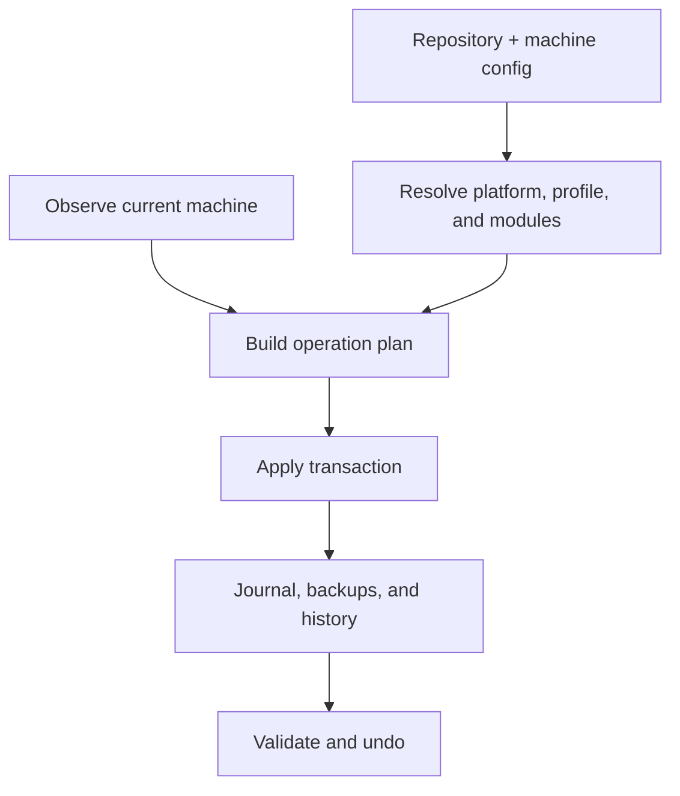

# Architecture

**Status: Go adoption and first permanent-core boundary accepted; permanent read-only core implemented; broader architecture proposed**

This document defines the working architecture for the future `dots` CLI. It separates durable boundaries from implementation choices that still require validation. Further Go implementation and migration are [paused](../plans/roadmap.md#current-priority); existing code, tests, and CI remain in place.

## Live Bash Framework

`bin/dots` locates the installation and delegates to `lib/dots/dispatch.bash`.
Routing probes only candidate filenames. `catalog.bash` owns static header parsing
and the shared built-in/help model; `ui.bash` is a sourceable presentation library;
`complete.bash` computes literal suggestions. Native adapter sources live under
`lib/dots/completion` and are linked into the repository's shell completion trees.
Only help/discovery/completion load the catalog. There is no catalog cache,
general transaction engine, or dependency on the Go binary. See [decision 0006](decisions/0006-bash-command-framework.md).

The [presentation contract](presentation.md) owns human output policy. `ui.bash` implements the shared Bash renderer; the file catalog's Python `Presentation` class mirrors it and requires policy parity checks when changed. Domain commands own their result data and choose human or data views explicitly. The dispatcher preserves extension streams; it does not decorate arbitrary output. This requirement applies to future authorized core work without changing the paused Go implementation.

The optional `lib/dots/interactive.bash` adapter is loaded only by interactive
command paths. It owns Gum/FZF capability selection, child-only presentation
policy and plain numbered prompts; the existing `ui.bash` remains subprocess-free.
The theme switcher locally prefers FZF for live palette browsing while retaining
the shared backend for review actions. Its review loop validates selection and
previews through the existing theme engine before delegating Apply to its unchanged publisher.

`bin/dots-menu-tmux-keys` delegates to `lib/dots/tmux-keys.bash`, which owns the read-only tmux binding snapshot, non-evaluating quoted-field parser, table ordering, and optional secure less pager. It reuses `ui.bash` without changing shared presentation policy or loading shell startup. Help and completion use static metadata; no general menu framework or dispatcher changes are introduced. See the [command contract](commands.md#tmux-keybinding-reference).

## Existing tmux configuration

`androidots/bin/termux-bar` owns per-tab default-session creation and attachment; `shells/shared/termux-tmux.sh` integrates it at the end of Bash/Zsh interactive initialization. The launcher validates Termux process ancestry, derives identity from root PID/start time, and marks only sessions it creates with `@dots-termux-default=1`. The main tmux layout hides that session's project-name suffix without hiding its Termux number or windows. The launcher waits for tmux completion and reports confirmed normal session exit to the startup hook using internal status 20; the hook exits the outer shell. Deliberate detach and unexpected server loss retain the outer shell; reload guards prevent automatic reattachment. See [startup behavior](shell-init.md#termux-tmux-startup). Fish and the `t` project-session helper retain their existing behavior.

`config/tmux/tmux.conf` owns the status row count and layouts after sourcing the optional generated theme. On Termux, a system row with clock and battery sits above ordered Termux numbers, with the current number joined to its optional tmux name as one badge, followed by windows; outside Termux only the tmux row appears. Reloads reset `status-format` to tmux's standard layout and save that window row in `@dots-tmux-row`, retaining its mouse ranges and scrolling. `default/themed/tmux.conf.tpl` publishes the `@dots-session-style` badge and `@dots-termux-*` color options, `info` current-window text with no underline, and the `selection` active-pane border. Theme-only refreshes update styling without changing either layout.

`config/tmux/termux-status.py` resolves the directory-linked adapter back to the repository and invokes the adjacent `androidots/bin/termux-sessions --json` once per asynchronous job, with a one-second timeout. It validates the snapshot and emits only numeric labels and controlled tmux styles. The viewing client's terminal ID selects the highlighted entry, independently for each client; an unmatched client leaves all entries inactive. Numbers follow snapshot creation order. The internal optional `--width=N` argument clips complete numeric labels around the current entry and adds overflow arrows, without emitting native window-list directives. The config budgets a quarter of client width, capped at 20 columns, for numbers and a quarter capped at 30 for the complete joined badge, including padding. The internal `--split-badge` option separates preceding styled numbers, the plain current number and following styled numbers using controlled delimiters. The main config extracts all three fields from the same cached job, joins the current number and optional project name with a colon, and inserts other numbers before the badge and after the native window list. Names stay in tmux formats, preserving one discovery query per job, native scrolling and mouse ranges. The prior `--split-current` interface remains compatible with unreloaded configurations. Window names equal to the full tmux session name are omitted only on Termux; all badge/window segments retain one leading/trailing space. Unmatched clients retain all visible numbers before the badge/windows; failures clear both sides. Missing tools, invalid data or query failures clear the segment; no cached state, background tracker, Android API access, submodule initialization or tab switching is added.

`config/tmux/android-status.py` (retained for independent consumers; disabled in the shipped bar) owns only the selected network indicator before the battery. Two concurrent, one-second, size-bounded CLI reads call the adjacent Wi-Fi and cellular Androidots scripts with `--json` through the same Python interpreter. It does not import their internals or collect Android APIs; the scripts own caches, permission gates and detached refresh workers. The adapter validates icons, signal levels and theme-color arguments, then emits an equal-width icon/marker slot with controlled tmux styles. Connected Wi-Fi wins; cellular requires explicitly disconnected Wi-Fi, enabled mobile data and a connected data state. Missing, invalid, expired or unknown Wi-Fi produces a neutral muted `?`, as does disconnected Wi-Fi with unavailable cellular activity. Only fresh disconnected Wi-Fi plus fresh confirmed inactive telephony-device data hides the segment; registered-cell signal cannot establish activity or device freshness. Retained positive connection observations remain eligible with `~`; an uncertain decision involving either retained stale snapshot shows `?~`. An absent network emits no separator. Notification, volume and location commands remain standalone and are not polled by tmux. The upper row uses `background`/`foreground`, the lower row uses `background` with `dark_background` window labels, inactive entries use `lighter_background`/`hint`, and current entries retain `hint`/`darker_background`.

`config/tmux/battery-status.sh` remains a tmux-format adapter for `~/repos/battery/battery`, validating its colored icon/percentage record and translating ANSI red/yellow/green into tmux styles. The external battery project owns Android API access, charging glyphs and thresholds. Its fixed-width mode uses one space after the icon and pads after the percentage. Its style reset inherits the top row's background. Helpers are loaded from `${XDG_CONFIG_HOME:-$HOME/.config}/tmux`; Python 3 is required for session discovery and Bash for the battery adapter. The config defaults to five-second asynchronous refreshes.

The shared Bash/Zsh `t` function belongs to `shells/shared/functions.sh`, not the Dots dispatcher. It selects an exact named session, creating only when missing, and switches rather than nesting when already inside tmux. Plain `t` resolves the Git worktree root on demand and derives the session name from its basename; an explicit name bypasses detection. Git is not required for startup or the non-repository Work fallback. See [shared commands](shared-shells.md).

## Existing Yazi Configuration

`config/yazi/plugins/dots.yazi` is the active, remote-installed Yazi plugin bundle. The standalone `dots.yazi` repository owns runtime source; publish there and update this copy through `ya pkg upgrade 5nik7/dots` so the package manager retains revision/hash ownership. Its `main.lua` exposes setup, command dispatch, and Git fetching; internal Lua modules retain separate Yazi-managed state. Dotline is the bundled Yatline-derived renderer, with a combined Git-head/repository module, a local `hover.lua` component for the hovered path, icon/name, and symlink target, and a bundled hostname/user component. The Git-head module owns both display getters and one shared refresh generation, including optional host icon and ownership metadata obtained through one asynchronous local `git-it info --json` call. It retains only validated icon/ownership fields, rejects stale results with the status, and spawns no commands during rendering; git-it owns remote selection, aliases, and configured owner matching. Borders, folder rules, projects, and pane toggles share the same plugin directory. The LS_COLORS module owns startup parsing and one metadata-based style resolver shared by file-pane rendering and the hovered header item; Dotline accepts full styles without mixing escape codes into measured text. Hover splits the fitted link target into directory and basename spans for independent styling while retaining one path-fitting budget. It owns per-part source selection, style overrides, visibility, and icon spacing; it clones base styles before overrides and uses only existing metadata for the directory prefix, without redraw filesystem calls.

The Yazi `init.lua` owns personal options, while its keymap and fetcher rules address `dots`. Original merged plugin directories remain inactive for reference and are no longer package dependencies. The [plugin README](../config/yazi/plugins/dots.yazi/README.md) owns configuration and command details. This is application configuration, independent of the Dots CLI and managed-file transaction engine.

## Shell initialization ownership

`lib/dots/init.bash` emits integration-only hooks before extension discovery.
`lib/dots/shell/` owns settings definitions, native adapters, derived paths,
portable palette data, and prompt refresh. `shells/` owns personal preferences
and minimal native startup wrappers. `bin/dots.ps1` provides native PowerShell generation plus bounded setup, inspection and recovery. `dots env` reports resolved Dots values without inspecting
private shell state. Its human layout lives in `lib/dots/shell/env-view.bash` and
uses the shared Bash UI helpers; scalar, JSON and ordinary redirected output
bypass that renderer. See [shell environment](shell-environment.md).

`bin/lib/common.sh` owns shared sourceable Bash/Zsh utility, logging, formatting, spinner and color-array helpers. Loading only defines helpers; startup no longer allocates the legacy 256-color arrays. The former `bin/colors.env` and its startup-created named globals are removed. Human helpers obtain styles lazily from the renderer; caller-owned variables remain untouched. Path operations, case conversion and quiet checks use builtins; human messages lazily reuse `lib/dots/ui.bash`, with a plain fallback for standalone copies. Optional eza formatting is confined to explicitly requested filename/icon helpers. See [shell utilities](shell-utils.md).

PowerShell personal startup uses `profile.ps1` (with the installer-compatible host entry), `init.ps1` and a guarded `interactive.ps1`. Helper definitions live separately from explicitly dot-sourced optional integrations; the shared native adapter remains responsible for settings, paths, published colors and prompt refresh. See [PowerShell startup](shell-init.md#powershell-profile).

## Existing Zsh Configuration

The live shell configuration is maintained independently of the paused Go core. `shells/zsh/zshrc` resolves its own file through symlinks and sources the adjacent `init.zsh` directly; `interactive.zsh` owns startup order; its `core/`, `integrations/`, and `platforms/` modules separate shared setup, tool activation, and execution-environment detection. Existing public module entry points remain available. Generated shell data belongs in user cache directories, not the repository. See the [Zsh guide](../shells/zsh/README.md).

## Implemented Permanent Core Boundary

Root `go.mod` (`github.com/5nik7/dots`, Go 1.27.1) and `cmd/dots` now own the separate permanent development binary. `internal/cli` binds help/version/doctor/commands/completion and renders registry and static extension metadata; `internal/dispatch` validates typed entries and resolves token routes/global spellings entirely in memory; `internal/platform` owns the ported read-only observations and file opening. `internal/extension` owns strict sidecar validation, explicit-root resolution and bounded enumeration; `internal/platform` owns native file/root policy and execution. `internal/cli/discovery.go` owns the public schema-1 catalog DTOs, shared in-memory construction and serialization over shared defensive projections and ordinary extension discovery. Public JSON types are separate from private registry/sidecar carriers; direct dispatch does not construct a catalog. No mutation API exists. The active `bin/dots` is a separate Bash command framework and may be maintained under the repository editing policy.

`tools/verify_core.py` copies only selected core inputs into owned temporary roots; `tools/ci_core.py` collects native check/startup/registry evidence. These tools are independent of the preserved experimental module and its collectors. CI runs both surfaces sequentially. The CLI logo/doctor adapters and explicit external resolver inspect their scoped runtime inputs; registry and candidate lookup have no filesystem/process dependencies. See [commands](commands.md#built-in-metadata-contract), [verification](testing.md#permanent-core-verification), and the [first-slice plan](../plans/phase-2-command-center.md).

## Implemented Experimental Boundary

`experiments/go-portability/` is an independent Go module containing a `cmd/dots-spike` entry point, private CLI and platform packages, test-only filesystem primitives, and a Python verification harness. It adds no root Go module and does not replace `bin/dots` or move live sources. The CLI owns only help, version, and read-only diagnostics; platform/runtime/path collection and platform-specific read-only file opening stay in the platform package. Logo lookup, size/type validation, and formatting stay in the CLI package. There is no resolver, extension dispatcher, state store, or mutation API.

The harness copies only experimental Go sources and the public `logo.txt` to a temporary build repository, isolates Go settings and caches, and retains reviewable binaries/evidence in a separate temporary artifact directory. Help reads a logo file at runtime rather than embedding another source copy. The executable uses only the Go standard library and invokes no subprocesses. Python, Go tools, and benchmark/inspection tools are development dependencies, not executable runtime dependencies.

The branch-specific Linux/Windows workflow provisions CI development tools and delegates check/distribution execution to `tools/ci_verify.py`. That collector owns sanitized source, runtime, and result artifacts outside the checkout; the shared verifier owns offline Go settings, telemetry isolation, fixture roots, and host-specific expectations. Recorded native Linux and Windows CI runs passed; claims remain limited to its experimental commands and disposable filesystem fixtures.

The verifier’s experimental `dist` mode delegates fixed-layout bundle encoding, checksum validation, and extraction to `tools/distribution.py`. It packages committed Go build identity and the committed public logo, then executes extracted artifacts in separate owned roots. This development boundary does not select a permanent release strategy, add an installer, or change the core command surface.

The [experiment plan](../plans/phase-1-portability.md) and [evaluation decision](decisions/0001-go-portability-experiment.md) record scope and evidence. The boundaries below remain the proposed production architecture; successful primitive tests do not implement transactions or managed-file safety.

## System Context

`dots` manages a repository-backed desired state for a user account. It observes the current machine, produces a plan, and applies approved operations through a transaction journal.



The same resolved plan representation should drive human previews, structured output, apply, tests, and recovery.

## Architectural Boundaries

### CLI and Dispatcher

The `dots` executable owns argument parsing, built-in route registration, longest-prefix external-command resolution, global output policy, and process exit behavior.

The common direct route must avoid loading the complete command registry or machine specification. Discovery-heavy operations such as `dots commands`, generated completions, and global help may load command metadata.

### Platform Adapter

The adapter reports detected platform evidence and normalized capabilities:

- Home, config, data, state, cache, temporary, and executable paths.
- File, directory, symbolic-link, junction, and hardlink support.
- Privilege mechanisms.
- Shell and profile locations.
- Package-manager availability.
- Path validation and platform-specific filesystem limits.

Portable core packages consume the adapter interface instead of branching on environment variables throughout the codebase.

### Configuration Loader

The loader reads repository configuration, machine-local configuration, explicit CLI overrides, and schema versions. It does not observe destination state or execute hooks.

### Resolver

The resolver selects modules from platform, profile, host, dependencies, and local overrides. It produces one deterministic desired specification with provenance for every selected resource.

The resolver detects dependency cycles, incompatible platform constraints, duplicate identifiers, and destination collisions before planning.

### Observer

The observer reads current filesystem and capability state without changing it. Expensive observations such as hashing are requested only when required by a comparison policy.

### Planner

The planner compares desired resources with observed state and emits ordered operations, no-ops, warnings, conflicts, blocked operations, backup requirements, and reversibility classifications.

Planning is read-only. Interactive approval happens after the plan exists.

### Transaction Engine

The transaction engine applies a validated plan while maintaining a durable journal. It owns locks, operation boundaries, backups, atomic replacement where supported, rollback, recovery, and undo validation.

Extensions cannot claim transactional management for direct unjournaled writes.

### State Store

The state store is outside the repository and contains:

- Machine selection and non-secret local state.
- Transaction journals.
- Backups.
- Locks.
- Recovery markers.
- Generated indexes or caches that can be rebuilt.

State formats require schema versions and safe atomic updates.

### Package Adapters

Package adapters translate normalized package identifiers into manager-specific queries and installations. They record whether a package was already installed and whether `dots` added it.

Package changes share the plan and journal vocabulary but do not promise automatic removal during ordinary filesystem undo.

### External Commands

External executables named `dots-*` add cohesive commands. The dispatcher maps hyphenated filenames to space-separated routes and resolves the longest match.

Extension discovery and metadata are described in `commands.md`. Extensions may call stable core interfaces, but must not duplicate the resolver or transaction engine.

## Working Implementation Direction

[Decision 0002](decisions/0002-phase-1-go-adoption.md) accepts Go, the initial toolchain/development targets, warm-start policy, minimal bundle/release-trust direction, and additive permanent-core/registry scope. Native Termux and Linux/Windows CI evidence supports that decision; it does not establish production OS floors, representative desktop performance, or controlled cold-cache results.

The first permanent implementation uses root `go.mod`, `cmd/dots`, and private CLI, dispatch, and platform packages for the approved read-only built-ins. Its [bounded file and test scope](decisions/0002-phase-1-go-adoption.md#next-bounded-implementation-task) is implemented in the bounded first slice. The independent experiment and its historical output remain unchanged; its provisional-language banner predates adoption. External execution, manifests, state, and transactions stay outside the first slice.

POSIX shell and PowerShell remain intended bootstrap and extension boundaries. They must not become separate implementations of desired-state resolution or transactions. Public release and remote bootstrap remain gated by the accepted trust requirements and deferred verification work in decision 0002.

## Target Repository Shape

The target is an incremental destination, not authorization for a wholesale move:

```text
dots/
├── cmd/dots/                 compiled CLI entry point
├── internal/                 private core packages
│   ├── cli/
│   ├── extension/             implemented development resolver
│   ├── dispatch/
│   ├── platform/
│   ├── config/
│   ├── spec/
│   ├── observe/
│   ├── plan/
│   ├── apply/
│   ├── state/
│   └── packages/
├── commands/                 official external dots-* commands
├── modules/                  repository-managed desired-state modules
├── profiles/                 profile and optional host composition
├── bootstrap/                minimal POSIX shell and PowerShell installers
├── agents/guides/            task-specific agent procedures
├── docs/                     contributor reference
├── plans/                    active implementation plans
├── schemas/                  machine-readable schemas when introduced
├── tests/                    unit fixtures and integration harnesses
├── dots.toml                 repository configuration
├── AGENTS.md
└── README.md
```

Existing `bin/`, `config/`, `shells/`, `themes/`, platform submodules, and other live directories remain in place until a focused module migration moves their ownership.

The optional `config/nvim` submodule owns independently versioned Neovim configuration source. The parent repository owns its source declaration and pinned commit, with explicit initialization and update described in the [README](../README.md#optional-neovim-configuration). This addition provides no core manifest, managed activation, plugin installation, or runtime-state ownership; existing live configuration remains in place.

## Storage Boundaries

The repository stores source configuration and versioned manifests. Machine-local configuration and runtime state remain outside it.

| Data | Unix, Termux, and WSL default | Native Windows default |
| --- | --- | --- |
| Repository | `~/dots` initially, configurable | `%USERPROFILE%\dots` initially, configurable |
| Machine config | `$XDG_CONFIG_HOME/dots/config.toml` or `~/.config/dots/config.toml` | `%APPDATA%\dots\config.toml` |
| State and journals | `$XDG_STATE_HOME/dots` or `~/.local/state/dots` | `%LOCALAPPDATA%\dots\state` |
| Cache | `$XDG_CACHE_HOME/dots` or `~/.cache/dots` | `%LOCALAPPDATA%\dots\cache` |

Backups must not be stored only inside the repository they are protecting against replacement or loss.

## Resolution and Apply Flow

1. Locate repository and machine configuration.
2. Detect or validate platform and capabilities.
3. Select profile and optional host.
4. Load only referenced modules and their dependencies.
5. Resolve variables and destinations.
6. Reject invalid paths, cycles, collisions, and unsupported required capabilities.
7. Observe current target state.
8. Build an ordered plan.
9. Present, serialize, or approve the plan.
10. Create a transaction journal and lock.
11. Apply operations and record each durable boundary.
12. Roll back on failure or finalize transaction history on success.

## Update Boundaries

These are deliberately separate operations:

- Updating the `dots` executable.
- Pulling the dotfiles repository.
- Synchronizing optional/private sources.
- Installing missing packages.
- Applying the resolved desired state.
- Upgrading already installed packages.

A future convenience workflow may compose them, but each stage must remain visible, separately testable, and separately recoverable.

## Trust Model

The repository and its enabled extensions are executable trust inputs. Public bootstrap should establish the core and public repository without implicitly expanding trust to private submodules or arbitrary commands found anywhere on `PATH`.

[Decision 0003](decisions/0003-trusted-external-command-protocol.md) fixes explicit prefix-only roots, duplicate refusal, static JSON and native adapters for development dispatch. Root selection trusts code and its parent directories; validation does not authenticate publishers, sandbox code or prevent concurrent replacement. Secrets and credentials are never ordinary diagnostic fields.

## Local Development Worktree Tooling

`tools/worktree_lifecycle.py` manages explicitly enrolled development worktrees independently of the public CLI and transaction architecture. It owns only Git-local enrollment/lock metadata and guarded calls to non-force Git worktree removal. Ordinary maintenance uses the existing checkout without invoking this helper. Optional worktree procedures, known-live-use review and platform limitations are defined in the [agent worktree guide](../agents/guides/worktrees.md). No CLI command, configuration loader, hook or background service is added.

The [Zsh renderer](decisions/0005-static-zsh-completion.md) in `internal/cli/completion.go` consumes that catalog after full validation. It owns shell quoting and a static embedded route/root snapshot, without adding I/O dependencies to dispatch or runtime discovery to shell startup.

## File Catalog and Configuration Layout

`lib/dots/files/mappings.py` owns stash/restore, interactive mapping edits and
explicit new mappings. It validates candidate catalogs in memory, uses shared
presentation/interaction adapters, and composes changes through Installation and
Store. No source contents are exposed by these commands. Installation's shared
apply accepts catalog locks and receipt-free metadata-only batches; original
baseline ownership remains in its single installation receipt.

`config/` is the canonical source directory; `configs -> config` is a temporary
compatibility alias in the parent and platform repositories. The parent owns the
Neovim gitlink at `config/nvim`; Neovim retains independent Git history.
`tools/migrate_config_paths.py` previews and journals identity-preserving retargeting
of existing home links. It is separate from a future general installation engine.

`.dots/sources.json` owns repository composition and exclusions. Each repository owns
its `.dots/files.json` resource metadata. `lib/dots/files/catalog.py` owns terminal presentation using the Bash UI color/icon policy, validation,
read-only observation/discovery, classification and atomic metadata tracking. Thin
`bin/dots-files-*` commands expose this through the Bash dispatcher; completion uses
the same data reader directly without extension execution. See [files](files.md).

`lib/dots/files/check.py` owns absent-source inspection and interactive catalog-only
removal. It consumes the same catalog, resource presentation and optional Gum
confirmation helpers, and submits guarded metadata operations to the existing
transaction Store. Bash and native PowerShell delegate to this controller; no
target mutation or separate recovery engine is introduced.

## Shared Theme Engine

`lib/dots/themes` owns native palette loading, semantic colors, literal template
rendering, cached initialization, compatibility APIs, journaled publication, fixed
application connectors, Git source lifecycle and explicit wallpaper adapters.
Bash/Zsh color arrays project resolved Dots colors over native palette extras, with generation-time format calculations and explicit ownership for stale-name cleanup; the [shell API](themes.md#shell-and-neovim-behavior) defines compatibility and reserved names.
Its `app-env.bash` adapter validates rendered FZF assignments as literal data
and adds their colors to published Bash/Zsh and Fish initialization. The Gum shell
template is rendered without execution during publication. The small `gum-env.bash`
adapter loads the published artifact in interactive Bash startup and the Bash/Zsh
`set_theme` published-palette path, including Bash/Zsh prompt refresh. Noninteractive
startup and generated theme-init output remain independent.
`bin/dots-theme-*` exposes the sole theme CLI, including native palette discovery and queries. The data-only `discovery.bash` module owns flat theme IDs, current-ID resolution and native family/flavor enumeration for commands, switcher, views and completion. Sourcing only defines helpers; scans remain on demand. Listing retains ID validation/deduplication, while completion preserves its existing literal hints; selection validation remains in the loader. Shared view/initialization helpers serve the CLI and palette helper APIs; there is no separate plural parser.
Legacy `themes/bin` entry points have been removed; shell integration lives in
`lib/dots/shell` and shared theme helpers in `lib/dots/themes`.

Flat `themes/ID` variants own semantic `colors.toml`, optional native `palette.toml`
and backgrounds. `default/themed` owns bundled templates; per-user `dots/themed`
overrides them. User-installed themes contribute data only. The stable XDG state
`dots/current/theme` symlink selects a generation under `dots/themes/generations`.
Codex consumes the existing rendered bat syntax theme through a fixed
`CODEX_HOME/themes/dots.tmTheme` connector; Codex-Termux shares that home. No
additional renderer, wrapper integration or startup scan is needed.
Vivid and FSH consume generated semantic templates through fixed XDG connectors.
The Bash/Zsh adapter selects the published Vivid file; Zsh caches its data output.
The Zsh-only FSH adapter runs after plugin loading and generation changes, using
FSH's native INI loader in an isolated Dots cache and preserving user overlays.
Validated data is also saved as the native FSH startup script in `FAST_WORK_DIR`,
with non-Dots selection backups and stale compiled-code invalidation; subsequent
shells can load the last good palette independently of the Dots build cache.
Journals preserve previous pointers and fixed app connector objects. Application
settings remain in `config`; generated palettes, bat caches, backups and wallpaper
selection records belong in machine-local state. Connector paths beneath symlinked
app directories may physically reside in a repository and must not be published as
machine-specific configuration.

The separate local Anodize.nvim plugin owns Neovim palette normalization, rendering
and reload lifecycle. `config/nvim/lua/util/dots_theme.lua` preserves the startup,
reload and dashboard interfaces; `dots_theme_legacy.lua` retains bounded raw data
for compatibility helpers only. Personal highlights and lualine configuration
remain Dots-owned. The old native adapter module is retained for compatibility,
but is not part of startup or automatic reload. Zsh continues reading generated
shell data. Wallpaper actions remain explicit capability-checked adapters. See
[themes](themes.md), [Anodize](anodize.md#neovim-integration), and
[decision 0008](decisions/0008-config-catalog-and-theme-apps.md).

## Git and file operation engines

Under [decision 0010](decisions/0010-git-and-managed-file-operations.md), `lib/dots/git` owns the adapted, attributed Git engine and uses shared Bash UI helpers. Inspection and mutation are separate modules, with static command metadata and no standalone git-it dependency. Git operations are incremental and preserve partial results.

`lib/dots/files/browser.py` owns the interactive tracked-config controller and
uses the catalog's observation/detail renderer plus the existing Manager planner
and Store transaction engine. `lib/dots/interaction.py` owns shared Python
selection and optional confirmation plumbing, with `interactive-select.bash` as
its private argv/result bridge to the Bash interaction adapter: keyboard stdin,
terminal UI on the provided stderr stream, and exact selection on stdout. The
browser supplies its visible stdout terminal as that UI stream; file and Anodize
confirmations supply stderr, keeping captured results separate. No shell
expressions are evaluated from selection labels. The browser retains approved
operations and source/target/catalog guards in memory until Apply.

`lib/dots/files/manage.py` composes location registries, catalog ownership, preview and presentation. `transactions.py` owns durable staging, object integrity, locks, replacement, rollback, snapshots and recovery. Every mutating file route uses it; `track` remains metadata-only. Catalog and location data belong to their owning repositories. User preferences and transaction/backup records belong in XDG config/state. This is a bounded POSIX implementation, not the general Go module/profile engine.

## Progress rendering

`lib/dots/progress.bash` and `lib/dots/progress.py` own equivalent [progress policy](presentation.md#operation-progress). Controllers opt in after excluding data and preview-only modes. Bash uses a private control pipe and rendering child; Python uses a scoped rendering thread. Actual work stays in its original calling context, and no progress files or persistent state are created. Existing human renderers stop the Bash display before messages; Python contexts suspend rendering around verbose action rows and finish before ordinary controller output. The file engine reports phases after durable boundaries without changing its journal schema. Prompt-capable/direct-output children run with animation stopped; private Anodize bridges suppress nested progress. The Bash dispatcher and shell startup do not load the rendering backend. Help, completion and data paths never start rendering workers or probe optional progress tools.

## Anodize authoring boundary

`lib/dots/anodize/logo.py` owns bounded text, Kitty and optional Chafa branding for Python human views. Its text-banner selector supplies the same usage artwork to routine views and Anodize interactive/completion previews; preview workers provide pane width and explicit display capabilities, with a fixed 16-row artwork budget for scrollable output. The core-owned `logo.bash` adapter renders static Dots help from the same bundled UTF-8 braille assets without executing an extension; it invokes the Python logo-only helper for optional graphics. The catalog loads this adapter only for Anodize help, and completion normalizes Anodize logo prefixes before static route lookup. These presentation paths do not call the engine, authoring operations or transaction store.

The owner-authorized [Anodize slice](anodize.md) is an exception to the general Go pause. `anodize/` is an independent pure Go color engine; `lib/dots/anodize/` owns Python authoring and the private Bash publication bridge. It reuses `files/transactions.py` and existing theme rendering/publication. `bin/anodize` and static `dots-anodize-*` routes provide CLI access. No engine calls occur during shell startup. See [decision 0011](decisions/0011-anodize-authoring.md).

Anodize standalone completion reuses generated copies of the shared Bash/Zsh/Fish adapters. Its private query bridge translates the standalone command line into the Dots completion protocol, reading bundled static headers and the selected theme repository without executing leaf commands or the Go engine. `tools/generate_anodize_integration.py` owns reproducible adapter generation and `man/anodize.1`; command and option text in the manual comes from the Python parser.

## Local theme plugin execution

The Bash theme publisher invokes the Python plugin coordinator once after commit.
Anodize continues to delegate apply to that publisher. The coordinator reads the
immutable generation's normalized palette JSON, serializes execution under the
existing publication lock and a plugin lock, and runs explicitly selected Bash
children. Neither downloaded themes nor shell startup discover executable hooks.

Bundled GTK 3 and Qt6ct adapters consume rendered template data and use the existing
file Store for app copies, narrow configuration registration and ownership receipts
in one retained-backup transaction. Custom user hook effects are outside that Store
and publication rollback. The [plugin contract](theme-plugins.md) owns discovery,
selection, runtime environment and retry behavior.

## Shared interactive shells

`shells/shared/` owns portable public environment settings, platform detection, runtime paths, FZF settings and user-facing functions/aliases for Bash and Zsh. `bin/lib/common.sh` remains the script utility library. Native startup routing, completion engines, ZLE/Readline hooks and tool activation remain in shell adapters; old function/alias files delegate to the shared resources. Zsh private/platform modules remain native. See [shared shells](shared-shells.md) for precedence, compatibility, prompt refresh and supported integrations.

## Unified theme command ownership

`bin/theme` forwards to the live Dots dispatcher. The shared theme handler owns
family queries as well as full-ID operations; generated wrappers contain no
independent parsing or palette logic. Data-only family metadata readers serve
help, completion and command generation. The theme publisher and Git importer
share a journaled command-generation pointer under theme state. Shell startup
loads published initialization and completion registrations directly, without
scanning theme directories. Family logos live in `themes/FAMILY/logo.txt`;
the Catppuccin PNG asset lives alongside its text logo. See [themes](themes.md#unified-commands-and-family-shortcuts).

## Shared file styles and Yazi snapshots

The theme file-color engine resolves declarative style layers and derives Vivid,
LS_COLORS and versioned JSON/Lua snapshots from one palette. Publication owns the
complete generation; shell adapters consume its LS_COLORS without regenerating it.
Rule edits reuse the existing file Store rather than introducing another journal.
The shared theme presentation module renders structured palette/style tables for
human queries and native previews. It consumes the resolved or published palette
directly for full views; it does not regenerate Vivid suffixes to display them.
Machine interfaces bypass that renderer.
After publication, an optional bounded Yazi DDS notification requests refresh.
The plugin reads its own configured state root, validates a complete snapshot and
updates UI colors without re-running feature setup or doing redraw-time I/O.
See [file colors](file-colors.md) for ownership and matching boundaries.

## Checkout setup ownership

`lib/dots/files/install.py` owns bounded installation planning, ownership receipts and source-update orchestration. Root shell/PowerShell scripts and `dots init --setup` delegate to it. `file_platform.py` supplies native locks, safe object checks, file/directory flushing and state roots to the existing catalog and transaction Store. Installation receipts are final operations in the same file transaction as target changes.

The theme publisher shares its immutable generation preparation with the setup bridge. Setup holds theme/command publication locks and publishes generated pointers/connectors through the file Store; ordinary theme commands retain their existing publisher. Fixed config connectors share a TSV definition. Setup never runs app reloads, wallpaper actions or theme hooks. See [installation](installation.md).

### Shared resource presentation

`lib/dots/resources.py` and `resources.bash` implement lazy, read-only file-style
matching for human renderers. `resources.tsv` is their shared icon and filename/MIME
registry. Theme publication produces the data-only `file-styles.tsv` projection
from resolved rules. The Bash UI loads its resource adapter only on first use;
Python Presentation creates a lazy resolver. Help and data routes need no style
snapshot or classifier process. Native PowerShell help/bootstrap uses `ui.ps1`;
POSIX bootstrap dependency errors use `bootstrap-ui.sh` before Python is available.
These adapters own presentation only; installation and transaction logic remain
in their existing owners.

### Git presentation roles

The file-style resolver also owns the sibling `git` namespace and its existing override layers. Theme publication exports its full styles in JSON/Lua and a separate `git-styles.tsv` projection. `lib/dots/ui.bash` exposes lazy Git-role lookup backed by `lib/dots/git-styles.bash`; the Git renderer chooses roles without resolving a palette or spawning per-row tools. Resource rows accept an optional label style while keeping filename matching independent. See [Git styles](file-colors.md#git-styles) and [the projection contract](themes.md#cli-git-style-projection).

The Yazi color-reference namespace preserves tokens through configuration cloning and resolves them from validated snapshots during setup/refresh. Git indicators cache complete styles separately from Git status; header defaults use the same role namespace. CLI ownership highlighting caches local fetch-remote matches per repository without changing publish policy or structured output.

The Starship/Blastoff integration uses the default palette template and bundled theme-plugin lifecycle. `starship.py` owns TOML section scanning, configuration-path resolution, palette-only edits and Blastoff lock coordination; the shared file transaction store owns backups/replacement/recovery. The saved personal `dots` theme owns module styles independently of generated palette values. No Blastoff core dependency or prompt-time palette process is added.

The Git theme consumer uses a generated include and the fixed connector table.
Git's Delta processes read generation-local bat assets through an isolated XDG
cache root. The file manager's `git_platform.py` owns the bounded platform-selector
plan shared by install, direct link and mapping apply/restore; generic catalog
overlap rules remain unchanged. The consolidation migration uses existing mapping
transactions/receipts rather than a separate mutation engine.

Verbose file-operation output uses an optional Store observer with a human renderer in
`lib/dots/files/events.py`. Bash theme operations use `lib/dots/verbose.bash`.
Both reuse existing resource styling and progress suspension; observers carry no
persistent state and do not own transaction decisions. See [verbose output](presentation.md#verbose-operations).

### Interactive file selection

The Python interaction adapter owns scoped FZF-first rich selection. The files
picker owns candidate metadata and bounded content previews, shared by file
controllers and the browser. Selection returns exact catalog IDs or paths to the
existing planners; it never applies transactions or grants approval. Private
transient snapshots carry opaque selection tokens and metadata, not file contents.

## Native PowerShell command adapter

`bin/dots.ps1` owns dependency-free native help/init and transports literal argument arrays through `lib/dots/native.py` to `lib/dots/cli.py`. Shared built-in headers live in `lib/dots/metadata/`; `command_metadata.py` reads extension headers without executing them. The native CLI reuses the existing file controllers, `Store`, presentation/resources, progress and interaction adapters. `files/app_paths.py` owns Windows app destinations. `git/cli.py` invokes Git with explicit argument vectors. `themes/palette_native.py`, `theme_cli.py`, `setup.py` and `bridge.py` supply native theme data, publication, inactive setup preparation and Anodize integration. Native generated commands have verified manifests; filesystem replacement stays in the existing transaction engine.

Bash's established Git/theme frontends remain during native acceptance. Do not maintain competing catalogs, transaction implementations or shell-specific flag semantics. The [PowerShell reference](powershell.md) records actual capabilities and pending native checks; the [parity plan](../plans/powershell-parity.md) owns rollout status. General Go migration stays paused.

Anodize authoring resolves both user and repository theme roots; explicit built-in
saves and journaled promotion remain in its Python controller and the shared Store.
`anodize/interactive.py` owns transient drafts and token-based preview snapshots.
`anodize/completion_preview.py` serves explicitly displayed Zsh FZF-tab previews,
with cache lifetime owned by the FZF invocation. Ordinary static completion remains
engine-free. Both Dots and Anodize call `themes/presentation.py` for palette syntax
previews; unsaved drafts pass resolved colors without publishing a theme.

## Androidots location and local completions

Androidots owns `termux-geo`, its Bash acquisition/cache/controller code, jq normalization, static completion templates, installer, and command tests. It reuses the parent Dots Bash UI/progress/resource helpers when available, with plain standalone output. Device coordinates remain separate from reverse-geocoder object positions. Its private disposable cache is independent of the status-indicator caches and managed-file transactions.

Personal Termux shell adapters register fixed Androidots-local completion paths: Zsh before compinit, Bash through the native bash-completion user-base list, and Fish through fish_complete_path. Generic `dots init` remains integration-only. The installer writes only explicit completion targets, preserving differing originals as sibling backups; it does not modify shell configuration. See the [helper reference](../androidots/docs/termux-geo.md).

## Weather command and daylight adapter

`bin/wttr` and `bin/wttr.ps1` are thin native entries into `lib/dots/wttr/cli.py`. The weather package owns j1 HTTP transport, separate stock curl passthrough, configuration, format fields, cache locking/cooldowns and bounded on-demand workers; it reuses the existing Androidots termux-geo interface and never duplicates device providers. `metadata.py` supplies parser/help/completion options. Weather styling classifies temperature/condition colors and encodes explicit widget formats; shared Presentation styled spans wrap inert text before adding colors. The common Dots Presentation/progress modules render human views; completion installation uses the shared file transaction Store. The `wttr` catalog resource registers configuration without installing it.

The Termux clock adapter accepts fixed daylight tokens only, leaving color mapping in tmux and palette values in the theme template. Network adapters are not invoked by the shipped layout. Battery and lower-row ownership are unchanged. Cache paths, timezone assumptions, background/foreground location boundaries and native Windows limits are defined in [the weather reference](wttr.md).
